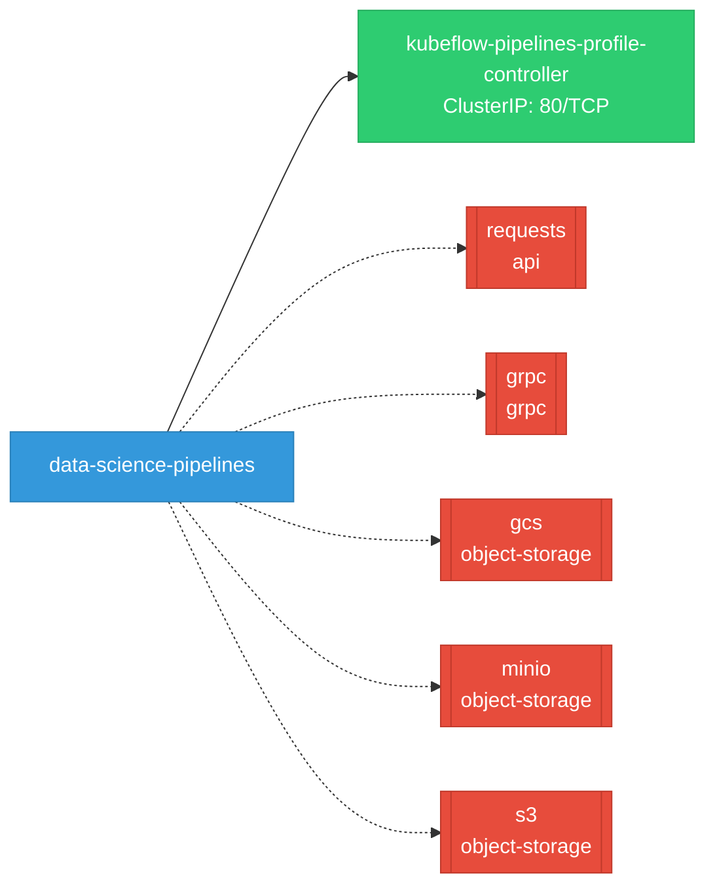
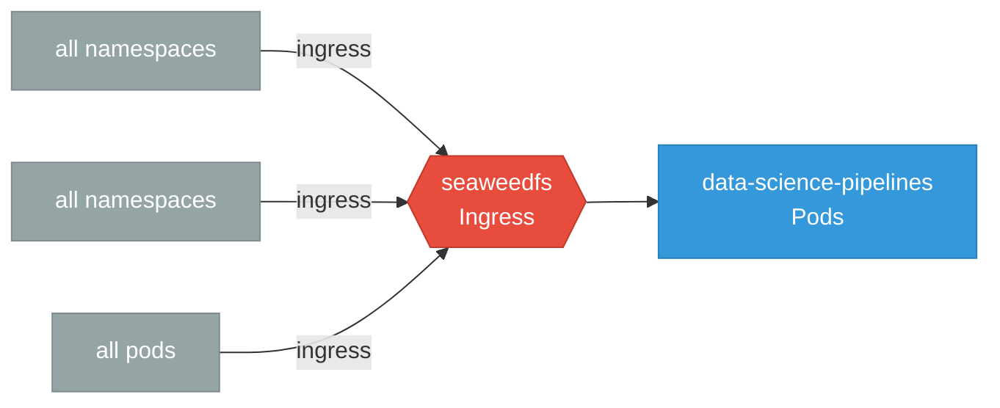

# data-science-pipelines: Network

[Overview](index.md) · [Agent Context](agent-context.md) · [Extracted Data](details.md) · [Network](network.md) · [RBAC](rbac.md) · [Security](security.md) · [Cache](cache.md) · [Dataflow](dataflow.md)

## Service Map

### Services

| Name | Type | Ports | Source |
|------|------|-------|--------|
| kubeflow-pipelines-profile-controller | ClusterIP | 80/TCP | [`manifests/kustomize/base/installs/multi-user/pipelines-profile-controller/service.yaml`](https://github.com/opendatahub-io/data-science-pipelines/blob/99d5da66f758d22eb96f8bda2ae46161100e75a6/manifests/kustomize/base/installs/multi-user/pipelines-profile-controller/service.yaml) |

### Ingress / Routing

| Kind | Name | Hosts | Paths | TLS | Source |
|------|------|-------|-------|-----|--------|
| DestinationRule | rbac-inferred |  |  | no | [`rbac/kubeflow-metacontroller`](https://github.com/opendatahub-io/data-science-pipelines/blob/99d5da66f758d22eb96f8bda2ae46161100e75a6/rbac/kubeflow-metacontroller) |
| Route | ml-pipeline-ui |  |  | yes | [`manifests/kustomize/env/openshift/base/route.yaml`](https://github.com/opendatahub-io/data-science-pipelines/blob/99d5da66f758d22eb96f8bda2ae46161100e75a6/manifests/kustomize/env/openshift/base/route.yaml) |

### Network Policies

| Name | Policy Types | Source |
|------|-------------|--------|
| seaweedfs | Ingress | [`manifests/kustomize/third-party/seaweedfs/base/seaweedfs/seaweedfs-networkpolicy.yaml`](https://github.com/opendatahub-io/data-science-pipelines/blob/99d5da66f758d22eb96f8bda2ae46161100e75a6/manifests/kustomize/third-party/seaweedfs/base/seaweedfs/seaweedfs-networkpolicy.yaml) |

## Network Policy Graph

Visual representation of NetworkPolicy rules. Ingress rules show what traffic is allowed into pods, egress rules show what traffic is allowed out.

