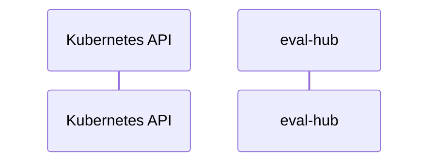

# eval-hub: Dataflow

[Overview](index.md) · [Agent Context](agent-context.md) · [Extracted Data](details.md) · [Network](network.md) · [RBAC](rbac.md) · [Security](security.md) · [Cache](cache.md) · [Dataflow](dataflow.md)

## Controller Watches

Kubernetes resources this controller monitors for changes. Each watch triggers reconciliation when the watched resource is created, updated, or deleted.

No controller watches found in analyzed sources.

## Reconciliation Flow

How the controller interacts with the Kubernetes API during reconciliation.

### HTTP Endpoints

| Method | Path | Source |
|--------|------|--------|
| * | / | [`internal/evalhub_mcp/server/server.go:246`](https://github.com/opendatahub-io/eval-hub/blob/7dee30bd3af4b516c24fa9b87306a5c106c98eba/internal/evalhub_mcp/server/server.go#L246) |
| * | /health | [`internal/evalhub_mcp/server/server.go:241`](https://github.com/opendatahub-io/eval-hub/blob/7dee30bd3af4b516c24fa9b87306a5c106c98eba/internal/evalhub_mcp/server/server.go#L241) |
| * | /metrics | [`internal/eval_hub/server/metrics_server.go:28`](https://github.com/opendatahub-io/eval-hub/blob/7dee30bd3af4b516c24fa9b87306a5c106c98eba/internal/eval_hub/server/metrics_server.go#L28) |

## Configuration

ConfigMaps and Helm values that control this component's runtime behavior.

