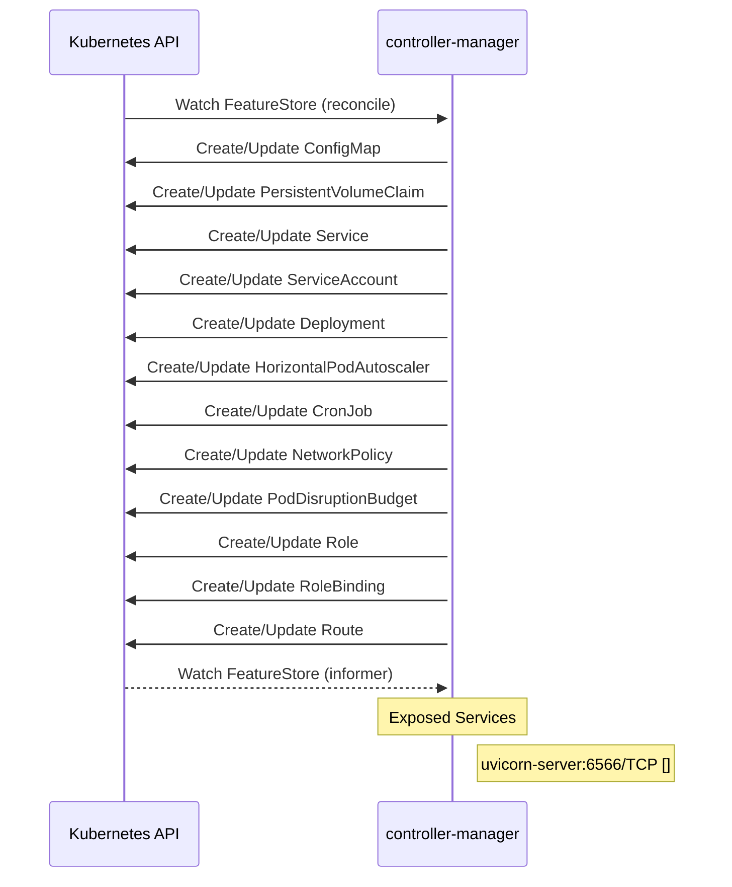

# feast: Dataflow

## Controller Watches

Kubernetes resources this controller monitors for changes. Each watch triggers reconciliation when the watched resource is created, updated, or deleted.

| Type | GVK | Source |
|------|-----|--------|
| For | api/v1/FeatureStore | [`infra/feast-operator/internal/controller/featurestore_controller.go:913`](https://github.com/opendatahub-io/feast/blob/5234586b905748104e2b2a85a6bcdd4aad2b9d1e/infra/feast-operator/internal/controller/featurestore_controller.go#L913) |
| Owns | /v1/ConfigMap | [`infra/feast-operator/internal/controller/featurestore_controller.go:914`](https://github.com/opendatahub-io/feast/blob/5234586b905748104e2b2a85a6bcdd4aad2b9d1e/infra/feast-operator/internal/controller/featurestore_controller.go#L914) |
| Owns | /v1/PersistentVolumeClaim | [`infra/feast-operator/internal/controller/featurestore_controller.go:917`](https://github.com/opendatahub-io/feast/blob/5234586b905748104e2b2a85a6bcdd4aad2b9d1e/infra/feast-operator/internal/controller/featurestore_controller.go#L917) |
| Owns | /v1/Service | [`infra/feast-operator/internal/controller/featurestore_controller.go:916`](https://github.com/opendatahub-io/feast/blob/5234586b905748104e2b2a85a6bcdd4aad2b9d1e/infra/feast-operator/internal/controller/featurestore_controller.go#L916) |
| Owns | /v1/ServiceAccount | [`infra/feast-operator/internal/controller/featurestore_controller.go:918`](https://github.com/opendatahub-io/feast/blob/5234586b905748104e2b2a85a6bcdd4aad2b9d1e/infra/feast-operator/internal/controller/featurestore_controller.go#L918) |
| Owns | apps/v1/Deployment | [`infra/feast-operator/internal/controller/featurestore_controller.go:915`](https://github.com/opendatahub-io/feast/blob/5234586b905748104e2b2a85a6bcdd4aad2b9d1e/infra/feast-operator/internal/controller/featurestore_controller.go#L915) |
| Owns | autoscaling/v2/HorizontalPodAutoscaler | [`infra/feast-operator/internal/controller/featurestore_controller.go:922`](https://github.com/opendatahub-io/feast/blob/5234586b905748104e2b2a85a6bcdd4aad2b9d1e/infra/feast-operator/internal/controller/featurestore_controller.go#L922) |
| Owns | batch/v1/CronJob | [`infra/feast-operator/internal/controller/featurestore_controller.go:921`](https://github.com/opendatahub-io/feast/blob/5234586b905748104e2b2a85a6bcdd4aad2b9d1e/infra/feast-operator/internal/controller/featurestore_controller.go#L921) |
| Owns | networking.k8s.io/v1/NetworkPolicy | [`infra/feast-operator/internal/controller/featurestore_controller.go:924`](https://github.com/opendatahub-io/feast/blob/5234586b905748104e2b2a85a6bcdd4aad2b9d1e/infra/feast-operator/internal/controller/featurestore_controller.go#L924) |
| Owns | policy/v1/PodDisruptionBudget | [`infra/feast-operator/internal/controller/featurestore_controller.go:923`](https://github.com/opendatahub-io/feast/blob/5234586b905748104e2b2a85a6bcdd4aad2b9d1e/infra/feast-operator/internal/controller/featurestore_controller.go#L923) |
| Owns | rbac.authorization.k8s.io/v1/Role | [`infra/feast-operator/internal/controller/featurestore_controller.go:920`](https://github.com/opendatahub-io/feast/blob/5234586b905748104e2b2a85a6bcdd4aad2b9d1e/infra/feast-operator/internal/controller/featurestore_controller.go#L920) |
| Owns | rbac.authorization.k8s.io/v1/RoleBinding | [`infra/feast-operator/internal/controller/featurestore_controller.go:919`](https://github.com/opendatahub-io/feast/blob/5234586b905748104e2b2a85a6bcdd4aad2b9d1e/infra/feast-operator/internal/controller/featurestore_controller.go#L919) |
| Owns | route/v1/Route | [`infra/feast-operator/internal/controller/featurestore_controller.go:928`](https://github.com/opendatahub-io/feast/blob/5234586b905748104e2b2a85a6bcdd4aad2b9d1e/infra/feast-operator/internal/controller/featurestore_controller.go#L928) |
| Watches | api/v1/FeatureStore | [`infra/feast-operator/internal/controller/featurestore_controller.go:925`](https://github.com/opendatahub-io/feast/blob/5234586b905748104e2b2a85a6bcdd4aad2b9d1e/infra/feast-operator/internal/controller/featurestore_controller.go#L925) |

## Reconciliation Flow

How the controller interacts with the Kubernetes API during reconciliation.

### HTTP Endpoints

| Method | Path | Source |
|--------|------|--------|
| * | /get-online-features | [`go/internal/feast/server/http_server.go:387`](https://github.com/opendatahub-io/feast/blob/5234586b905748104e2b2a85a6bcdd4aad2b9d1e/go/internal/feast/server/http_server.go#L387) |
| * | /get-online-features | [`go/internal/feast/server/http_server.go:401`](https://github.com/opendatahub-io/feast/blob/5234586b905748104e2b2a85a6bcdd4aad2b9d1e/go/internal/feast/server/http_server.go#L401) |
| * | /health | [`go/internal/feast/server/http_server.go:388`](https://github.com/opendatahub-io/feast/blob/5234586b905748104e2b2a85a6bcdd4aad2b9d1e/go/internal/feast/server/http_server.go#L388) |
| * | /health | [`go/internal/feast/server/http_server.go:402`](https://github.com/opendatahub-io/feast/blob/5234586b905748104e2b2a85a6bcdd4aad2b9d1e/go/internal/feast/server/http_server.go#L402) |
| * | /metrics | [`go/main.go:204`](https://github.com/opendatahub-io/feast/blob/5234586b905748104e2b2a85a6bcdd4aad2b9d1e/go/main.go#L204) |
| * | /metrics | [`go/main.go:264`](https://github.com/opendatahub-io/feast/blob/5234586b905748104e2b2a85a6bcdd4aad2b9d1e/go/main.go#L264) |

## Configuration

ConfigMaps and Helm values that control this component's runtime behavior.

### Helm

**Chart:** feast v0.68.0

