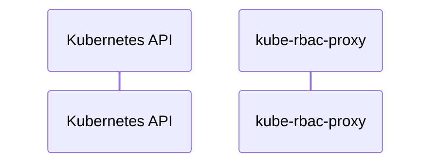

# kube-rbac-proxy: Dataflow

[Overview](index.md) · [Agent Context](agent-context.md) · [Extracted Data](details.md) · [Network](network.md) · [RBAC](rbac.md) · [Security](security.md) · [Dataflow](dataflow.md)

## Controller Watches

Kubernetes resources this controller monitors for changes. Each watch triggers reconciliation when the watched resource is created, updated, or deleted.

No controller watches found in analyzed sources.

## Reconciliation Flow

How the controller interacts with the Kubernetes API during reconciliation.

### HTTP Endpoints

| Method | Path | Source |
|--------|------|--------|
| * | / | [`cmd/kube-rbac-proxy/app/kube-rbac-proxy.go:420`](https://github.com/opendatahub-io/kube-rbac-proxy/blob/02f8bc2e2bc37f0b7e0afc6949ca7f4db5f89189/cmd/kube-rbac-proxy/app/kube-rbac-proxy.go#L420) |

## Configuration

ConfigMaps and Helm values that control this component's runtime behavior.

