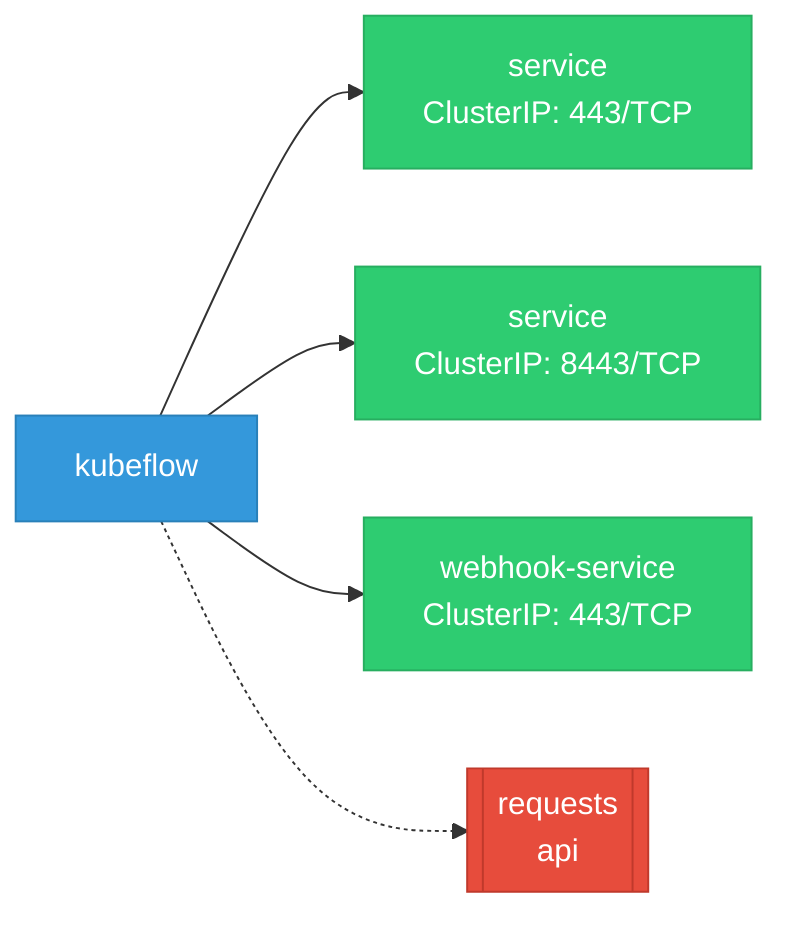
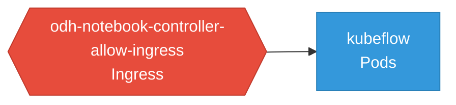

# kubeflow: Network

## Service Map

### Services

| Name | Type | Ports | Source |
|------|------|-------|--------|
| service | ClusterIP | 443/TCP | [`components/notebook-controller/config/manager/service.yaml`](https://github.com/opendatahub-io/kubeflow/blob/2a500da8344feda010c989eb2bd24fee9a0acd51/components/notebook-controller/config/manager/service.yaml) |
| service | ClusterIP | 8443/TCP | [`components/odh-notebook-controller/config/manager/service.yaml`](https://github.com/opendatahub-io/kubeflow/blob/2a500da8344feda010c989eb2bd24fee9a0acd51/components/odh-notebook-controller/config/manager/service.yaml) |
| webhook-service | ClusterIP | 443/TCP | [`components/odh-notebook-controller/config/webhook/service.yaml`](https://github.com/opendatahub-io/kubeflow/blob/2a500da8344feda010c989eb2bd24fee9a0acd51/components/odh-notebook-controller/config/webhook/service.yaml) |

### Network Policies

| Name | Policy Types | Source |
|------|-------------|--------|
| odh-notebook-controller-allow-ingress | Ingress | [`components/odh-notebook-controller/config/overlays/openshift/network-policies.yaml`](https://github.com/opendatahub-io/kubeflow/blob/2a500da8344feda010c989eb2bd24fee9a0acd51/components/odh-notebook-controller/config/overlays/openshift/network-policies.yaml) |

## Network Policy Graph

Visual representation of NetworkPolicy rules. Ingress rules show what traffic is allowed into pods, egress rules show what traffic is allowed out.

