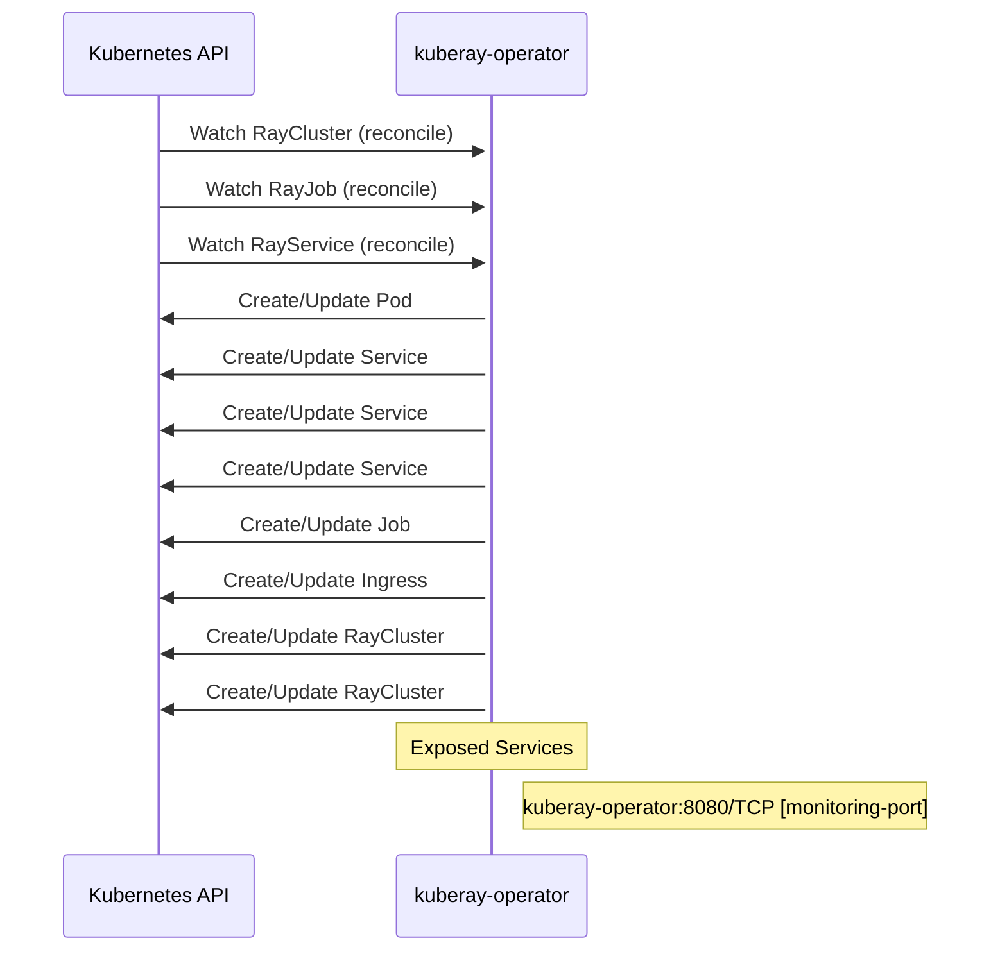

# kuberay: Dataflow

## Controller Watches

Kubernetes resources this controller monitors for changes. Each watch triggers reconciliation when the watched resource is created, updated, or deleted.

| Type | GVK | Source |
|------|-----|--------|
| For | ray/v1/RayCluster | [`ray-operator/controllers/ray/raycluster_controller.go:1117`](https://github.com/opendatahub-io/kuberay/blob/e2b85bf7c3476dfd3224fa5cdaa67f235115eb53/ray-operator/controllers/ray/raycluster_controller.go#L1117) |
| For | ray/v1/RayJob | [`ray-operator/controllers/ray/rayjob_controller.go:482`](https://github.com/opendatahub-io/kuberay/blob/e2b85bf7c3476dfd3224fa5cdaa67f235115eb53/ray-operator/controllers/ray/rayjob_controller.go#L482) |
| For | ray/v1/RayService | [`ray-operator/controllers/ray/rayservice_controller.go:317`](https://github.com/opendatahub-io/kuberay/blob/e2b85bf7c3476dfd3224fa5cdaa67f235115eb53/ray-operator/controllers/ray/rayservice_controller.go#L317) |
| Owns | /v1/Pod | [`ray-operator/controllers/ray/raycluster_controller.go:1122`](https://github.com/opendatahub-io/kuberay/blob/e2b85bf7c3476dfd3224fa5cdaa67f235115eb53/ray-operator/controllers/ray/raycluster_controller.go#L1122) |
| Owns | /v1/Service | [`ray-operator/controllers/ray/raycluster_controller.go:1123`](https://github.com/opendatahub-io/kuberay/blob/e2b85bf7c3476dfd3224fa5cdaa67f235115eb53/ray-operator/controllers/ray/raycluster_controller.go#L1123) |
| Owns | /v1/Service | [`ray-operator/controllers/ray/rayjob_controller.go:484`](https://github.com/opendatahub-io/kuberay/blob/e2b85bf7c3476dfd3224fa5cdaa67f235115eb53/ray-operator/controllers/ray/rayjob_controller.go#L484) |
| Owns | /v1/Service | [`ray-operator/controllers/ray/rayservice_controller.go:323`](https://github.com/opendatahub-io/kuberay/blob/e2b85bf7c3476dfd3224fa5cdaa67f235115eb53/ray-operator/controllers/ray/rayservice_controller.go#L323) |
| Owns | batch/v1/Job | [`ray-operator/controllers/ray/rayjob_controller.go:485`](https://github.com/opendatahub-io/kuberay/blob/e2b85bf7c3476dfd3224fa5cdaa67f235115eb53/ray-operator/controllers/ray/rayjob_controller.go#L485) |
| Owns | networking.k8s.io/v1/Ingress | [`ray-operator/controllers/ray/rayservice_controller.go:324`](https://github.com/opendatahub-io/kuberay/blob/e2b85bf7c3476dfd3224fa5cdaa67f235115eb53/ray-operator/controllers/ray/rayservice_controller.go#L324) |
| Owns | ray/v1/RayCluster | [`ray-operator/controllers/ray/rayjob_controller.go:483`](https://github.com/opendatahub-io/kuberay/blob/e2b85bf7c3476dfd3224fa5cdaa67f235115eb53/ray-operator/controllers/ray/rayjob_controller.go#L483) |
| Owns | ray/v1/RayCluster | [`ray-operator/controllers/ray/rayservice_controller.go:322`](https://github.com/opendatahub-io/kuberay/blob/e2b85bf7c3476dfd3224fa5cdaa67f235115eb53/ray-operator/controllers/ray/rayservice_controller.go#L322) |

## Reconciliation Flow

How the controller interacts with the Kubernetes API during reconciliation.

### HTTP Endpoints

| Method | Path | Source |
|--------|------|--------|
| * | DELETE | [`proto/go_client/config.pb.gw.go:662`](https://github.com/opendatahub-io/kuberay/blob/e2b85bf7c3476dfd3224fa5cdaa67f235115eb53/proto/go_client/config.pb.gw.go#L662) |
| * | DELETE | [`proto/go_client/serve.pb.gw.go:856`](https://github.com/opendatahub-io/kuberay/blob/e2b85bf7c3476dfd3224fa5cdaa67f235115eb53/proto/go_client/serve.pb.gw.go#L856) |
| * | DELETE | [`proto/go_client/serve.pb.gw.go:672`](https://github.com/opendatahub-io/kuberay/blob/e2b85bf7c3476dfd3224fa5cdaa67f235115eb53/proto/go_client/serve.pb.gw.go#L672) |
| * | DELETE | [`proto/go_client/job.pb.gw.go:558`](https://github.com/opendatahub-io/kuberay/blob/e2b85bf7c3476dfd3224fa5cdaa67f235115eb53/proto/go_client/job.pb.gw.go#L558) |
| * | DELETE | [`proto/go_client/cluster.pb.gw.go:414`](https://github.com/opendatahub-io/kuberay/blob/e2b85bf7c3476dfd3224fa5cdaa67f235115eb53/proto/go_client/cluster.pb.gw.go#L414) |
| * | DELETE | [`proto/go_client/job.pb.gw.go:414`](https://github.com/opendatahub-io/kuberay/blob/e2b85bf7c3476dfd3224fa5cdaa67f235115eb53/proto/go_client/job.pb.gw.go#L414) |
| * | DELETE | [`proto/go_client/config.pb.gw.go:1052`](https://github.com/opendatahub-io/kuberay/blob/e2b85bf7c3476dfd3224fa5cdaa67f235115eb53/proto/go_client/config.pb.gw.go#L1052) |
| * | DELETE | [`proto/go_client/config.pb.gw.go:907`](https://github.com/opendatahub-io/kuberay/blob/e2b85bf7c3476dfd3224fa5cdaa67f235115eb53/proto/go_client/config.pb.gw.go#L907) |
| * | DELETE | [`proto/go_client/config.pb.gw.go:763`](https://github.com/opendatahub-io/kuberay/blob/e2b85bf7c3476dfd3224fa5cdaa67f235115eb53/proto/go_client/config.pb.gw.go#L763) |
| * | DELETE | [`proto/go_client/cluster.pb.gw.go:558`](https://github.com/opendatahub-io/kuberay/blob/e2b85bf7c3476dfd3224fa5cdaa67f235115eb53/proto/go_client/cluster.pb.gw.go#L558) |
| * | GET | [`proto/go_client/config.pb.gw.go:1012`](https://github.com/opendatahub-io/kuberay/blob/e2b85bf7c3476dfd3224fa5cdaa67f235115eb53/proto/go_client/config.pb.gw.go#L1012) |
| * | GET | [`proto/go_client/job.pb.gw.go:391`](https://github.com/opendatahub-io/kuberay/blob/e2b85bf7c3476dfd3224fa5cdaa67f235115eb53/proto/go_client/job.pb.gw.go#L391) |
| * | GET | [`proto/go_client/config.pb.gw.go:616`](https://github.com/opendatahub-io/kuberay/blob/e2b85bf7c3476dfd3224fa5cdaa67f235115eb53/proto/go_client/config.pb.gw.go#L616) |
| * | GET | [`proto/go_client/config.pb.gw.go:639`](https://github.com/opendatahub-io/kuberay/blob/e2b85bf7c3476dfd3224fa5cdaa67f235115eb53/proto/go_client/config.pb.gw.go#L639) |
| * | GET | [`proto/go_client/cluster.pb.gw.go:345`](https://github.com/opendatahub-io/kuberay/blob/e2b85bf7c3476dfd3224fa5cdaa67f235115eb53/proto/go_client/cluster.pb.gw.go#L345) |
| * | GET | [`proto/go_client/serve.pb.gw.go:836`](https://github.com/opendatahub-io/kuberay/blob/e2b85bf7c3476dfd3224fa5cdaa67f235115eb53/proto/go_client/serve.pb.gw.go#L836) |
| * | GET | [`proto/go_client/config.pb.gw.go:717`](https://github.com/opendatahub-io/kuberay/blob/e2b85bf7c3476dfd3224fa5cdaa67f235115eb53/proto/go_client/config.pb.gw.go#L717) |
| * | GET | [`proto/go_client/config.pb.gw.go:740`](https://github.com/opendatahub-io/kuberay/blob/e2b85bf7c3476dfd3224fa5cdaa67f235115eb53/proto/go_client/config.pb.gw.go#L740) |
| * | GET | [`proto/go_client/cluster.pb.gw.go:538`](https://github.com/opendatahub-io/kuberay/blob/e2b85bf7c3476dfd3224fa5cdaa67f235115eb53/proto/go_client/cluster.pb.gw.go#L538) |
| * | GET | [`proto/go_client/serve.pb.gw.go:816`](https://github.com/opendatahub-io/kuberay/blob/e2b85bf7c3476dfd3224fa5cdaa67f235115eb53/proto/go_client/serve.pb.gw.go#L816) |
| * | GET | [`proto/go_client/config.pb.gw.go:847`](https://github.com/opendatahub-io/kuberay/blob/e2b85bf7c3476dfd3224fa5cdaa67f235115eb53/proto/go_client/config.pb.gw.go#L847) |
| * | GET | [`proto/go_client/config.pb.gw.go:867`](https://github.com/opendatahub-io/kuberay/blob/e2b85bf7c3476dfd3224fa5cdaa67f235115eb53/proto/go_client/config.pb.gw.go#L867) |
| * | GET | [`proto/go_client/config.pb.gw.go:887`](https://github.com/opendatahub-io/kuberay/blob/e2b85bf7c3476dfd3224fa5cdaa67f235115eb53/proto/go_client/config.pb.gw.go#L887) |
| * | GET | [`proto/go_client/cluster.pb.gw.go:518`](https://github.com/opendatahub-io/kuberay/blob/e2b85bf7c3476dfd3224fa5cdaa67f235115eb53/proto/go_client/cluster.pb.gw.go#L518) |
| * | GET | [`proto/go_client/serve.pb.gw.go:796`](https://github.com/opendatahub-io/kuberay/blob/e2b85bf7c3476dfd3224fa5cdaa67f235115eb53/proto/go_client/serve.pb.gw.go#L796) |
| * | GET | [`proto/go_client/cluster.pb.gw.go:368`](https://github.com/opendatahub-io/kuberay/blob/e2b85bf7c3476dfd3224fa5cdaa67f235115eb53/proto/go_client/cluster.pb.gw.go#L368) |
| * | GET | [`proto/go_client/config.pb.gw.go:1032`](https://github.com/opendatahub-io/kuberay/blob/e2b85bf7c3476dfd3224fa5cdaa67f235115eb53/proto/go_client/config.pb.gw.go#L1032) |
| * | GET | [`proto/go_client/cluster.pb.gw.go:498`](https://github.com/opendatahub-io/kuberay/blob/e2b85bf7c3476dfd3224fa5cdaa67f235115eb53/proto/go_client/cluster.pb.gw.go#L498) |
| * | GET | [`proto/go_client/serve.pb.gw.go:649`](https://github.com/opendatahub-io/kuberay/blob/e2b85bf7c3476dfd3224fa5cdaa67f235115eb53/proto/go_client/serve.pb.gw.go#L649) |
| * | GET | [`proto/go_client/job.pb.gw.go:345`](https://github.com/opendatahub-io/kuberay/blob/e2b85bf7c3476dfd3224fa5cdaa67f235115eb53/proto/go_client/job.pb.gw.go#L345) |
| * | GET | [`proto/go_client/job.pb.gw.go:368`](https://github.com/opendatahub-io/kuberay/blob/e2b85bf7c3476dfd3224fa5cdaa67f235115eb53/proto/go_client/job.pb.gw.go#L368) |
| * | GET | [`proto/go_client/config.pb.gw.go:593`](https://github.com/opendatahub-io/kuberay/blob/e2b85bf7c3476dfd3224fa5cdaa67f235115eb53/proto/go_client/config.pb.gw.go#L593) |
| * | GET | [`proto/go_client/serve.pb.gw.go:626`](https://github.com/opendatahub-io/kuberay/blob/e2b85bf7c3476dfd3224fa5cdaa67f235115eb53/proto/go_client/serve.pb.gw.go#L626) |
| * | GET | [`proto/go_client/serve.pb.gw.go:603`](https://github.com/opendatahub-io/kuberay/blob/e2b85bf7c3476dfd3224fa5cdaa67f235115eb53/proto/go_client/serve.pb.gw.go#L603) |
| * | GET | [`proto/go_client/job.pb.gw.go:498`](https://github.com/opendatahub-io/kuberay/blob/e2b85bf7c3476dfd3224fa5cdaa67f235115eb53/proto/go_client/job.pb.gw.go#L498) |
| * | GET | [`proto/go_client/job.pb.gw.go:518`](https://github.com/opendatahub-io/kuberay/blob/e2b85bf7c3476dfd3224fa5cdaa67f235115eb53/proto/go_client/job.pb.gw.go#L518) |
| * | GET | [`proto/go_client/job.pb.gw.go:538`](https://github.com/opendatahub-io/kuberay/blob/e2b85bf7c3476dfd3224fa5cdaa67f235115eb53/proto/go_client/job.pb.gw.go#L538) |
| * | GET | [`proto/go_client/cluster.pb.gw.go:391`](https://github.com/opendatahub-io/kuberay/blob/e2b85bf7c3476dfd3224fa5cdaa67f235115eb53/proto/go_client/cluster.pb.gw.go#L391) |
| * | PATCH | [`proto/go_client/serve.pb.gw.go:580`](https://github.com/opendatahub-io/kuberay/blob/e2b85bf7c3476dfd3224fa5cdaa67f235115eb53/proto/go_client/serve.pb.gw.go#L580) |
| * | PATCH | [`proto/go_client/serve.pb.gw.go:776`](https://github.com/opendatahub-io/kuberay/blob/e2b85bf7c3476dfd3224fa5cdaa67f235115eb53/proto/go_client/serve.pb.gw.go#L776) |
| * | POST | [`proto/go_client/job.pb.gw.go:478`](https://github.com/opendatahub-io/kuberay/blob/e2b85bf7c3476dfd3224fa5cdaa67f235115eb53/proto/go_client/job.pb.gw.go#L478) |
| * | POST | [`proto/go_client/serve.pb.gw.go:534`](https://github.com/opendatahub-io/kuberay/blob/e2b85bf7c3476dfd3224fa5cdaa67f235115eb53/proto/go_client/serve.pb.gw.go#L534) |
| * | POST | [`proto/go_client/cluster.pb.gw.go:478`](https://github.com/opendatahub-io/kuberay/blob/e2b85bf7c3476dfd3224fa5cdaa67f235115eb53/proto/go_client/cluster.pb.gw.go#L478) |
| * | POST | [`proto/go_client/job.pb.gw.go:322`](https://github.com/opendatahub-io/kuberay/blob/e2b85bf7c3476dfd3224fa5cdaa67f235115eb53/proto/go_client/job.pb.gw.go#L322) |
| * | POST | [`proto/go_client/cluster.pb.gw.go:322`](https://github.com/opendatahub-io/kuberay/blob/e2b85bf7c3476dfd3224fa5cdaa67f235115eb53/proto/go_client/cluster.pb.gw.go#L322) |
| * | POST | [`proto/go_client/serve.pb.gw.go:736`](https://github.com/opendatahub-io/kuberay/blob/e2b85bf7c3476dfd3224fa5cdaa67f235115eb53/proto/go_client/serve.pb.gw.go#L736) |
| * | POST | [`proto/go_client/config.pb.gw.go:992`](https://github.com/opendatahub-io/kuberay/blob/e2b85bf7c3476dfd3224fa5cdaa67f235115eb53/proto/go_client/config.pb.gw.go#L992) |
| * | POST | [`proto/go_client/config.pb.gw.go:827`](https://github.com/opendatahub-io/kuberay/blob/e2b85bf7c3476dfd3224fa5cdaa67f235115eb53/proto/go_client/config.pb.gw.go#L827) |
| * | POST | [`proto/go_client/config.pb.gw.go:694`](https://github.com/opendatahub-io/kuberay/blob/e2b85bf7c3476dfd3224fa5cdaa67f235115eb53/proto/go_client/config.pb.gw.go#L694) |
| * | POST | [`proto/go_client/config.pb.gw.go:570`](https://github.com/opendatahub-io/kuberay/blob/e2b85bf7c3476dfd3224fa5cdaa67f235115eb53/proto/go_client/config.pb.gw.go#L570) |
| * | PUT | [`proto/go_client/serve.pb.gw.go:756`](https://github.com/opendatahub-io/kuberay/blob/e2b85bf7c3476dfd3224fa5cdaa67f235115eb53/proto/go_client/serve.pb.gw.go#L756) |
| * | PUT | [`proto/go_client/serve.pb.gw.go:557`](https://github.com/opendatahub-io/kuberay/blob/e2b85bf7c3476dfd3224fa5cdaa67f235115eb53/proto/go_client/serve.pb.gw.go#L557) |

## Configuration

ConfigMaps and Helm values that control this component's runtime behavior.

### Helm

**Chart:** kuberay-apiserver v1.0.0

