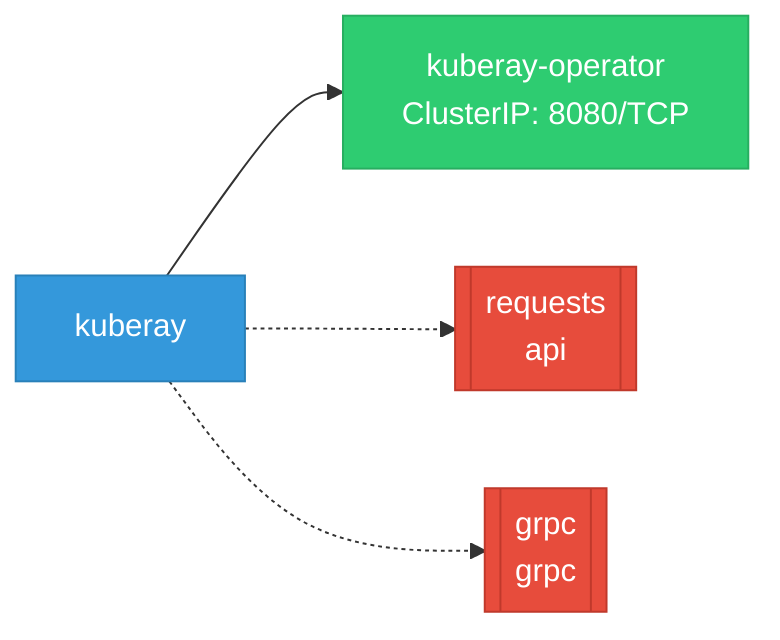

# kuberay: Network

## Service Map

### Services

| Name | Type | Ports | Source |
|------|------|-------|--------|
| kuberay-operator | ClusterIP | 8080/TCP | [`ray-operator/config/manager/service.yaml`](https://github.com/opendatahub-io/kuberay/blob/e2b85bf7c3476dfd3224fa5cdaa67f235115eb53/ray-operator/config/manager/service.yaml) |

!!! warning "No Network Policies"
    No NetworkPolicy resources were found in the analyzed sources. Network policies may exist in overlays, Helm values, or cluster-level configurations not captured by static analysis.

