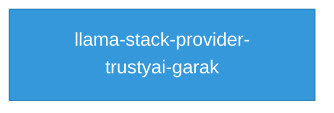

# llama-stack-provider-trustyai-garak

> **Architecture snapshot: 2026-11-28** (2026-11-28)

[Overview](index.md) · [Agent Context](agent-context.md) · [Extracted Data](details.md) · [Network](network.md) · [RBAC](rbac.md) · [Security](security.md) · [Dataflow](dataflow.md)

**Repository:** opendatahub-io/llama-stack-provider-trustyai-garak  
**Analyzer:** arch-analyzer 38b24267ad379636973f678b4ca92689c2c6fdf3  
**Extracted:** 2026-11-28T07:18:03Z

## Summary

| Metric | Count |
|--------|-------|
| CRDs | 0 |
| Deployments | 0 |
| Services | 0 |
| Secrets | 0 |
| Cluster Roles | 0 |
| Controller Watches | 0 |

## Component Architecture

CRDs, controllers, and owned Kubernetes resources.

### CRDs

No CRDs found in analyzed sources.

## Dependencies

