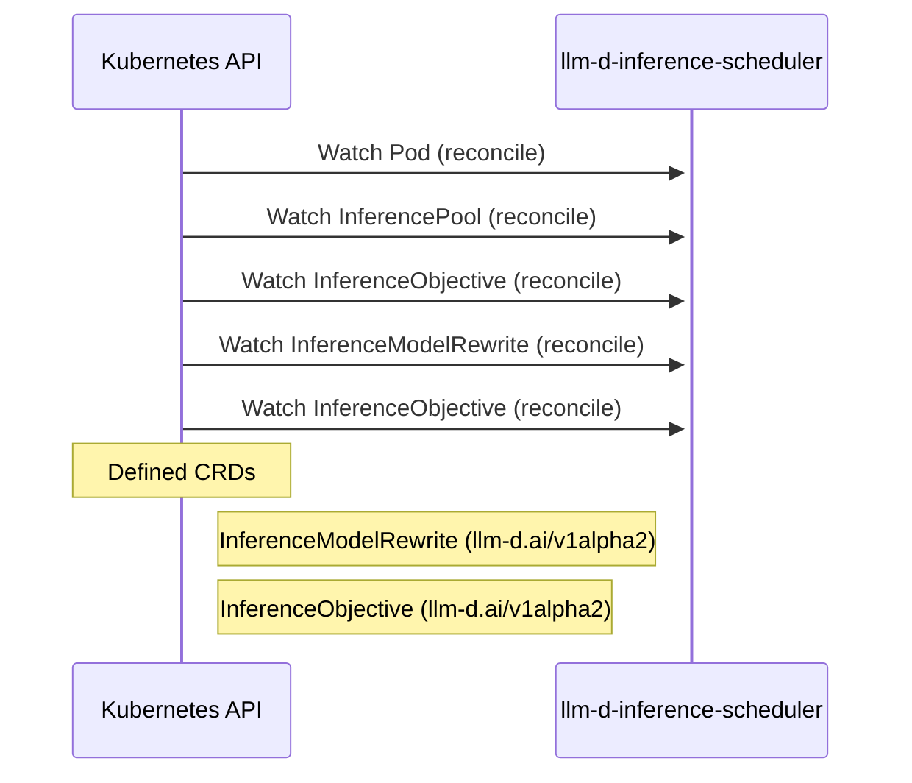

# llm-d-inference-scheduler: Dataflow

## Controller Watches

Kubernetes resources this controller monitors for changes. Each watch triggers reconciliation when the watched resource is created, updated, or deleted.

| Type | GVK | Source |
|------|-----|--------|
| For | /v1/Pod | [`pkg/epp/controller/pod_reconciler.go:91`](https://github.com/opendatahub-io/llm-d-inference-scheduler/blob/30fb1d0cff419b5cba63e71c1b521983afc921d1/pkg/epp/controller/pod_reconciler.go#L91) |
| For | api/v1/InferencePool | [`pkg/epp/controller/inferencepool_reconciler.go:80`](https://github.com/opendatahub-io/llm-d-inference-scheduler/blob/30fb1d0cff419b5cba63e71c1b521983afc921d1/pkg/epp/controller/inferencepool_reconciler.go#L80) |
| For | apix/v1/InferenceObjective | [`pkg/epp/controller/inferenceobjective_reconciler.go:171`](https://github.com/opendatahub-io/llm-d-inference-scheduler/blob/30fb1d0cff419b5cba63e71c1b521983afc921d1/pkg/epp/controller/inferenceobjective_reconciler.go#L171) |
| For | apix/v1alpha2/InferenceModelRewrite | [`pkg/epp/controller/inferencemodelrewrite_reconciler.go:82`](https://github.com/opendatahub-io/llm-d-inference-scheduler/blob/30fb1d0cff419b5cba63e71c1b521983afc921d1/pkg/epp/controller/inferencemodelrewrite_reconciler.go#L82) |
| For | apix/v1alpha2/InferenceObjective | [`pkg/epp/controller/inferenceobjective_reconciler.go:218`](https://github.com/opendatahub-io/llm-d-inference-scheduler/blob/30fb1d0cff419b5cba63e71c1b521983afc921d1/pkg/epp/controller/inferenceobjective_reconciler.go#L218) |

## Reconciliation Flow

How the controller interacts with the Kubernetes API during reconciliation.

### HTTP Endpoints

| Method | Path | Source |
|--------|------|--------|
| * | / | [`pkg/sidecar/proxy/proxy.go:638`](https://github.com/opendatahub-io/llm-d-inference-scheduler/blob/30fb1d0cff419b5cba63e71c1b521983afc921d1/pkg/sidecar/proxy/proxy.go#L638) |
| * | /metrics | [`cmd/coordinator/main.go:268`](https://github.com/opendatahub-io/llm-d-inference-scheduler/blob/30fb1d0cff419b5cba63e71c1b521983afc921d1/cmd/coordinator/main.go#L268) |
| * | /metrics | [`cmd/epp/runner/runner.go:1472`](https://github.com/opendatahub-io/llm-d-inference-scheduler/blob/30fb1d0cff419b5cba63e71c1b521983afc921d1/cmd/epp/runner/runner.go#L1472) |
| * | /metrics | [`pkg/sidecar/proxy/dns_metrics.go:147`](https://github.com/opendatahub-io/llm-d-inference-scheduler/blob/30fb1d0cff419b5cba63e71c1b521983afc921d1/pkg/sidecar/proxy/dns_metrics.go#L147) |
| * | GET /health | [`pkg/sidecar/proxy/proxy.go:605`](https://github.com/opendatahub-io/llm-d-inference-scheduler/blob/30fb1d0cff419b5cba63e71c1b521983afc921d1/pkg/sidecar/proxy/proxy.go#L605) |
| * | POST  | [`pkg/sidecar/proxy/proxy.go:610`](https://github.com/opendatahub-io/llm-d-inference-scheduler/blob/30fb1d0cff419b5cba63e71c1b521983afc921d1/pkg/sidecar/proxy/proxy.go#L610) |
| * | POST  | [`pkg/sidecar/proxy/proxy.go:611`](https://github.com/opendatahub-io/llm-d-inference-scheduler/blob/30fb1d0cff419b5cba63e71c1b521983afc921d1/pkg/sidecar/proxy/proxy.go#L611) |

## Configuration

ConfigMaps and Helm values that control this component's runtime behavior.

### Helm

**Chart:** llm-d-router-gateway v0.0.0

