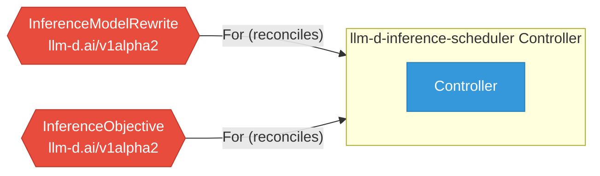

# llm-d-inference-scheduler

> **Architecture snapshot: 2026-11-28** (2026-11-28)

[Overview](index.md) · [Agent Context](agent-context.md) · [Extracted Data](details.md) · [Network](network.md) · [RBAC](rbac.md) · [Security](security.md) · [Dataflow](dataflow.md)

**Repository:** opendatahub-io/llm-d-inference-scheduler  
**Analyzer:** arch-analyzer 38b24267ad379636973f678b4ca92689c2c6fdf3  
**Extracted:** 2026-11-28T07:17:14Z

## Summary

| Metric | Count |
|--------|-------|
| CRDs | 2 |
| Deployments | 0 |
| Services | 0 |
| Secrets | 0 |
| Cluster Roles | 0 |
| Controller Watches | 5 |

## Component Architecture

CRDs, controllers, and owned Kubernetes resources.

### CRDs

| Group | Version | Kind | Scope | Fields | Validation Rules | Discovery | Source |
|-------|---------|------|-------|--------|------------------|-----------|--------|
| llm-d.ai | v1alpha2 | InferenceModelRewrite | Namespaced | 24 | 0 | YAML | [`config/crd/bases/llm-d.ai_inferencemodelrewrites.yaml`](https://github.com/opendatahub-io/llm-d-inference-scheduler/blob/273e16edfb68fe76ebf4af0bfe981e8968ae09d4/config/crd/bases/llm-d.ai_inferencemodelrewrites.yaml) |
| llm-d.ai | v1alpha2 | InferenceObjective | Namespaced | 27 | 3 | YAML | [`config/crd/bases/llm-d.ai_inferenceobjectives.yaml`](https://github.com/opendatahub-io/llm-d-inference-scheduler/blob/273e16edfb68fe76ebf4af0bfe981e8968ae09d4/config/crd/bases/llm-d.ai_inferenceobjectives.yaml) |

## Dependencies

### Key External Dependencies

| Module | Version |
|--------|---------|
| github.com/go-logr/logr | v1.4.4 |
| github.com/go-logr/stdr | v1.2.2 |
| github.com/go-logr/zapr | v1.3.0 |
| github.com/prometheus/client_golang | v1.24.1 |
| github.com/prometheus/client_model | v0.6.3 |
| github.com/prometheus/common | v0.70.1 |
| google.golang.org/grpc | v1.84.0 |
| k8s.io/api | v0.37.2 |
| k8s.io/apiextensions-apiserver | v0.37.2 |
| k8s.io/apimachinery | v0.37.2 |
| k8s.io/client-go | v0.37.2 |
| sigs.k8s.io/controller-runtime | v0.25.3 |

