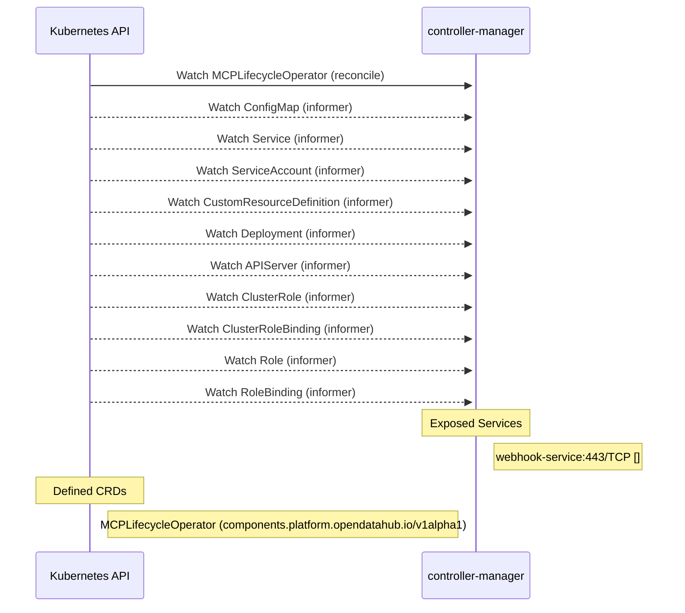

# mcp-lifecycle-module-operator: Dataflow

[Overview](index.md) · [Agent Context](agent-context.md) · [Extracted Data](details.md) · [Network](network.md) · [RBAC](rbac.md) · [Security](security.md) · [Cache](cache.md) · [Dataflow](dataflow.md)

## Controller Watches

Kubernetes resources this controller monitors for changes. Each watch triggers reconciliation when the watched resource is created, updated, or deleted.

| Type | GVK | Source |
|------|-----|--------|
| For | api/v1alpha1/MCPLifecycleOperator | [`internal/controller/mcplifecycleoperator_reconciler.go:799`](https://github.com/opendatahub-io/mcp-lifecycle-module-operator/blob/c5e2f5d2201bfafd02a7000d9b90f516e16eeb4b/internal/controller/mcplifecycleoperator_reconciler.go#L799) |
| Watches | /v1/ConfigMap | [`internal/controller/mcplifecycleoperator_reconciler.go:800`](https://github.com/opendatahub-io/mcp-lifecycle-module-operator/blob/c5e2f5d2201bfafd02a7000d9b90f516e16eeb4b/internal/controller/mcplifecycleoperator_reconciler.go#L800) |
| Watches | /v1/Service | [`internal/controller/mcplifecycleoperator_reconciler.go:803`](https://github.com/opendatahub-io/mcp-lifecycle-module-operator/blob/c5e2f5d2201bfafd02a7000d9b90f516e16eeb4b/internal/controller/mcplifecycleoperator_reconciler.go#L803) |
| Watches | /v1/ServiceAccount | [`internal/controller/mcplifecycleoperator_reconciler.go:802`](https://github.com/opendatahub-io/mcp-lifecycle-module-operator/blob/c5e2f5d2201bfafd02a7000d9b90f516e16eeb4b/internal/controller/mcplifecycleoperator_reconciler.go#L802) |
| Watches | apiextensions.k8s.io/v1/CustomResourceDefinition | [`internal/controller/mcplifecycleoperator_reconciler.go:808`](https://github.com/opendatahub-io/mcp-lifecycle-module-operator/blob/c5e2f5d2201bfafd02a7000d9b90f516e16eeb4b/internal/controller/mcplifecycleoperator_reconciler.go#L808) |
| Watches | apps/v1/Deployment | [`internal/controller/mcplifecycleoperator_reconciler.go:801`](https://github.com/opendatahub-io/mcp-lifecycle-module-operator/blob/c5e2f5d2201bfafd02a7000d9b90f516e16eeb4b/internal/controller/mcplifecycleoperator_reconciler.go#L801) |
| Watches | config/v1/APIServer | [`internal/controller/mcplifecycleoperator_reconciler.go:811`](https://github.com/opendatahub-io/mcp-lifecycle-module-operator/blob/c5e2f5d2201bfafd02a7000d9b90f516e16eeb4b/internal/controller/mcplifecycleoperator_reconciler.go#L811) |
| Watches | rbac.authorization.k8s.io/v1/ClusterRole | [`internal/controller/mcplifecycleoperator_reconciler.go:804`](https://github.com/opendatahub-io/mcp-lifecycle-module-operator/blob/c5e2f5d2201bfafd02a7000d9b90f516e16eeb4b/internal/controller/mcplifecycleoperator_reconciler.go#L804) |
| Watches | rbac.authorization.k8s.io/v1/ClusterRoleBinding | [`internal/controller/mcplifecycleoperator_reconciler.go:805`](https://github.com/opendatahub-io/mcp-lifecycle-module-operator/blob/c5e2f5d2201bfafd02a7000d9b90f516e16eeb4b/internal/controller/mcplifecycleoperator_reconciler.go#L805) |
| Watches | rbac.authorization.k8s.io/v1/Role | [`internal/controller/mcplifecycleoperator_reconciler.go:806`](https://github.com/opendatahub-io/mcp-lifecycle-module-operator/blob/c5e2f5d2201bfafd02a7000d9b90f516e16eeb4b/internal/controller/mcplifecycleoperator_reconciler.go#L806) |
| Watches | rbac.authorization.k8s.io/v1/RoleBinding | [`internal/controller/mcplifecycleoperator_reconciler.go:807`](https://github.com/opendatahub-io/mcp-lifecycle-module-operator/blob/c5e2f5d2201bfafd02a7000d9b90f516e16eeb4b/internal/controller/mcplifecycleoperator_reconciler.go#L807) |

## Reconciliation Flow

How the controller interacts with the Kubernetes API during reconciliation.

## Configuration

ConfigMaps and Helm values that control this component's runtime behavior.

