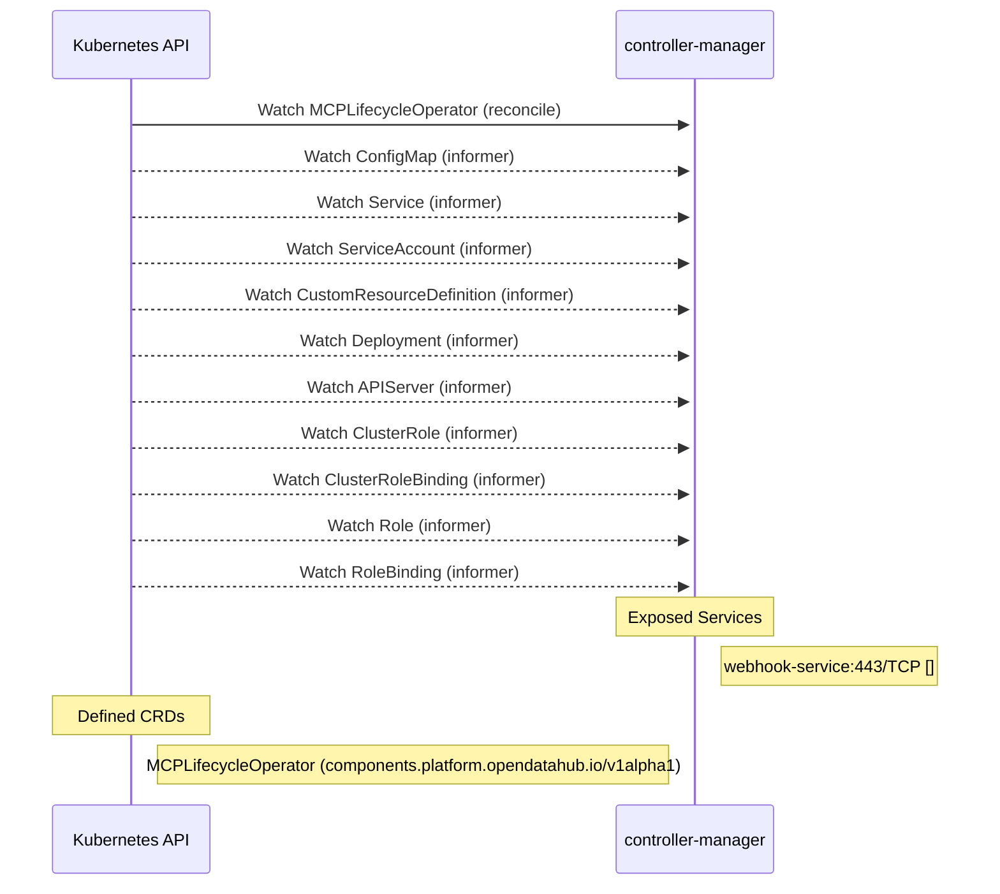

# mcp-lifecycle-module-operator: Dataflow

## Controller Watches

Kubernetes resources this controller monitors for changes. Each watch triggers reconciliation when the watched resource is created, updated, or deleted.

| Type | GVK | Source |
|------|-----|--------|
| For | api/v1alpha1/MCPLifecycleOperator | [`internal/controller/mcplifecycleoperator_reconciler.go:737`](https://github.com/opendatahub-io/mcp-lifecycle-module-operator/blob/16e47d56b2f60d273638f9427e932f917fc0bb44/internal/controller/mcplifecycleoperator_reconciler.go#L737) |
| Watches | /v1/ConfigMap | [`internal/controller/mcplifecycleoperator_reconciler.go:738`](https://github.com/opendatahub-io/mcp-lifecycle-module-operator/blob/16e47d56b2f60d273638f9427e932f917fc0bb44/internal/controller/mcplifecycleoperator_reconciler.go#L738) |
| Watches | /v1/Service | [`internal/controller/mcplifecycleoperator_reconciler.go:741`](https://github.com/opendatahub-io/mcp-lifecycle-module-operator/blob/16e47d56b2f60d273638f9427e932f917fc0bb44/internal/controller/mcplifecycleoperator_reconciler.go#L741) |
| Watches | /v1/ServiceAccount | [`internal/controller/mcplifecycleoperator_reconciler.go:740`](https://github.com/opendatahub-io/mcp-lifecycle-module-operator/blob/16e47d56b2f60d273638f9427e932f917fc0bb44/internal/controller/mcplifecycleoperator_reconciler.go#L740) |
| Watches | apiextensions.k8s.io/v1/CustomResourceDefinition | [`internal/controller/mcplifecycleoperator_reconciler.go:746`](https://github.com/opendatahub-io/mcp-lifecycle-module-operator/blob/16e47d56b2f60d273638f9427e932f917fc0bb44/internal/controller/mcplifecycleoperator_reconciler.go#L746) |
| Watches | apps/v1/Deployment | [`internal/controller/mcplifecycleoperator_reconciler.go:739`](https://github.com/opendatahub-io/mcp-lifecycle-module-operator/blob/16e47d56b2f60d273638f9427e932f917fc0bb44/internal/controller/mcplifecycleoperator_reconciler.go#L739) |
| Watches | config/v1/APIServer | [`internal/controller/mcplifecycleoperator_reconciler.go:749`](https://github.com/opendatahub-io/mcp-lifecycle-module-operator/blob/16e47d56b2f60d273638f9427e932f917fc0bb44/internal/controller/mcplifecycleoperator_reconciler.go#L749) |
| Watches | rbac.authorization.k8s.io/v1/ClusterRole | [`internal/controller/mcplifecycleoperator_reconciler.go:742`](https://github.com/opendatahub-io/mcp-lifecycle-module-operator/blob/16e47d56b2f60d273638f9427e932f917fc0bb44/internal/controller/mcplifecycleoperator_reconciler.go#L742) |
| Watches | rbac.authorization.k8s.io/v1/ClusterRoleBinding | [`internal/controller/mcplifecycleoperator_reconciler.go:743`](https://github.com/opendatahub-io/mcp-lifecycle-module-operator/blob/16e47d56b2f60d273638f9427e932f917fc0bb44/internal/controller/mcplifecycleoperator_reconciler.go#L743) |
| Watches | rbac.authorization.k8s.io/v1/Role | [`internal/controller/mcplifecycleoperator_reconciler.go:744`](https://github.com/opendatahub-io/mcp-lifecycle-module-operator/blob/16e47d56b2f60d273638f9427e932f917fc0bb44/internal/controller/mcplifecycleoperator_reconciler.go#L744) |
| Watches | rbac.authorization.k8s.io/v1/RoleBinding | [`internal/controller/mcplifecycleoperator_reconciler.go:745`](https://github.com/opendatahub-io/mcp-lifecycle-module-operator/blob/16e47d56b2f60d273638f9427e932f917fc0bb44/internal/controller/mcplifecycleoperator_reconciler.go#L745) |

## Reconciliation Flow

How the controller interacts with the Kubernetes API during reconciliation.

## Configuration

ConfigMaps and Helm values that control this component's runtime behavior.

