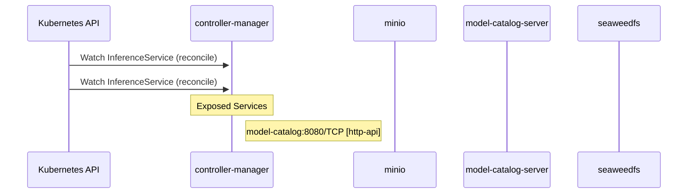

# model-registry: Dataflow

[Overview](index.md) · [Agent Context](agent-context.md) · [Extracted Data](details.md) · [Network](network.md) · [RBAC](rbac.md) · [Security](security.md) · [Cache](cache.md) · [Dataflow](dataflow.md)

## Controller Watches

Kubernetes resources this controller monitors for changes. Each watch triggers reconciliation when the watched resource is created, updated, or deleted.

| Type | GVK | Source |
|------|-----|--------|
| For | serving/v1beta1/InferenceService | [`cmd/controller/internal/controllers/inferenceservice_controller.go:44`](https://github.com/opendatahub-io/model-registry/blob/51d3c2fd69c5d1b191e8c4a4a8c29b644ef6555a/cmd/controller/internal/controllers/inferenceservice_controller.go#L44) |
| For | serving/v1beta1/InferenceService | [`pkg/inferenceservice-controller/controller.go:247`](https://github.com/opendatahub-io/model-registry/blob/51d3c2fd69c5d1b191e8c4a4a8c29b644ef6555a/pkg/inferenceservice-controller/controller.go#L247) |

## Reconciliation Flow

How the controller interacts with the Kubernetes API during reconciliation.

### HTTP Endpoints

| Method | Path | Source |
|--------|------|--------|
| GET | /healthcheck | [`clients/ui/bff/openapi/swagger.yaml`](https://github.com/opendatahub-io/model-registry/blob/51d3c2fd69c5d1b191e8c4a4a8c29b644ef6555a/clients/ui/bff/openapi/swagger.yaml) |
| GET | /healthcheck | [`clients/ui/bff/openapi/swagger.json`](https://github.com/opendatahub-io/model-registry/blob/51d3c2fd69c5d1b191e8c4a4a8c29b644ef6555a/clients/ui/bff/openapi/swagger.json) |

## Configuration

ConfigMaps and Helm values that control this component's runtime behavior.

### ConfigMaps

| Name | Data Keys | Source |
|------|-----------|--------|
| auth-proxy-config | nginx.conf | [`manifests/kustomize/options/ui/overlays/standalone/auth-proxy-configmap.yaml`](https://github.com/opendatahub-io/model-registry/blob/51d3c2fd69c5d1b191e8c4a4a8c29b644ef6555a/manifests/kustomize/options/ui/overlays/standalone/auth-proxy-configmap.yaml) |
| model-registry-configmap | MODEL_REGISTRY_DATA_STORE_TYPE, MODEL_REGISTRY_REST_SERVICE_HOST, MODEL_REGISTRY_REST_SERVICE_PORT | [`manifests/kustomize/base/model-registry-configmap.yaml`](https://github.com/opendatahub-io/model-registry/blob/51d3c2fd69c5d1b191e8c4a4a8c29b644ef6555a/manifests/kustomize/base/model-registry-configmap.yaml) |

