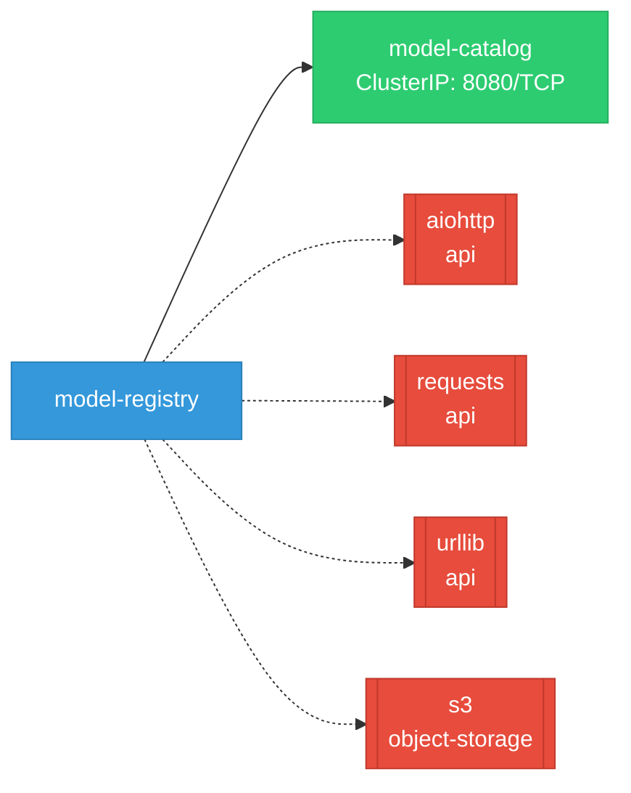

# model-registry: Network

[Overview](index.md) · [Agent Context](agent-context.md) · [Extracted Data](details.md) · [Network](network.md) · [RBAC](rbac.md) · [Security](security.md) · [Cache](cache.md) · [Dataflow](dataflow.md)

## Service Map

### Services

| Name | Type | Ports | Source |
|------|------|-------|--------|
| model-catalog | ClusterIP | 8080/TCP | [`manifests/kustomize/options/catalog/base/service.yaml`](https://github.com/opendatahub-io/model-registry/blob/51d3c2fd69c5d1b191e8c4a4a8c29b644ef6555a/manifests/kustomize/options/catalog/base/service.yaml) |

!!! warning "No Network Policies"
    No NetworkPolicy resources were found in the analyzed sources. Network policies may exist in overlays, Helm values, or cluster-level configurations not captured by static analysis.

