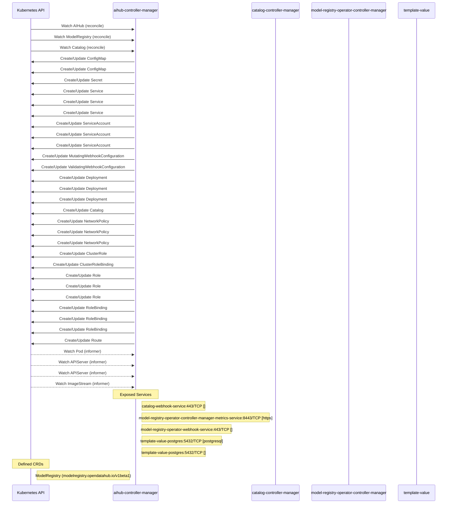

# model-registry-operator: Dataflow

[Overview](index.md) · [Agent Context](agent-context.md) · [Extracted Data](details.md) · [Network](network.md) · [RBAC](rbac.md) · [Security](security.md) · [Dataflow](dataflow.md)

## Controller Watches

Kubernetes resources this controller monitors for changes. Each watch triggers reconciliation when the watched resource is created, updated, or deleted.

| Type | GVK | Source |
|------|-----|--------|
| For | aihub/v1alpha1/AIHub | [`internal/controller/aihub_controller.go:805`](https://github.com/opendatahub-io/model-registry-operator/blob/4ce9197a395094ebd5449f62e0715470b1a69f26/internal/controller/aihub_controller.go#L805) |
| For | api/v1beta1/ModelRegistry | [`internal/controller/modelregistry_controller.go:296`](https://github.com/opendatahub-io/model-registry-operator/blob/4ce9197a395094ebd5449f62e0715470b1a69f26/internal/controller/modelregistry_controller.go#L296) |
| For | catalog/v1alpha1/Catalog | [`internal/controller/catalog_controller.go:1726`](https://github.com/opendatahub-io/model-registry-operator/blob/4ce9197a395094ebd5449f62e0715470b1a69f26/internal/controller/catalog_controller.go#L1726) |
| Owns | /v1/ConfigMap | [`internal/controller/aihub_controller.go:809`](https://github.com/opendatahub-io/model-registry-operator/blob/4ce9197a395094ebd5449f62e0715470b1a69f26/internal/controller/aihub_controller.go#L809) |
| Owns | /v1/ConfigMap | [`internal/controller/catalog_controller.go:1730`](https://github.com/opendatahub-io/model-registry-operator/blob/4ce9197a395094ebd5449f62e0715470b1a69f26/internal/controller/catalog_controller.go#L1730) |
| Owns | /v1/Secret | [`internal/controller/catalog_controller.go:1731`](https://github.com/opendatahub-io/model-registry-operator/blob/4ce9197a395094ebd5449f62e0715470b1a69f26/internal/controller/catalog_controller.go#L1731) |
| Owns | /v1/Service | [`internal/controller/modelregistry_controller.go:297`](https://github.com/opendatahub-io/model-registry-operator/blob/4ce9197a395094ebd5449f62e0715470b1a69f26/internal/controller/modelregistry_controller.go#L297) |
| Owns | /v1/Service | [`internal/controller/aihub_controller.go:807`](https://github.com/opendatahub-io/model-registry-operator/blob/4ce9197a395094ebd5449f62e0715470b1a69f26/internal/controller/aihub_controller.go#L807) |
| Owns | /v1/Service | [`internal/controller/catalog_controller.go:1728`](https://github.com/opendatahub-io/model-registry-operator/blob/4ce9197a395094ebd5449f62e0715470b1a69f26/internal/controller/catalog_controller.go#L1728) |
| Owns | /v1/ServiceAccount | [`internal/controller/aihub_controller.go:808`](https://github.com/opendatahub-io/model-registry-operator/blob/4ce9197a395094ebd5449f62e0715470b1a69f26/internal/controller/aihub_controller.go#L808) |
| Owns | /v1/ServiceAccount | [`internal/controller/modelregistry_controller.go:298`](https://github.com/opendatahub-io/model-registry-operator/blob/4ce9197a395094ebd5449f62e0715470b1a69f26/internal/controller/modelregistry_controller.go#L298) |
| Owns | /v1/ServiceAccount | [`internal/controller/catalog_controller.go:1729`](https://github.com/opendatahub-io/model-registry-operator/blob/4ce9197a395094ebd5449f62e0715470b1a69f26/internal/controller/catalog_controller.go#L1729) |
| Owns | admissionregistration.k8s.io/v1/MutatingWebhookConfiguration | [`internal/controller/aihub_controller.go:816`](https://github.com/opendatahub-io/model-registry-operator/blob/4ce9197a395094ebd5449f62e0715470b1a69f26/internal/controller/aihub_controller.go#L816) |
| Owns | admissionregistration.k8s.io/v1/ValidatingWebhookConfiguration | [`internal/controller/aihub_controller.go:815`](https://github.com/opendatahub-io/model-registry-operator/blob/4ce9197a395094ebd5449f62e0715470b1a69f26/internal/controller/aihub_controller.go#L815) |
| Owns | apps/v1/Deployment | [`internal/controller/catalog_controller.go:1727`](https://github.com/opendatahub-io/model-registry-operator/blob/4ce9197a395094ebd5449f62e0715470b1a69f26/internal/controller/catalog_controller.go#L1727) |
| Owns | apps/v1/Deployment | [`internal/controller/modelregistry_controller.go:299`](https://github.com/opendatahub-io/model-registry-operator/blob/4ce9197a395094ebd5449f62e0715470b1a69f26/internal/controller/modelregistry_controller.go#L299) |
| Owns | apps/v1/Deployment | [`internal/controller/aihub_controller.go:806`](https://github.com/opendatahub-io/model-registry-operator/blob/4ce9197a395094ebd5449f62e0715470b1a69f26/internal/controller/aihub_controller.go#L806) |
| Owns | catalog/v1alpha1/Catalog | [`internal/controller/aihub_controller.go:817`](https://github.com/opendatahub-io/model-registry-operator/blob/4ce9197a395094ebd5449f62e0715470b1a69f26/internal/controller/aihub_controller.go#L817) |
| Owns | networking.k8s.io/v1/NetworkPolicy | [`internal/controller/modelregistry_controller.go:301`](https://github.com/opendatahub-io/model-registry-operator/blob/4ce9197a395094ebd5449f62e0715470b1a69f26/internal/controller/modelregistry_controller.go#L301) |
| Owns | networking.k8s.io/v1/NetworkPolicy | [`internal/controller/aihub_controller.go:810`](https://github.com/opendatahub-io/model-registry-operator/blob/4ce9197a395094ebd5449f62e0715470b1a69f26/internal/controller/aihub_controller.go#L810) |
| Owns | networking.k8s.io/v1/NetworkPolicy | [`internal/controller/catalog_controller.go:1732`](https://github.com/opendatahub-io/model-registry-operator/blob/4ce9197a395094ebd5449f62e0715470b1a69f26/internal/controller/catalog_controller.go#L1732) |
| Owns | rbac.authorization.k8s.io/v1/ClusterRole | [`internal/controller/aihub_controller.go:813`](https://github.com/opendatahub-io/model-registry-operator/blob/4ce9197a395094ebd5449f62e0715470b1a69f26/internal/controller/aihub_controller.go#L813) |
| Owns | rbac.authorization.k8s.io/v1/ClusterRoleBinding | [`internal/controller/aihub_controller.go:814`](https://github.com/opendatahub-io/model-registry-operator/blob/4ce9197a395094ebd5449f62e0715470b1a69f26/internal/controller/aihub_controller.go#L814) |
| Owns | rbac.authorization.k8s.io/v1/Role | [`internal/controller/aihub_controller.go:811`](https://github.com/opendatahub-io/model-registry-operator/blob/4ce9197a395094ebd5449f62e0715470b1a69f26/internal/controller/aihub_controller.go#L811) |
| Owns | rbac.authorization.k8s.io/v1/Role | [`internal/controller/catalog_controller.go:1733`](https://github.com/opendatahub-io/model-registry-operator/blob/4ce9197a395094ebd5449f62e0715470b1a69f26/internal/controller/catalog_controller.go#L1733) |
| Owns | rbac.authorization.k8s.io/v1/Role | [`internal/controller/modelregistry_controller.go:300`](https://github.com/opendatahub-io/model-registry-operator/blob/4ce9197a395094ebd5449f62e0715470b1a69f26/internal/controller/modelregistry_controller.go#L300) |
| Owns | rbac.authorization.k8s.io/v1/RoleBinding | [`internal/controller/catalog_controller.go:1734`](https://github.com/opendatahub-io/model-registry-operator/blob/4ce9197a395094ebd5449f62e0715470b1a69f26/internal/controller/catalog_controller.go#L1734) |
| Owns | rbac.authorization.k8s.io/v1/RoleBinding | [`internal/controller/aihub_controller.go:812`](https://github.com/opendatahub-io/model-registry-operator/blob/4ce9197a395094ebd5449f62e0715470b1a69f26/internal/controller/aihub_controller.go#L812) |
| Owns | rbac.authorization.k8s.io/v1/RoleBinding | [`internal/controller/modelregistry_controller.go:307`](https://github.com/opendatahub-io/model-registry-operator/blob/4ce9197a395094ebd5449f62e0715470b1a69f26/internal/controller/modelregistry_controller.go#L307) |
| Owns | route/v1/Route | [`internal/controller/catalog_controller.go:1743`](https://github.com/opendatahub-io/model-registry-operator/blob/4ce9197a395094ebd5449f62e0715470b1a69f26/internal/controller/catalog_controller.go#L1743) |
| Watches | /v1/Pod | [`internal/controller/catalog_controller.go:1739`](https://github.com/opendatahub-io/model-registry-operator/blob/4ce9197a395094ebd5449f62e0715470b1a69f26/internal/controller/catalog_controller.go#L1739) |
| Watches | config/v1/APIServer | [`internal/controller/catalog_controller.go:1736`](https://github.com/opendatahub-io/model-registry-operator/blob/4ce9197a395094ebd5449f62e0715470b1a69f26/internal/controller/catalog_controller.go#L1736) |
| Watches | config/v1/APIServer | [`internal/controller/modelregistry_controller.go:303`](https://github.com/opendatahub-io/model-registry-operator/blob/4ce9197a395094ebd5449f62e0715470b1a69f26/internal/controller/modelregistry_controller.go#L303) |
| Watches | image/v1/ImageStream | [`internal/controller/catalog_controller.go:1744`](https://github.com/opendatahub-io/model-registry-operator/blob/4ce9197a395094ebd5449f62e0715470b1a69f26/internal/controller/catalog_controller.go#L1744) |

### Programmatic Resource Operations

| Verb | Kind | Group | Condition |
|------|------|-------|----------|
| update | AIHub | aihub |  |
| delete | Deployment | apps |  |
| update | Catalog | catalog |  |
| update | ModelRegistry | api |  |

## Reconciliation Flow

How the controller interacts with the Kubernetes API during reconciliation.

### Webhooks

| Name | Type | Path | Failure Policy | Service | Overlays | Enable Condition | Sources |
|------|------|------|----------------|---------|----------|------------------|----------|
| conversion-unknown | conversion | /convert |  | system/webhook-service |  |  | [`config/crd/patches/webhook_in_modelregistries.yaml`](https://github.com/opendatahub-io/model-registry-operator/blob/4ce9197a395094ebd5449f62e0715470b1a69f26/config/crd/patches/webhook_in_modelregistries.yaml) |
| mmodelregistry.opendatahub.io | mutating | /mutate-modelregistry-opendatahub-io-modelregistry | Fail | opendatahub/model-registry-operator-webhook-service | config/overlays/odh |  | [`config/webhook/manifests.yaml`](https://github.com/opendatahub-io/model-registry-operator/blob/4ce9197a395094ebd5449f62e0715470b1a69f26/config/webhook/manifests.yaml), [`kustomize:config/overlays/odh (model-registry-operator-mutating-webhook-configuration)`](https://github.com/opendatahub-io/model-registry-operator/blob/4ce9197a395094ebd5449f62e0715470b1a69f26/kustomize:config/overlays/odh %28model-registry-operator-mutating-webhook-configuration%29), [`internal/webhook/modelregistry_webhook.go`](https://github.com/opendatahub-io/model-registry-operator/blob/4ce9197a395094ebd5449f62e0715470b1a69f26/internal/webhook/modelregistry_webhook.go) |
| vcatalog.aihub.opendatahub.io | validating | /validate-aihub-opendatahub-io-catalog | Fail | opendatahub/catalog-webhook-service | config/overlays/odh |  | [`config/overlays/catalog/webhook.yaml`](https://github.com/opendatahub-io/model-registry-operator/blob/4ce9197a395094ebd5449f62e0715470b1a69f26/config/overlays/catalog/webhook.yaml), [`kustomize:config/overlays/odh (catalog-validating-webhook-configuration)`](https://github.com/opendatahub-io/model-registry-operator/blob/4ce9197a395094ebd5449f62e0715470b1a69f26/kustomize:config/overlays/odh %28catalog-validating-webhook-configuration%29), [`internal/webhook/catalog_webhook.go`](https://github.com/opendatahub-io/model-registry-operator/blob/4ce9197a395094ebd5449f62e0715470b1a69f26/internal/webhook/catalog_webhook.go) |
| vmodelregistry.opendatahub.io | validating | /validate-modelregistry-opendatahub-io-modelregistry | Fail | opendatahub/model-registry-operator-webhook-service | config/overlays/odh |  | [`config/webhook/manifests.yaml`](https://github.com/opendatahub-io/model-registry-operator/blob/4ce9197a395094ebd5449f62e0715470b1a69f26/config/webhook/manifests.yaml), [`kustomize:config/overlays/odh (model-registry-operator-validating-webhook-configuration)`](https://github.com/opendatahub-io/model-registry-operator/blob/4ce9197a395094ebd5449f62e0715470b1a69f26/kustomize:config/overlays/odh %28model-registry-operator-validating-webhook-configuration%29), [`internal/webhook/modelregistry_webhook.go`](https://github.com/opendatahub-io/model-registry-operator/blob/4ce9197a395094ebd5449f62e0715470b1a69f26/internal/webhook/modelregistry_webhook.go) |

### HTTP Endpoints

| Method | Path | Source |
|--------|------|--------|
| * | /healthz | [`internal/setup/health.go:57`](https://github.com/opendatahub-io/model-registry-operator/blob/4ce9197a395094ebd5449f62e0715470b1a69f26/internal/setup/health.go#L57) |
| * | /readyz | [`internal/setup/health.go:61`](https://github.com/opendatahub-io/model-registry-operator/blob/4ce9197a395094ebd5449f62e0715470b1a69f26/internal/setup/health.go#L61) |

## Configuration

ConfigMaps and Helm values that control this component's runtime behavior.

