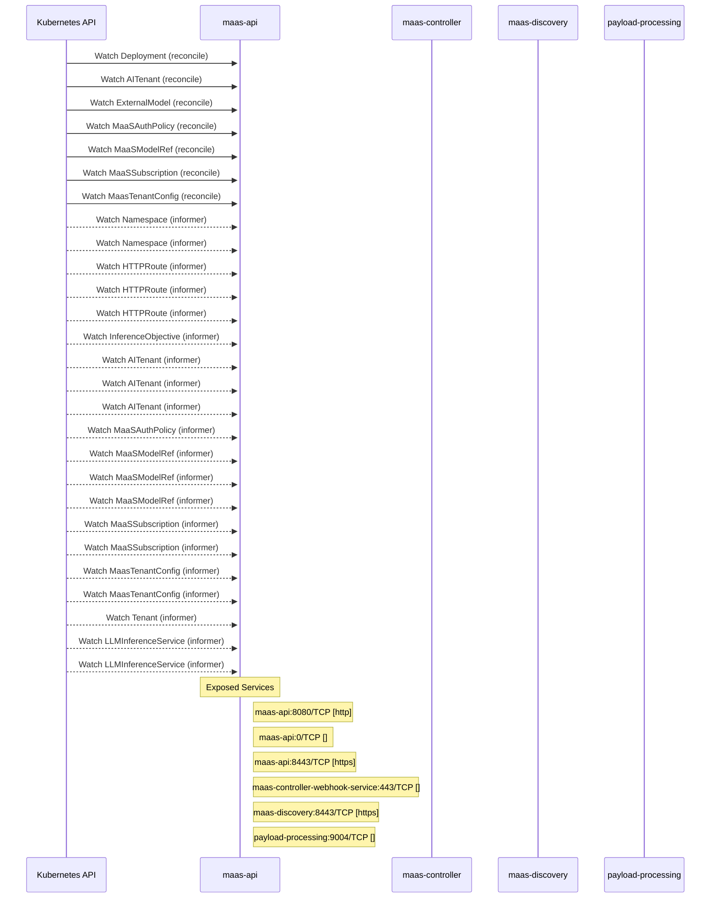

# models-as-a-service: Dataflow

## Controller Watches

Kubernetes resources this controller monitors for changes. Each watch triggers reconciliation when the watched resource is created, updated, or deleted.

| Type | GVK | Source |
|------|-----|--------|
| For | apps/v1/Deployment | [`maas-controller/pkg/controller/maas/self_deployment_controller.go:1181`](https://github.com/opendatahub-io/models-as-a-service/blob/2b8a663c76825306f3c12445ce5a21eebea3b001/maas-controller/pkg/controller/maas/self_deployment_controller.go#L1181) |
| For | maas/v1alpha1/AITenant | [`maas-controller/pkg/controller/maas/aitenant_controller.go:319`](https://github.com/opendatahub-io/models-as-a-service/blob/2b8a663c76825306f3c12445ce5a21eebea3b001/maas-controller/pkg/controller/maas/aitenant_controller.go#L319) |
| For | maas/v1alpha1/ExternalModel | [`maas-controller/pkg/reconciler/externalmodel/reconciler.go:529`](https://github.com/opendatahub-io/models-as-a-service/blob/2b8a663c76825306f3c12445ce5a21eebea3b001/maas-controller/pkg/reconciler/externalmodel/reconciler.go#L529) |
| For | maas/v1alpha1/MaaSAuthPolicy | [`maas-controller/pkg/controller/maas/maasauthpolicy_controller.go:2400`](https://github.com/opendatahub-io/models-as-a-service/blob/2b8a663c76825306f3c12445ce5a21eebea3b001/maas-controller/pkg/controller/maas/maasauthpolicy_controller.go#L2400) |
| For | maas/v1alpha1/MaaSModelRef | [`maas-controller/pkg/controller/maas/maasmodelref_controller.go:717`](https://github.com/opendatahub-io/models-as-a-service/blob/2b8a663c76825306f3c12445ce5a21eebea3b001/maas-controller/pkg/controller/maas/maasmodelref_controller.go#L717) |
| For | maas/v1alpha1/MaaSSubscription | [`maas-controller/pkg/controller/maas/maassubscription_controller.go:1469`](https://github.com/opendatahub-io/models-as-a-service/blob/2b8a663c76825306f3c12445ce5a21eebea3b001/maas-controller/pkg/controller/maas/maassubscription_controller.go#L1469) |
| For | maas/v1alpha1/MaasTenantConfig | [`maas-controller/pkg/controller/maas/tenant_controller.go:326`](https://github.com/opendatahub-io/models-as-a-service/blob/2b8a663c76825306f3c12445ce5a21eebea3b001/maas-controller/pkg/controller/maas/tenant_controller.go#L326) |
| Watches | /v1/Namespace | [`maas-controller/pkg/controller/maas/maasauthpolicy_controller.go:2474`](https://github.com/opendatahub-io/models-as-a-service/blob/2b8a663c76825306f3c12445ce5a21eebea3b001/maas-controller/pkg/controller/maas/maasauthpolicy_controller.go#L2474) |
| Watches | /v1/Namespace | [`maas-controller/pkg/controller/maas/maassubscription_controller.go:1548`](https://github.com/opendatahub-io/models-as-a-service/blob/2b8a663c76825306f3c12445ce5a21eebea3b001/maas-controller/pkg/controller/maas/maassubscription_controller.go#L1548) |
| Watches | apis/v1/HTTPRoute | [`maas-controller/pkg/controller/maas/maasauthpolicy_controller.go:2406`](https://github.com/opendatahub-io/models-as-a-service/blob/2b8a663c76825306f3c12445ce5a21eebea3b001/maas-controller/pkg/controller/maas/maasauthpolicy_controller.go#L2406) |
| Watches | apis/v1/HTTPRoute | [`maas-controller/pkg/controller/maas/maasmodelref_controller.go:723`](https://github.com/opendatahub-io/models-as-a-service/blob/2b8a663c76825306f3c12445ce5a21eebea3b001/maas-controller/pkg/controller/maas/maasmodelref_controller.go#L723) |
| Watches | apis/v1/HTTPRoute | [`maas-controller/pkg/controller/maas/maassubscription_controller.go:1482`](https://github.com/opendatahub-io/models-as-a-service/blob/2b8a663c76825306f3c12445ce5a21eebea3b001/maas-controller/pkg/controller/maas/maassubscription_controller.go#L1482) |
| Watches | apix/v1alpha2/InferenceObjective | [`maas-controller/pkg/controller/maas/maassubscription_controller.go:1520`](https://github.com/opendatahub-io/models-as-a-service/blob/2b8a663c76825306f3c12445ce5a21eebea3b001/maas-controller/pkg/controller/maas/maassubscription_controller.go#L1520) |
| Watches | maas/v1alpha1/AITenant | [`maas-controller/pkg/controller/maas/maasauthpolicy_controller.go:2420`](https://github.com/opendatahub-io/models-as-a-service/blob/2b8a663c76825306f3c12445ce5a21eebea3b001/maas-controller/pkg/controller/maas/maasauthpolicy_controller.go#L2420) |
| Watches | maas/v1alpha1/AITenant | [`maas-controller/pkg/controller/maas/maasmodelref_controller.go:791`](https://github.com/opendatahub-io/models-as-a-service/blob/2b8a663c76825306f3c12445ce5a21eebea3b001/maas-controller/pkg/controller/maas/maasmodelref_controller.go#L791) |
| Watches | maas/v1alpha1/AITenant | [`maas-controller/pkg/controller/maas/maassubscription_controller.go:1491`](https://github.com/opendatahub-io/models-as-a-service/blob/2b8a663c76825306f3c12445ce5a21eebea3b001/maas-controller/pkg/controller/maas/maassubscription_controller.go#L1491) |
| Watches | maas/v1alpha1/MaaSAuthPolicy | [`maas-controller/pkg/controller/maas/maasmodelref_controller.go:785`](https://github.com/opendatahub-io/models-as-a-service/blob/2b8a663c76825306f3c12445ce5a21eebea3b001/maas-controller/pkg/controller/maas/maasmodelref_controller.go#L785) |
| Watches | maas/v1alpha1/MaaSModelRef | [`maas-controller/pkg/controller/maas/maasmodelref_controller.go:734`](https://github.com/opendatahub-io/models-as-a-service/blob/2b8a663c76825306f3c12445ce5a21eebea3b001/maas-controller/pkg/controller/maas/maasmodelref_controller.go#L734) |
| Watches | maas/v1alpha1/MaaSModelRef | [`maas-controller/pkg/controller/maas/maassubscription_controller.go:1486`](https://github.com/opendatahub-io/models-as-a-service/blob/2b8a663c76825306f3c12445ce5a21eebea3b001/maas-controller/pkg/controller/maas/maassubscription_controller.go#L1486) |
| Watches | maas/v1alpha1/MaaSModelRef | [`maas-controller/pkg/controller/maas/maasauthpolicy_controller.go:2410`](https://github.com/opendatahub-io/models-as-a-service/blob/2b8a663c76825306f3c12445ce5a21eebea3b001/maas-controller/pkg/controller/maas/maasauthpolicy_controller.go#L2410) |
| Watches | maas/v1alpha1/MaaSSubscription | [`maas-controller/pkg/controller/maas/maasauthpolicy_controller.go:2433`](https://github.com/opendatahub-io/models-as-a-service/blob/2b8a663c76825306f3c12445ce5a21eebea3b001/maas-controller/pkg/controller/maas/maasauthpolicy_controller.go#L2433) |
| Watches | maas/v1alpha1/MaaSSubscription | [`maas-controller/pkg/controller/maas/maasmodelref_controller.go:781`](https://github.com/opendatahub-io/models-as-a-service/blob/2b8a663c76825306f3c12445ce5a21eebea3b001/maas-controller/pkg/controller/maas/maasmodelref_controller.go#L781) |
| Watches | maas/v1alpha1/MaasTenantConfig | [`maas-controller/pkg/controller/maas/maassubscription_controller.go:1496`](https://github.com/opendatahub-io/models-as-a-service/blob/2b8a663c76825306f3c12445ce5a21eebea3b001/maas-controller/pkg/controller/maas/maassubscription_controller.go#L1496) |
| Watches | maas/v1alpha1/MaasTenantConfig | [`maas-controller/pkg/controller/maas/maasauthpolicy_controller.go:2426`](https://github.com/opendatahub-io/models-as-a-service/blob/2b8a663c76825306f3c12445ce5a21eebea3b001/maas-controller/pkg/controller/maas/maasauthpolicy_controller.go#L2426) |
| Watches | maas/v1alpha1/Tenant | [`maas-controller/pkg/controller/maas/maassubscription_controller.go:1499`](https://github.com/opendatahub-io/models-as-a-service/blob/2b8a663c76825306f3c12445ce5a21eebea3b001/maas-controller/pkg/controller/maas/maassubscription_controller.go#L1499) |
| Watches | serving/v1alpha2/LLMInferenceService | [`maas-controller/pkg/controller/maas/maassubscription_controller.go:1508`](https://github.com/opendatahub-io/models-as-a-service/blob/2b8a663c76825306f3c12445ce5a21eebea3b001/maas-controller/pkg/controller/maas/maassubscription_controller.go#L1508) |
| Watches | serving/v1alpha2/LLMInferenceService | [`maas-controller/pkg/controller/maas/maasmodelref_controller.go:760`](https://github.com/opendatahub-io/models-as-a-service/blob/2b8a663c76825306f3c12445ce5a21eebea3b001/maas-controller/pkg/controller/maas/maasmodelref_controller.go#L760) |

## Reconciliation Flow

How the controller interacts with the Kubernetes API during reconciliation.

### Webhooks

| Name | Type | Path | Failure Policy | Service | Overlays | Enable Condition | Sources |
|------|------|------|----------------|---------|----------|------------------|----------|
| vaitenant.kb.io | validating | /validate-maas-opendatahub-io-v1alpha1-aitenant | Fail | system/maas-controller-webhook-service |  |  | [`deployment/base/maas-controller/webhook/validating_webhook_configuration.yaml`](https://github.com/opendatahub-io/models-as-a-service/blob/2b8a663c76825306f3c12445ce5a21eebea3b001/deployment/base/maas-controller/webhook/validating_webhook_configuration.yaml) |
| vexternalmodel.kb.io | validating | /validate-maas-opendatahub-io-v1alpha1-externalmodel | Fail | system/maas-controller-webhook-service |  |  | [`deployment/base/maas-controller/webhook/validating_webhook_configuration.yaml`](https://github.com/opendatahub-io/models-as-a-service/blob/2b8a663c76825306f3c12445ce5a21eebea3b001/deployment/base/maas-controller/webhook/validating_webhook_configuration.yaml) |
| vmaasauthpolicy.kb.io | validating | /validate-maas-opendatahub-io-v1alpha1-maasauthpolicy | Fail | system/maas-controller-webhook-service |  |  | [`deployment/base/maas-controller/webhook/validating_webhook_configuration.yaml`](https://github.com/opendatahub-io/models-as-a-service/blob/2b8a663c76825306f3c12445ce5a21eebea3b001/deployment/base/maas-controller/webhook/validating_webhook_configuration.yaml) |
| vmaasmodelref.kb.io | validating | /validate-maas-opendatahub-io-v1alpha1-maasmodelref | Fail | system/maas-controller-webhook-service |  |  | [`deployment/base/maas-controller/webhook/validating_webhook_configuration.yaml`](https://github.com/opendatahub-io/models-as-a-service/blob/2b8a663c76825306f3c12445ce5a21eebea3b001/deployment/base/maas-controller/webhook/validating_webhook_configuration.yaml) |
| vmaassubscription.kb.io | validating | /validate-maas-opendatahub-io-v1alpha1-maassubscription | Fail | system/maas-controller-webhook-service |  |  | [`deployment/base/maas-controller/webhook/validating_webhook_configuration.yaml`](https://github.com/opendatahub-io/models-as-a-service/blob/2b8a663c76825306f3c12445ce5a21eebea3b001/deployment/base/maas-controller/webhook/validating_webhook_configuration.yaml) |

### HTTP Endpoints

| Method | Path | Source |
|--------|------|--------|
| OPTIONS | /*path | [`maas-api/cmd/main.go:171`](https://github.com/opendatahub-io/models-as-a-service/blob/2b8a663c76825306f3c12445ce5a21eebea3b001/maas-api/cmd/main.go#L171) |
| DELETE | /:id | [`maas-api/cmd/main.go:370`](https://github.com/opendatahub-io/models-as-a-service/blob/2b8a663c76825306f3c12445ce5a21eebea3b001/maas-api/cmd/main.go#L370) |
| GET | /:id | [`maas-api/cmd/main.go:369`](https://github.com/opendatahub-io/models-as-a-service/blob/2b8a663c76825306f3c12445ce5a21eebea3b001/maas-api/cmd/main.go#L369) |
| * | /api-keys | [`maas-api/cmd/main.go:365`](https://github.com/opendatahub-io/models-as-a-service/blob/2b8a663c76825306f3c12445ce5a21eebea3b001/maas-api/cmd/main.go#L365) |
| POST | /api-keys/cleanup | [`maas-api/cmd/main.go:388`](https://github.com/opendatahub-io/models-as-a-service/blob/2b8a663c76825306f3c12445ce5a21eebea3b001/maas-api/cmd/main.go#L388) |
| POST | /api-keys/search | [`maas-api/cmd/main.go:373`](https://github.com/opendatahub-io/models-as-a-service/blob/2b8a663c76825306f3c12445ce5a21eebea3b001/maas-api/cmd/main.go#L373) |
| POST | /api-keys/validate | [`maas-api/cmd/main.go:386`](https://github.com/opendatahub-io/models-as-a-service/blob/2b8a663c76825306f3c12445ce5a21eebea3b001/maas-api/cmd/main.go#L386) |
| POST | /bulk-revoke | [`maas-api/cmd/main.go:368`](https://github.com/opendatahub-io/models-as-a-service/blob/2b8a663c76825306f3c12445ce5a21eebea3b001/maas-api/cmd/main.go#L368) |
| GET | /config | [`maas-api/cmd/main.go:366`](https://github.com/opendatahub-io/models-as-a-service/blob/2b8a663c76825306f3c12445ce5a21eebea3b001/maas-api/cmd/main.go#L366) |
| GET | /health | [`maas-api/cmd/main.go:265`](https://github.com/opendatahub-io/models-as-a-service/blob/2b8a663c76825306f3c12445ce5a21eebea3b001/maas-api/cmd/main.go#L265) |
| GET | /health/database | [`maas-api/cmd/main.go:268`](https://github.com/opendatahub-io/models-as-a-service/blob/2b8a663c76825306f3c12445ce5a21eebea3b001/maas-api/cmd/main.go#L268) |
| GET | /healthz | [`maas-discovery/internal/handler/handler.go:84`](https://github.com/opendatahub-io/models-as-a-service/blob/2b8a663c76825306f3c12445ce5a21eebea3b001/maas-discovery/internal/handler/handler.go#L84) |
| * | /internal/v1 | [`maas-api/cmd/main.go:385`](https://github.com/opendatahub-io/models-as-a-service/blob/2b8a663c76825306f3c12445ce5a21eebea3b001/maas-api/cmd/main.go#L385) |
| GET | /logs/loki/api/v1/label/:name/values | [`maas-api/internal/lokiproxy/handler.go:99`](https://github.com/opendatahub-io/models-as-a-service/blob/2b8a663c76825306f3c12445ce5a21eebea3b001/maas-api/internal/lokiproxy/handler.go#L99) |
| GET | /logs/loki/api/v1/labels | [`maas-api/internal/lokiproxy/handler.go:98`](https://github.com/opendatahub-io/models-as-a-service/blob/2b8a663c76825306f3c12445ce5a21eebea3b001/maas-api/internal/lokiproxy/handler.go#L98) |
| GET | /logs/loki/api/v1/query_range | [`maas-api/internal/lokiproxy/handler.go:97`](https://github.com/opendatahub-io/models-as-a-service/blob/2b8a663c76825306f3c12445ce5a21eebea3b001/maas-api/internal/lokiproxy/handler.go#L97) |
| GET | /me | [`maas-api/cmd/main.go:349`](https://github.com/opendatahub-io/models-as-a-service/blob/2b8a663c76825306f3c12445ce5a21eebea3b001/maas-api/cmd/main.go#L349) |
| * | /metrics | [`maas-api/internal/metrics/server.go:87`](https://github.com/opendatahub-io/models-as-a-service/blob/2b8a663c76825306f3c12445ce5a21eebea3b001/maas-api/internal/metrics/server.go#L87) |
| GET | /model/:model-id/subscriptions | [`maas-api/cmd/main.go:354`](https://github.com/opendatahub-io/models-as-a-service/blob/2b8a663c76825306f3c12445ce5a21eebea3b001/maas-api/cmd/main.go#L354) |
| GET | /models | [`maas-api/cmd/main.go:335`](https://github.com/opendatahub-io/models-as-a-service/blob/2b8a663c76825306f3c12445ce5a21eebea3b001/maas-api/cmd/main.go#L335) |
| GET | /readyz | [`maas-discovery/internal/handler/handler.go:85`](https://github.com/opendatahub-io/models-as-a-service/blob/2b8a663c76825306f3c12445ce5a21eebea3b001/maas-discovery/internal/handler/handler.go#L85) |
| GET | /subscriptions | [`maas-api/cmd/main.go:353`](https://github.com/opendatahub-io/models-as-a-service/blob/2b8a663c76825306f3c12445ce5a21eebea3b001/maas-api/cmd/main.go#L353) |
| POST | /subscriptions/select | [`maas-api/cmd/main.go:391`](https://github.com/opendatahub-io/models-as-a-service/blob/2b8a663c76825306f3c12445ce5a21eebea3b001/maas-api/cmd/main.go#L391) |
| GET | /tenants | [`maas-api/cmd/main.go:377`](https://github.com/opendatahub-io/models-as-a-service/blob/2b8a663c76825306f3c12445ce5a21eebea3b001/maas-api/cmd/main.go#L377) |
| DELETE | /tenants/:tenant/api-keys | [`maas-api/cmd/main.go:389`](https://github.com/opendatahub-io/models-as-a-service/blob/2b8a663c76825306f3c12445ce5a21eebea3b001/maas-api/cmd/main.go#L389) |
| DELETE | /tenants/:tenant/subscriptions/:subscription/api-keys | [`maas-api/cmd/main.go:390`](https://github.com/opendatahub-io/models-as-a-service/blob/2b8a663c76825306f3c12445ce5a21eebea3b001/maas-api/cmd/main.go#L390) |
| * | /v1 | [`maas-api/cmd/main.go:277`](https://github.com/opendatahub-io/models-as-a-service/blob/2b8a663c76825306f3c12445ce5a21eebea3b001/maas-api/cmd/main.go#L277) |
| GET | /v1/tenants | [`maas-discovery/internal/handler/handler.go:83`](https://github.com/opendatahub-io/models-as-a-service/blob/2b8a663c76825306f3c12445ce5a21eebea3b001/maas-discovery/internal/handler/handler.go#L83) |

## Configuration

ConfigMaps and Helm values that control this component's runtime behavior.

