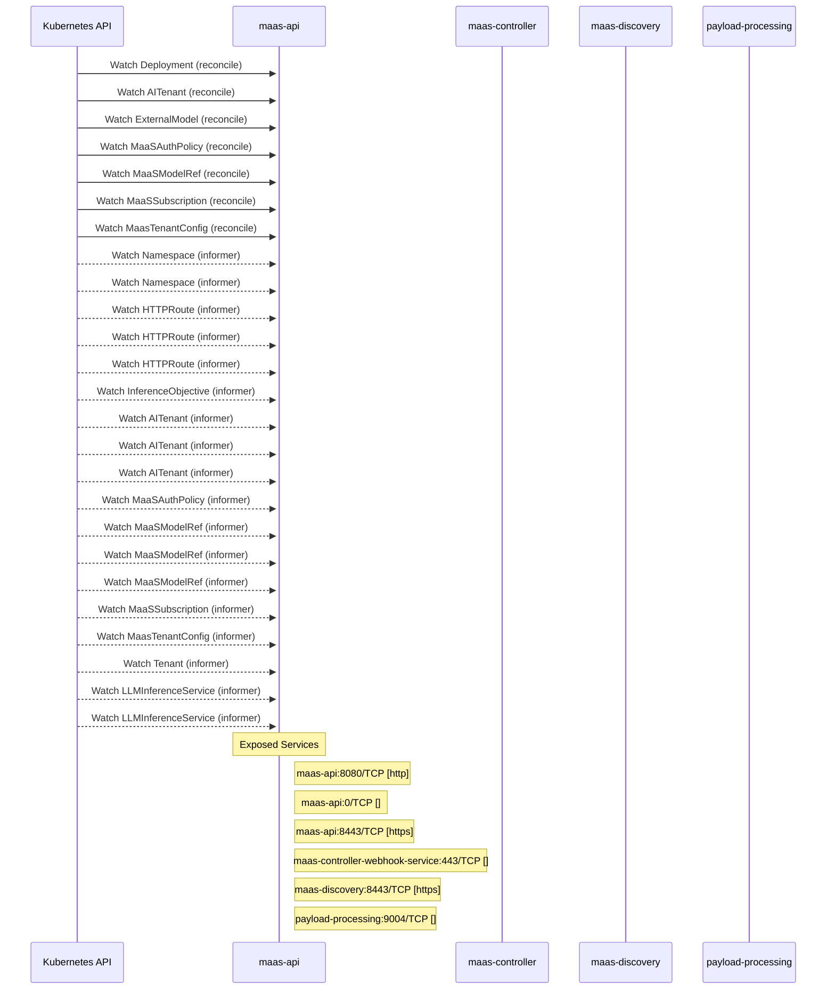

# models-as-a-service: Dataflow

## Controller Watches

Kubernetes resources this controller monitors for changes. Each watch triggers reconciliation when the watched resource is created, updated, or deleted.

| Type | GVK | Source |
|------|-----|--------|
| For | apps/v1/Deployment | [`maas-controller/pkg/controller/maas/self_deployment_controller.go:1068`](https://github.com/opendatahub-io/models-as-a-service/blob/d2c4fc133d5c3dd8cd95138982a5de9951db0af0/maas-controller/pkg/controller/maas/self_deployment_controller.go#L1068) |
| For | maas/v1alpha1/AITenant | [`maas-controller/pkg/controller/maas/aitenant_controller.go:290`](https://github.com/opendatahub-io/models-as-a-service/blob/d2c4fc133d5c3dd8cd95138982a5de9951db0af0/maas-controller/pkg/controller/maas/aitenant_controller.go#L290) |
| For | maas/v1alpha1/ExternalModel | [`maas-controller/pkg/reconciler/externalmodel/reconciler.go:439`](https://github.com/opendatahub-io/models-as-a-service/blob/d2c4fc133d5c3dd8cd95138982a5de9951db0af0/maas-controller/pkg/reconciler/externalmodel/reconciler.go#L439) |
| For | maas/v1alpha1/MaaSAuthPolicy | [`maas-controller/pkg/controller/maas/maasauthpolicy_controller.go:2126`](https://github.com/opendatahub-io/models-as-a-service/blob/d2c4fc133d5c3dd8cd95138982a5de9951db0af0/maas-controller/pkg/controller/maas/maasauthpolicy_controller.go#L2126) |
| For | maas/v1alpha1/MaaSModelRef | [`maas-controller/pkg/controller/maas/maasmodelref_controller.go:671`](https://github.com/opendatahub-io/models-as-a-service/blob/d2c4fc133d5c3dd8cd95138982a5de9951db0af0/maas-controller/pkg/controller/maas/maasmodelref_controller.go#L671) |
| For | maas/v1alpha1/MaaSSubscription | [`maas-controller/pkg/controller/maas/maassubscription_controller.go:1338`](https://github.com/opendatahub-io/models-as-a-service/blob/d2c4fc133d5c3dd8cd95138982a5de9951db0af0/maas-controller/pkg/controller/maas/maassubscription_controller.go#L1338) |
| For | maas/v1alpha1/MaasTenantConfig | [`maas-controller/pkg/controller/maas/tenant_controller.go:313`](https://github.com/opendatahub-io/models-as-a-service/blob/d2c4fc133d5c3dd8cd95138982a5de9951db0af0/maas-controller/pkg/controller/maas/tenant_controller.go#L313) |
| Watches | /v1/Namespace | [`maas-controller/pkg/controller/maas/maasauthpolicy_controller.go:2170`](https://github.com/opendatahub-io/models-as-a-service/blob/d2c4fc133d5c3dd8cd95138982a5de9951db0af0/maas-controller/pkg/controller/maas/maasauthpolicy_controller.go#L2170) |
| Watches | /v1/Namespace | [`maas-controller/pkg/controller/maas/maassubscription_controller.go:1417`](https://github.com/opendatahub-io/models-as-a-service/blob/d2c4fc133d5c3dd8cd95138982a5de9951db0af0/maas-controller/pkg/controller/maas/maassubscription_controller.go#L1417) |
| Watches | apis/v1/HTTPRoute | [`maas-controller/pkg/controller/maas/maasmodelref_controller.go:677`](https://github.com/opendatahub-io/models-as-a-service/blob/d2c4fc133d5c3dd8cd95138982a5de9951db0af0/maas-controller/pkg/controller/maas/maasmodelref_controller.go#L677) |
| Watches | apis/v1/HTTPRoute | [`maas-controller/pkg/controller/maas/maassubscription_controller.go:1351`](https://github.com/opendatahub-io/models-as-a-service/blob/d2c4fc133d5c3dd8cd95138982a5de9951db0af0/maas-controller/pkg/controller/maas/maassubscription_controller.go#L1351) |
| Watches | apis/v1/HTTPRoute | [`maas-controller/pkg/controller/maas/maasauthpolicy_controller.go:2132`](https://github.com/opendatahub-io/models-as-a-service/blob/d2c4fc133d5c3dd8cd95138982a5de9951db0af0/maas-controller/pkg/controller/maas/maasauthpolicy_controller.go#L2132) |
| Watches | apix/v1alpha2/InferenceObjective | [`maas-controller/pkg/controller/maas/maassubscription_controller.go:1389`](https://github.com/opendatahub-io/models-as-a-service/blob/d2c4fc133d5c3dd8cd95138982a5de9951db0af0/maas-controller/pkg/controller/maas/maassubscription_controller.go#L1389) |
| Watches | maas/v1alpha1/AITenant | [`maas-controller/pkg/controller/maas/maasmodelref_controller.go:744`](https://github.com/opendatahub-io/models-as-a-service/blob/d2c4fc133d5c3dd8cd95138982a5de9951db0af0/maas-controller/pkg/controller/maas/maasmodelref_controller.go#L744) |
| Watches | maas/v1alpha1/AITenant | [`maas-controller/pkg/controller/maas/maassubscription_controller.go:1360`](https://github.com/opendatahub-io/models-as-a-service/blob/d2c4fc133d5c3dd8cd95138982a5de9951db0af0/maas-controller/pkg/controller/maas/maassubscription_controller.go#L1360) |
| Watches | maas/v1alpha1/AITenant | [`maas-controller/pkg/controller/maas/maasauthpolicy_controller.go:2146`](https://github.com/opendatahub-io/models-as-a-service/blob/d2c4fc133d5c3dd8cd95138982a5de9951db0af0/maas-controller/pkg/controller/maas/maasauthpolicy_controller.go#L2146) |
| Watches | maas/v1alpha1/MaaSAuthPolicy | [`maas-controller/pkg/controller/maas/maasmodelref_controller.go:738`](https://github.com/opendatahub-io/models-as-a-service/blob/d2c4fc133d5c3dd8cd95138982a5de9951db0af0/maas-controller/pkg/controller/maas/maasmodelref_controller.go#L738) |
| Watches | maas/v1alpha1/MaaSModelRef | [`maas-controller/pkg/controller/maas/maassubscription_controller.go:1355`](https://github.com/opendatahub-io/models-as-a-service/blob/d2c4fc133d5c3dd8cd95138982a5de9951db0af0/maas-controller/pkg/controller/maas/maassubscription_controller.go#L1355) |
| Watches | maas/v1alpha1/MaaSModelRef | [`maas-controller/pkg/controller/maas/maasmodelref_controller.go:687`](https://github.com/opendatahub-io/models-as-a-service/blob/d2c4fc133d5c3dd8cd95138982a5de9951db0af0/maas-controller/pkg/controller/maas/maasmodelref_controller.go#L687) |
| Watches | maas/v1alpha1/MaaSModelRef | [`maas-controller/pkg/controller/maas/maasauthpolicy_controller.go:2136`](https://github.com/opendatahub-io/models-as-a-service/blob/d2c4fc133d5c3dd8cd95138982a5de9951db0af0/maas-controller/pkg/controller/maas/maasauthpolicy_controller.go#L2136) |
| Watches | maas/v1alpha1/MaaSSubscription | [`maas-controller/pkg/controller/maas/maasmodelref_controller.go:734`](https://github.com/opendatahub-io/models-as-a-service/blob/d2c4fc133d5c3dd8cd95138982a5de9951db0af0/maas-controller/pkg/controller/maas/maasmodelref_controller.go#L734) |
| Watches | maas/v1alpha1/MaasTenantConfig | [`maas-controller/pkg/controller/maas/maassubscription_controller.go:1365`](https://github.com/opendatahub-io/models-as-a-service/blob/d2c4fc133d5c3dd8cd95138982a5de9951db0af0/maas-controller/pkg/controller/maas/maassubscription_controller.go#L1365) |
| Watches | maas/v1alpha1/Tenant | [`maas-controller/pkg/controller/maas/maassubscription_controller.go:1368`](https://github.com/opendatahub-io/models-as-a-service/blob/d2c4fc133d5c3dd8cd95138982a5de9951db0af0/maas-controller/pkg/controller/maas/maassubscription_controller.go#L1368) |
| Watches | serving/v1alpha2/LLMInferenceService | [`maas-controller/pkg/controller/maas/maassubscription_controller.go:1377`](https://github.com/opendatahub-io/models-as-a-service/blob/d2c4fc133d5c3dd8cd95138982a5de9951db0af0/maas-controller/pkg/controller/maas/maassubscription_controller.go#L1377) |
| Watches | serving/v1alpha2/LLMInferenceService | [`maas-controller/pkg/controller/maas/maasmodelref_controller.go:713`](https://github.com/opendatahub-io/models-as-a-service/blob/d2c4fc133d5c3dd8cd95138982a5de9951db0af0/maas-controller/pkg/controller/maas/maasmodelref_controller.go#L713) |

## Reconciliation Flow

How the controller interacts with the Kubernetes API during reconciliation.

### Webhooks

| Name | Type | Path | Failure Policy | Service | Overlays | Enable Condition | Sources |
|------|------|------|----------------|---------|----------|------------------|----------|
| vaitenant.kb.io | validating | /validate-maas-opendatahub-io-v1alpha1-aitenant | Fail | system/maas-controller-webhook-service |  |  | [`deployment/base/maas-controller/webhook/validating_webhook_configuration.yaml`](https://github.com/opendatahub-io/models-as-a-service/blob/d2c4fc133d5c3dd8cd95138982a5de9951db0af0/deployment/base/maas-controller/webhook/validating_webhook_configuration.yaml) |
| vmaasauthpolicy.kb.io | validating | /validate-maas-opendatahub-io-v1alpha1-maasauthpolicy | Fail | system/maas-controller-webhook-service |  |  | [`deployment/base/maas-controller/webhook/validating_webhook_configuration.yaml`](https://github.com/opendatahub-io/models-as-a-service/blob/d2c4fc133d5c3dd8cd95138982a5de9951db0af0/deployment/base/maas-controller/webhook/validating_webhook_configuration.yaml) |
| vmaasmodelref.kb.io | validating | /validate-maas-opendatahub-io-v1alpha1-maasmodelref | Fail | system/maas-controller-webhook-service |  |  | [`deployment/base/maas-controller/webhook/validating_webhook_configuration.yaml`](https://github.com/opendatahub-io/models-as-a-service/blob/d2c4fc133d5c3dd8cd95138982a5de9951db0af0/deployment/base/maas-controller/webhook/validating_webhook_configuration.yaml) |
| vmaassubscription.kb.io | validating | /validate-maas-opendatahub-io-v1alpha1-maassubscription | Fail | system/maas-controller-webhook-service |  |  | [`deployment/base/maas-controller/webhook/validating_webhook_configuration.yaml`](https://github.com/opendatahub-io/models-as-a-service/blob/d2c4fc133d5c3dd8cd95138982a5de9951db0af0/deployment/base/maas-controller/webhook/validating_webhook_configuration.yaml) |

### HTTP Endpoints

| Method | Path | Source |
|--------|------|--------|
| OPTIONS | /*path | [`maas-api/cmd/main.go:171`](https://github.com/opendatahub-io/models-as-a-service/blob/d2c4fc133d5c3dd8cd95138982a5de9951db0af0/maas-api/cmd/main.go#L171) |
| DELETE | /:id | [`maas-api/cmd/main.go:336`](https://github.com/opendatahub-io/models-as-a-service/blob/d2c4fc133d5c3dd8cd95138982a5de9951db0af0/maas-api/cmd/main.go#L336) |
| GET | /:id | [`maas-api/cmd/main.go:335`](https://github.com/opendatahub-io/models-as-a-service/blob/d2c4fc133d5c3dd8cd95138982a5de9951db0af0/maas-api/cmd/main.go#L335) |
| * | /api-keys | [`maas-api/cmd/main.go:331`](https://github.com/opendatahub-io/models-as-a-service/blob/d2c4fc133d5c3dd8cd95138982a5de9951db0af0/maas-api/cmd/main.go#L331) |
| POST | /api-keys/cleanup | [`maas-api/cmd/main.go:354`](https://github.com/opendatahub-io/models-as-a-service/blob/d2c4fc133d5c3dd8cd95138982a5de9951db0af0/maas-api/cmd/main.go#L354) |
| POST | /api-keys/search | [`maas-api/cmd/main.go:339`](https://github.com/opendatahub-io/models-as-a-service/blob/d2c4fc133d5c3dd8cd95138982a5de9951db0af0/maas-api/cmd/main.go#L339) |
| POST | /api-keys/validate | [`maas-api/cmd/main.go:352`](https://github.com/opendatahub-io/models-as-a-service/blob/d2c4fc133d5c3dd8cd95138982a5de9951db0af0/maas-api/cmd/main.go#L352) |
| POST | /bulk-revoke | [`maas-api/cmd/main.go:334`](https://github.com/opendatahub-io/models-as-a-service/blob/d2c4fc133d5c3dd8cd95138982a5de9951db0af0/maas-api/cmd/main.go#L334) |
| GET | /config | [`maas-api/cmd/main.go:332`](https://github.com/opendatahub-io/models-as-a-service/blob/d2c4fc133d5c3dd8cd95138982a5de9951db0af0/maas-api/cmd/main.go#L332) |
| GET | /health | [`maas-api/cmd/main.go:250`](https://github.com/opendatahub-io/models-as-a-service/blob/d2c4fc133d5c3dd8cd95138982a5de9951db0af0/maas-api/cmd/main.go#L250) |
| GET | /healthz | [`maas-discovery/internal/handler/handler.go:84`](https://github.com/opendatahub-io/models-as-a-service/blob/d2c4fc133d5c3dd8cd95138982a5de9951db0af0/maas-discovery/internal/handler/handler.go#L84) |
| * | /internal/v1 | [`maas-api/cmd/main.go:351`](https://github.com/opendatahub-io/models-as-a-service/blob/d2c4fc133d5c3dd8cd95138982a5de9951db0af0/maas-api/cmd/main.go#L351) |
| GET | /me | [`maas-api/cmd/main.go:306`](https://github.com/opendatahub-io/models-as-a-service/blob/d2c4fc133d5c3dd8cd95138982a5de9951db0af0/maas-api/cmd/main.go#L306) |
| * | /metrics | [`maas-api/internal/metrics/server.go:86`](https://github.com/opendatahub-io/models-as-a-service/blob/d2c4fc133d5c3dd8cd95138982a5de9951db0af0/maas-api/internal/metrics/server.go#L86) |
| GET | /model/:model-id/subscriptions | [`maas-api/cmd/main.go:320`](https://github.com/opendatahub-io/models-as-a-service/blob/d2c4fc133d5c3dd8cd95138982a5de9951db0af0/maas-api/cmd/main.go#L320) |
| GET | /models | [`maas-api/cmd/main.go:302`](https://github.com/opendatahub-io/models-as-a-service/blob/d2c4fc133d5c3dd8cd95138982a5de9951db0af0/maas-api/cmd/main.go#L302) |
| GET | /readyz | [`maas-discovery/internal/handler/handler.go:85`](https://github.com/opendatahub-io/models-as-a-service/blob/d2c4fc133d5c3dd8cd95138982a5de9951db0af0/maas-discovery/internal/handler/handler.go#L85) |
| GET | /subscriptions | [`maas-api/cmd/main.go:319`](https://github.com/opendatahub-io/models-as-a-service/blob/d2c4fc133d5c3dd8cd95138982a5de9951db0af0/maas-api/cmd/main.go#L319) |
| POST | /subscriptions/select | [`maas-api/cmd/main.go:357`](https://github.com/opendatahub-io/models-as-a-service/blob/d2c4fc133d5c3dd8cd95138982a5de9951db0af0/maas-api/cmd/main.go#L357) |
| GET | /tenants | [`maas-api/cmd/main.go:343`](https://github.com/opendatahub-io/models-as-a-service/blob/d2c4fc133d5c3dd8cd95138982a5de9951db0af0/maas-api/cmd/main.go#L343) |
| DELETE | /tenants/:tenant/api-keys | [`maas-api/cmd/main.go:355`](https://github.com/opendatahub-io/models-as-a-service/blob/d2c4fc133d5c3dd8cd95138982a5de9951db0af0/maas-api/cmd/main.go#L355) |
| DELETE | /tenants/:tenant/subscriptions/:subscription/api-keys | [`maas-api/cmd/main.go:356`](https://github.com/opendatahub-io/models-as-a-service/blob/d2c4fc133d5c3dd8cd95138982a5de9951db0af0/maas-api/cmd/main.go#L356) |
| * | /v1 | [`maas-api/cmd/main.go:258`](https://github.com/opendatahub-io/models-as-a-service/blob/d2c4fc133d5c3dd8cd95138982a5de9951db0af0/maas-api/cmd/main.go#L258) |
| GET | /v1/tenants | [`maas-discovery/internal/handler/handler.go:83`](https://github.com/opendatahub-io/models-as-a-service/blob/d2c4fc133d5c3dd8cd95138982a5de9951db0af0/maas-discovery/internal/handler/handler.go#L83) |

## Configuration

ConfigMaps and Helm values that control this component's runtime behavior.

