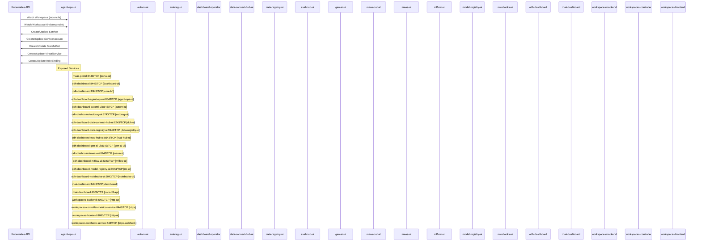

# odh-dashboard: Dataflow

## Controller Watches

Kubernetes resources this controller monitors for changes. Each watch triggers reconciliation when the watched resource is created, updated, or deleted.

| Type | GVK | Source |
|------|-----|--------|
| For | api/v1beta1/Workspace | [`packages/notebooks/upstream/workspaces/controller/internal/controller/workspace_controller.go:944`](https://github.com/opendatahub-io/odh-dashboard/blob/1f01aace49c9e56b81cbe1cd4807de36a0120474/packages/notebooks/upstream/workspaces/controller/internal/controller/workspace_controller.go#L944) |
| For | api/v1beta1/WorkspaceKind | [`packages/notebooks/upstream/workspaces/controller/internal/controller/workspacekind_controller.go:285`](https://github.com/opendatahub-io/odh-dashboard/blob/1f01aace49c9e56b81cbe1cd4807de36a0120474/packages/notebooks/upstream/workspaces/controller/internal/controller/workspacekind_controller.go#L285) |
| Owns | /v1/Service | [`packages/notebooks/upstream/workspaces/controller/internal/controller/workspace_controller.go:946`](https://github.com/opendatahub-io/odh-dashboard/blob/1f01aace49c9e56b81cbe1cd4807de36a0120474/packages/notebooks/upstream/workspaces/controller/internal/controller/workspace_controller.go#L946) |
| Owns | /v1/ServiceAccount | [`packages/notebooks/upstream/workspaces/controller/internal/controller/workspace_controller.go:947`](https://github.com/opendatahub-io/odh-dashboard/blob/1f01aace49c9e56b81cbe1cd4807de36a0120474/packages/notebooks/upstream/workspaces/controller/internal/controller/workspace_controller.go#L947) |
| Owns | apps/v1/StatefulSet | [`packages/notebooks/upstream/workspaces/controller/internal/controller/workspace_controller.go:945`](https://github.com/opendatahub-io/odh-dashboard/blob/1f01aace49c9e56b81cbe1cd4807de36a0120474/packages/notebooks/upstream/workspaces/controller/internal/controller/workspace_controller.go#L945) |
| Owns | networking/v1/VirtualService | [`packages/notebooks/upstream/workspaces/controller/internal/controller/workspace_controller.go:951`](https://github.com/opendatahub-io/odh-dashboard/blob/1f01aace49c9e56b81cbe1cd4807de36a0120474/packages/notebooks/upstream/workspaces/controller/internal/controller/workspace_controller.go#L951) |
| Owns | rbac.authorization.k8s.io/v1/RoleBinding | [`packages/notebooks/upstream/workspaces/controller/internal/controller/workspace_controller.go:948`](https://github.com/opendatahub-io/odh-dashboard/blob/1f01aace49c9e56b81cbe1cd4807de36a0120474/packages/notebooks/upstream/workspaces/controller/internal/controller/workspace_controller.go#L948) |

## Reconciliation Flow

How the controller interacts with the Kubernetes API during reconciliation.

### HTTP Endpoints

| Method | Path | Source |
|--------|------|--------|
| * | / | [`distributions/core-bff/bff/internal/api/routes.go:105`](https://github.com/opendatahub-io/odh-dashboard/blob/1f01aace49c9e56b81cbe1cd4807de36a0120474/distributions/core-bff/bff/internal/api/routes.go#L105) |
| * | / | [`packages/notebooks/upstream/workspaces/backend/api/app.go:152`](https://github.com/opendatahub-io/odh-dashboard/blob/1f01aace49c9e56b81cbe1cd4807de36a0120474/packages/notebooks/upstream/workspaces/backend/api/app.go#L152) |
| GET | /api/v1alpha1/data/connection-types | [`packages/data-connect-hub/bff/internal/api/connection_types_handler.go:114`](https://github.com/opendatahub-io/odh-dashboard/blob/1f01aace49c9e56b81cbe1cd4807de36a0120474/packages/data-connect-hub/bff/internal/api/connection_types_handler.go#L114) |
| GET | /api/v1alpha1/data/connection-types/ | [`packages/data-connect-hub/bff/internal/api/connection_types_handler.go:188`](https://github.com/opendatahub-io/odh-dashboard/blob/1f01aace49c9e56b81cbe1cd4807de36a0120474/packages/data-connect-hub/bff/internal/api/connection_types_handler.go#L188) |
| GET | /api/v1alpha1/data/connections | [`packages/data-connect-hub/bff/internal/api/connections_handler.go:87`](https://github.com/opendatahub-io/odh-dashboard/blob/1f01aace49c9e56b81cbe1cd4807de36a0120474/packages/data-connect-hub/bff/internal/api/connections_handler.go#L87) |
| POST | /api/v1alpha1/data/connections | [`packages/data-connect-hub/bff/internal/api/connection_create_handler.go:91`](https://github.com/opendatahub-io/odh-dashboard/blob/1f01aace49c9e56b81cbe1cd4807de36a0120474/packages/data-connect-hub/bff/internal/api/connection_create_handler.go#L91) |
| DELETE | /api/v1alpha1/data/connections/ | [`packages/data-connect-hub/bff/internal/api/connection_delete_handler.go:56`](https://github.com/opendatahub-io/odh-dashboard/blob/1f01aace49c9e56b81cbe1cd4807de36a0120474/packages/data-connect-hub/bff/internal/api/connection_delete_handler.go#L56) |
| GET | /api/v1alpha1/data/connections/ | [`packages/data-connect-hub/bff/internal/api/connections_handler.go:166`](https://github.com/opendatahub-io/odh-dashboard/blob/1f01aace49c9e56b81cbe1cd4807de36a0120474/packages/data-connect-hub/bff/internal/api/connections_handler.go#L166) |
| POST | /api/v1alpha1/data/connections/ | [`packages/data-connect-hub/bff/internal/api/connection_readiness_handler.go:61`](https://github.com/opendatahub-io/odh-dashboard/blob/1f01aace49c9e56b81cbe1cd4807de36a0120474/packages/data-connect-hub/bff/internal/api/connection_readiness_handler.go#L61) |
| POST | /api/v1alpha1/data/test/credentials | [`packages/data-connect-hub/bff/internal/api/test_credentials_handler.go:80`](https://github.com/opendatahub-io/odh-dashboard/blob/1f01aace49c9e56b81cbe1cd4807de36a0120474/packages/data-connect-hub/bff/internal/api/test_credentials_handler.go#L80) |
| GET | /healthcheck | [`packages/notebooks/upstream/workspaces/backend/openapi/swagger.json`](https://github.com/opendatahub-io/odh-dashboard/blob/1f01aace49c9e56b81cbe1cd4807de36a0120474/packages/notebooks/upstream/workspaces/backend/openapi/swagger.json) |
| GET | /healthcheck | [`packages/model-registry/upstream/bff/openapi/swagger.json`](https://github.com/opendatahub-io/odh-dashboard/blob/1f01aace49c9e56b81cbe1cd4807de36a0120474/packages/model-registry/upstream/bff/openapi/swagger.json) |
| GET | /healthcheck | [`packages/model-registry/upstream/bff/openapi/swagger.yaml`](https://github.com/opendatahub-io/odh-dashboard/blob/1f01aace49c9e56b81cbe1cd4807de36a0120474/packages/model-registry/upstream/bff/openapi/swagger.yaml) |
| GET | /namespaces | [`packages/notebooks/upstream/workspaces/backend/openapi/swagger.json`](https://github.com/opendatahub-io/odh-dashboard/blob/1f01aace49c9e56b81cbe1cd4807de36a0120474/packages/notebooks/upstream/workspaces/backend/openapi/swagger.json) |
| GET | /persistentvolumeclaims/{namespace} | [`packages/notebooks/upstream/workspaces/backend/openapi/swagger.json`](https://github.com/opendatahub-io/odh-dashboard/blob/1f01aace49c9e56b81cbe1cd4807de36a0120474/packages/notebooks/upstream/workspaces/backend/openapi/swagger.json) |
| POST | /persistentvolumeclaims/{namespace} | [`packages/notebooks/upstream/workspaces/backend/openapi/swagger.json`](https://github.com/opendatahub-io/odh-dashboard/blob/1f01aace49c9e56b81cbe1cd4807de36a0120474/packages/notebooks/upstream/workspaces/backend/openapi/swagger.json) |
| DELETE | /persistentvolumeclaims/{namespace}/{name} | [`packages/notebooks/upstream/workspaces/backend/openapi/swagger.json`](https://github.com/opendatahub-io/odh-dashboard/blob/1f01aace49c9e56b81cbe1cd4807de36a0120474/packages/notebooks/upstream/workspaces/backend/openapi/swagger.json) |
| GET | /secrets/{namespace} | [`packages/notebooks/upstream/workspaces/backend/openapi/swagger.json`](https://github.com/opendatahub-io/odh-dashboard/blob/1f01aace49c9e56b81cbe1cd4807de36a0120474/packages/notebooks/upstream/workspaces/backend/openapi/swagger.json) |
| POST | /secrets/{namespace} | [`packages/notebooks/upstream/workspaces/backend/openapi/swagger.json`](https://github.com/opendatahub-io/odh-dashboard/blob/1f01aace49c9e56b81cbe1cd4807de36a0120474/packages/notebooks/upstream/workspaces/backend/openapi/swagger.json) |
| DELETE | /secrets/{namespace}/{name} | [`packages/notebooks/upstream/workspaces/backend/openapi/swagger.json`](https://github.com/opendatahub-io/odh-dashboard/blob/1f01aace49c9e56b81cbe1cd4807de36a0120474/packages/notebooks/upstream/workspaces/backend/openapi/swagger.json) |
| GET | /secrets/{namespace}/{name} | [`packages/notebooks/upstream/workspaces/backend/openapi/swagger.json`](https://github.com/opendatahub-io/odh-dashboard/blob/1f01aace49c9e56b81cbe1cd4807de36a0120474/packages/notebooks/upstream/workspaces/backend/openapi/swagger.json) |
| PUT | /secrets/{namespace}/{name} | [`packages/notebooks/upstream/workspaces/backend/openapi/swagger.json`](https://github.com/opendatahub-io/odh-dashboard/blob/1f01aace49c9e56b81cbe1cd4807de36a0120474/packages/notebooks/upstream/workspaces/backend/openapi/swagger.json) |
| GET | /storageclasses | [`packages/notebooks/upstream/workspaces/backend/openapi/swagger.json`](https://github.com/opendatahub-io/odh-dashboard/blob/1f01aace49c9e56b81cbe1cd4807de36a0120474/packages/notebooks/upstream/workspaces/backend/openapi/swagger.json) |
| GET | /user | [`packages/notebooks/upstream/workspaces/backend/openapi/swagger.json`](https://github.com/opendatahub-io/odh-dashboard/blob/1f01aace49c9e56b81cbe1cd4807de36a0120474/packages/notebooks/upstream/workspaces/backend/openapi/swagger.json) |
| GET | /workspacekinds | [`packages/notebooks/upstream/workspaces/backend/openapi/swagger.json`](https://github.com/opendatahub-io/odh-dashboard/blob/1f01aace49c9e56b81cbe1cd4807de36a0120474/packages/notebooks/upstream/workspaces/backend/openapi/swagger.json) |
| POST | /workspacekinds | [`packages/notebooks/upstream/workspaces/backend/openapi/swagger.json`](https://github.com/opendatahub-io/odh-dashboard/blob/1f01aace49c9e56b81cbe1cd4807de36a0120474/packages/notebooks/upstream/workspaces/backend/openapi/swagger.json) |
| DELETE | /workspacekinds/{name} | [`packages/notebooks/upstream/workspaces/backend/openapi/swagger.json`](https://github.com/opendatahub-io/odh-dashboard/blob/1f01aace49c9e56b81cbe1cd4807de36a0120474/packages/notebooks/upstream/workspaces/backend/openapi/swagger.json) |
| GET | /workspacekinds/{name} | [`packages/notebooks/upstream/workspaces/backend/openapi/swagger.json`](https://github.com/opendatahub-io/odh-dashboard/blob/1f01aace49c9e56b81cbe1cd4807de36a0120474/packages/notebooks/upstream/workspaces/backend/openapi/swagger.json) |
| PUT | /workspacekinds/{name} | [`packages/notebooks/upstream/workspaces/backend/openapi/swagger.json`](https://github.com/opendatahub-io/odh-dashboard/blob/1f01aace49c9e56b81cbe1cd4807de36a0120474/packages/notebooks/upstream/workspaces/backend/openapi/swagger.json) |
| GET | /workspacekinds/{name}/assets/icon | [`packages/notebooks/upstream/workspaces/backend/openapi/swagger.json`](https://github.com/opendatahub-io/odh-dashboard/blob/1f01aace49c9e56b81cbe1cd4807de36a0120474/packages/notebooks/upstream/workspaces/backend/openapi/swagger.json) |
| GET | /workspacekinds/{name}/assets/logo | [`packages/notebooks/upstream/workspaces/backend/openapi/swagger.json`](https://github.com/opendatahub-io/odh-dashboard/blob/1f01aace49c9e56b81cbe1cd4807de36a0120474/packages/notebooks/upstream/workspaces/backend/openapi/swagger.json) |
| POST | /workspacekinds/{name}/podtemplate/options/listvalues | [`packages/notebooks/upstream/workspaces/backend/openapi/swagger.json`](https://github.com/opendatahub-io/odh-dashboard/blob/1f01aace49c9e56b81cbe1cd4807de36a0120474/packages/notebooks/upstream/workspaces/backend/openapi/swagger.json) |
| GET | /workspaces | [`packages/notebooks/upstream/workspaces/backend/openapi/swagger.json`](https://github.com/opendatahub-io/odh-dashboard/blob/1f01aace49c9e56b81cbe1cd4807de36a0120474/packages/notebooks/upstream/workspaces/backend/openapi/swagger.json) |
| GET | /workspaces/{namespace} | [`packages/notebooks/upstream/workspaces/backend/openapi/swagger.json`](https://github.com/opendatahub-io/odh-dashboard/blob/1f01aace49c9e56b81cbe1cd4807de36a0120474/packages/notebooks/upstream/workspaces/backend/openapi/swagger.json) |
| POST | /workspaces/{namespace} | [`packages/notebooks/upstream/workspaces/backend/openapi/swagger.json`](https://github.com/opendatahub-io/odh-dashboard/blob/1f01aace49c9e56b81cbe1cd4807de36a0120474/packages/notebooks/upstream/workspaces/backend/openapi/swagger.json) |
| DELETE | /workspaces/{namespace}/{name} | [`packages/notebooks/upstream/workspaces/backend/openapi/swagger.json`](https://github.com/opendatahub-io/odh-dashboard/blob/1f01aace49c9e56b81cbe1cd4807de36a0120474/packages/notebooks/upstream/workspaces/backend/openapi/swagger.json) |
| GET | /workspaces/{namespace}/{name} | [`packages/notebooks/upstream/workspaces/backend/openapi/swagger.json`](https://github.com/opendatahub-io/odh-dashboard/blob/1f01aace49c9e56b81cbe1cd4807de36a0120474/packages/notebooks/upstream/workspaces/backend/openapi/swagger.json) |
| PUT | /workspaces/{namespace}/{name} | [`packages/notebooks/upstream/workspaces/backend/openapi/swagger.json`](https://github.com/opendatahub-io/odh-dashboard/blob/1f01aace49c9e56b81cbe1cd4807de36a0120474/packages/notebooks/upstream/workspaces/backend/openapi/swagger.json) |
| POST | /workspaces/{namespace}/{name}/actions/pause | [`packages/notebooks/upstream/workspaces/backend/openapi/swagger.json`](https://github.com/opendatahub-io/odh-dashboard/blob/1f01aace49c9e56b81cbe1cd4807de36a0120474/packages/notebooks/upstream/workspaces/backend/openapi/swagger.json) |
| GET | /workspaces/{namespace}/{name}/podtemplate/details | [`packages/notebooks/upstream/workspaces/backend/openapi/swagger.json`](https://github.com/opendatahub-io/odh-dashboard/blob/1f01aace49c9e56b81cbe1cd4807de36a0120474/packages/notebooks/upstream/workspaces/backend/openapi/swagger.json) |
| GET | /workspaces/{namespace}/{name}/podtemplate/logs/batch | [`packages/notebooks/upstream/workspaces/backend/openapi/swagger.json`](https://github.com/opendatahub-io/odh-dashboard/blob/1f01aace49c9e56b81cbe1cd4807de36a0120474/packages/notebooks/upstream/workspaces/backend/openapi/swagger.json) |
| GET | /workspaces/{namespace}/{name}/podtemplate/resources | [`packages/notebooks/upstream/workspaces/backend/openapi/swagger.json`](https://github.com/opendatahub-io/odh-dashboard/blob/1f01aace49c9e56b81cbe1cd4807de36a0120474/packages/notebooks/upstream/workspaces/backend/openapi/swagger.json) |
| * | GET  | [`distributions/core-bff/bff/internal/api/routes_model_serving.go:63`](https://github.com/opendatahub-io/odh-dashboard/blob/1f01aace49c9e56b81cbe1cd4807de36a0120474/distributions/core-bff/bff/internal/api/routes_model_serving.go#L63) |
| * | GET  | [`distributions/core-bff/bff/internal/api/routes_model_serving.go:62`](https://github.com/opendatahub-io/odh-dashboard/blob/1f01aace49c9e56b81cbe1cd4807de36a0120474/distributions/core-bff/bff/internal/api/routes_model_serving.go#L62) |
| * | GET  | [`distributions/core-bff/bff/internal/api/routes_model_serving.go:64`](https://github.com/opendatahub-io/odh-dashboard/blob/1f01aace49c9e56b81cbe1cd4807de36a0120474/distributions/core-bff/bff/internal/api/routes_model_serving.go#L64) |
| * | GET  | [`distributions/core-bff/bff/internal/api/routes_model_serving.go:65`](https://github.com/opendatahub-io/odh-dashboard/blob/1f01aace49c9e56b81cbe1cd4807de36a0120474/distributions/core-bff/bff/internal/api/routes_model_serving.go#L65) |

## Configuration

ConfigMaps and Helm values that control this component's runtime behavior.

### ConfigMaps

| Name | Data Keys | Source |
|------|-----------|--------|
| autorag-router-ca-bundle |  | [`manifests/modules/autorag/router-ca-configmap.yaml`](https://github.com/opendatahub-io/odh-dashboard/blob/1f01aace49c9e56b81cbe1cd4807de36a0120474/manifests/modules/autorag/router-ca-configmap.yaml) |
| data-registry-config | apiURL | [`manifests/modules/data-registry/configmap.yaml`](https://github.com/opendatahub-io/odh-dashboard/blob/1f01aace49c9e56b81cbe1cd4807de36a0120474/manifests/modules/data-registry/configmap.yaml) |
| model-registry-ui-config | images-jobs-async-upload, images-oci-base-image | [`manifests/base/model-registry/configmap.yaml`](https://github.com/opendatahub-io/odh-dashboard/blob/1f01aace49c9e56b81cbe1cd4807de36a0120474/manifests/base/model-registry/configmap.yaml) |

### Helm

**Chart:** dashboard v0.1.0

