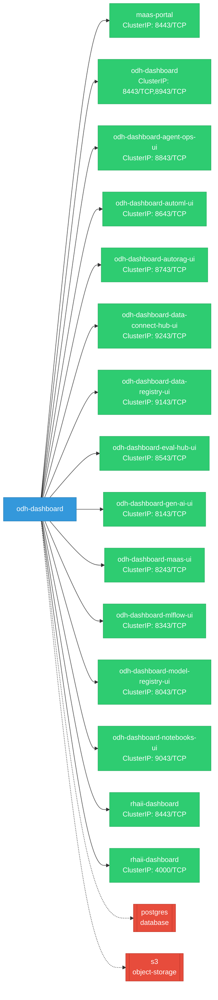

# odh-dashboard: Network

[Overview](index.md) · [Agent Context](agent-context.md) · [Extracted Data](details.md) · [Network](network.md) · [RBAC](rbac.md) · [Security](security.md) · [Cache](cache.md) · [Dataflow](dataflow.md)

## Service Map

### Services

| Name | Type | Ports | Source |
|------|------|-------|--------|
| maas-portal | ClusterIP | 8443/TCP | [`manifests/distributions/maas-portal/service.yaml`](https://github.com/opendatahub-io/odh-dashboard/blob/20d5e2d7f824bcf886cef357ae98e9884af1772d/manifests/distributions/maas-portal/service.yaml) |
| odh-dashboard | ClusterIP | 8443/TCP, 8943/TCP | [`manifests/base/service.yaml`](https://github.com/opendatahub-io/odh-dashboard/blob/20d5e2d7f824bcf886cef357ae98e9884af1772d/manifests/base/service.yaml) |
| odh-dashboard-agent-ops-ui | ClusterIP | 8843/TCP | [`manifests/modules/agent-ops/service.yaml`](https://github.com/opendatahub-io/odh-dashboard/blob/20d5e2d7f824bcf886cef357ae98e9884af1772d/manifests/modules/agent-ops/service.yaml) |
| odh-dashboard-automl-ui | ClusterIP | 8643/TCP | [`manifests/modules/automl/service.yaml`](https://github.com/opendatahub-io/odh-dashboard/blob/20d5e2d7f824bcf886cef357ae98e9884af1772d/manifests/modules/automl/service.yaml) |
| odh-dashboard-autorag-ui | ClusterIP | 8743/TCP | [`manifests/modules/autorag/service.yaml`](https://github.com/opendatahub-io/odh-dashboard/blob/20d5e2d7f824bcf886cef357ae98e9884af1772d/manifests/modules/autorag/service.yaml) |
| odh-dashboard-data-connect-hub-ui | ClusterIP | 9243/TCP | [`manifests/modules/data-connect-hub/service.yaml`](https://github.com/opendatahub-io/odh-dashboard/blob/20d5e2d7f824bcf886cef357ae98e9884af1772d/manifests/modules/data-connect-hub/service.yaml) |
| odh-dashboard-data-registry-ui | ClusterIP | 9143/TCP | [`manifests/modules/data-registry/service.yaml`](https://github.com/opendatahub-io/odh-dashboard/blob/20d5e2d7f824bcf886cef357ae98e9884af1772d/manifests/modules/data-registry/service.yaml) |
| odh-dashboard-eval-hub-ui | ClusterIP | 8543/TCP | [`manifests/modules/eval-hub/service.yaml`](https://github.com/opendatahub-io/odh-dashboard/blob/20d5e2d7f824bcf886cef357ae98e9884af1772d/manifests/modules/eval-hub/service.yaml) |
| odh-dashboard-gen-ai-ui | ClusterIP | 8143/TCP | [`manifests/modules/gen-ai/service.yaml`](https://github.com/opendatahub-io/odh-dashboard/blob/20d5e2d7f824bcf886cef357ae98e9884af1772d/manifests/modules/gen-ai/service.yaml) |
| odh-dashboard-maas-ui | ClusterIP | 8243/TCP | [`manifests/modules/maas/service.yaml`](https://github.com/opendatahub-io/odh-dashboard/blob/20d5e2d7f824bcf886cef357ae98e9884af1772d/manifests/modules/maas/service.yaml) |
| odh-dashboard-mlflow-ui | ClusterIP | 8343/TCP | [`manifests/modules/mlflow/service.yaml`](https://github.com/opendatahub-io/odh-dashboard/blob/20d5e2d7f824bcf886cef357ae98e9884af1772d/manifests/modules/mlflow/service.yaml) |
| odh-dashboard-model-registry-ui | ClusterIP | 8043/TCP | [`manifests/modules/model-registry/service.yaml`](https://github.com/opendatahub-io/odh-dashboard/blob/20d5e2d7f824bcf886cef357ae98e9884af1772d/manifests/modules/model-registry/service.yaml) |
| odh-dashboard-notebooks-ui | ClusterIP | 9043/TCP | [`manifests/modules/notebooks/service.yaml`](https://github.com/opendatahub-io/odh-dashboard/blob/20d5e2d7f824bcf886cef357ae98e9884af1772d/manifests/modules/notebooks/service.yaml) |
| rhaii-dashboard | ClusterIP | 8443/TCP | [`manifests/distributions/rhaii/service.yaml`](https://github.com/opendatahub-io/odh-dashboard/blob/20d5e2d7f824bcf886cef357ae98e9884af1772d/manifests/distributions/rhaii/service.yaml) |
| rhaii-dashboard | ClusterIP | 4000/TCP | [`distributions/core-bff/manifests/base/service.yaml`](https://github.com/opendatahub-io/odh-dashboard/blob/20d5e2d7f824bcf886cef357ae98e9884af1772d/distributions/core-bff/manifests/base/service.yaml) |

### Ingress / Routing

| Kind | Name | Hosts | Paths | TLS | Source |
|------|------|-------|-------|-----|--------|
| HTTPRoute | maas-portal |  | /maas-portal, /maas-portal | no | [`manifests/distributions/maas-portal/httproute.yaml`](https://github.com/opendatahub-io/odh-dashboard/blob/20d5e2d7f824bcf886cef357ae98e9884af1772d/manifests/distributions/maas-portal/httproute.yaml) |
| HTTPRoute | odh-dashboard |  | / | no | [`manifests/base/httproute.yaml`](https://github.com/opendatahub-io/odh-dashboard/blob/20d5e2d7f824bcf886cef357ae98e9884af1772d/manifests/base/httproute.yaml) |
| HTTPRoute | rhaii-dashboard |  | / | no | [`manifests/distributions/rhaii/httproute.yaml`](https://github.com/opendatahub-io/odh-dashboard/blob/20d5e2d7f824bcf886cef357ae98e9884af1772d/manifests/distributions/rhaii/httproute.yaml) |
| Route | rbac-inferred |  |  | no | [`rbac/odh-dashboard`](https://github.com/opendatahub-io/odh-dashboard/blob/20d5e2d7f824bcf886cef357ae98e9884af1772d/rbac/odh-dashboard) |

### Network Policies

| Name | Policy Types | Source |
|------|-------------|--------|
| agent-ops-allow-ports | Ingress, Egress | [`manifests/modules/agent-ops/networkpolicy.yaml`](https://github.com/opendatahub-io/odh-dashboard/blob/20d5e2d7f824bcf886cef357ae98e9884af1772d/manifests/modules/agent-ops/networkpolicy.yaml) |
| automl-allow-ports | Ingress, Egress | [`manifests/modules/automl/networkpolicy.yaml`](https://github.com/opendatahub-io/odh-dashboard/blob/20d5e2d7f824bcf886cef357ae98e9884af1772d/manifests/modules/automl/networkpolicy.yaml) |
| autorag-allow-ports | Ingress, Egress | [`manifests/modules/autorag/networkpolicy.yaml`](https://github.com/opendatahub-io/odh-dashboard/blob/20d5e2d7f824bcf886cef357ae98e9884af1772d/manifests/modules/autorag/networkpolicy.yaml) |
| dashboard-allow-ports | Ingress, Egress | [`manifests/base/networkpolicy.yaml`](https://github.com/opendatahub-io/odh-dashboard/blob/20d5e2d7f824bcf886cef357ae98e9884af1772d/manifests/base/networkpolicy.yaml) |
| dashboard-perses-access | Ingress | [`manifests/observability/rhoai/network-policy.yaml`](https://github.com/opendatahub-io/odh-dashboard/blob/20d5e2d7f824bcf886cef357ae98e9884af1772d/manifests/observability/rhoai/network-policy.yaml) |
| dashboard-perses-access | Ingress | [`manifests/observability/odh/network-policy.yaml`](https://github.com/opendatahub-io/odh-dashboard/blob/20d5e2d7f824bcf886cef357ae98e9884af1772d/manifests/observability/odh/network-policy.yaml) |
| dashboard-perses-egress | Egress | [`manifests/rhoai/perses-egress-network-policy.yaml`](https://github.com/opendatahub-io/odh-dashboard/blob/20d5e2d7f824bcf886cef357ae98e9884af1772d/manifests/rhoai/perses-egress-network-policy.yaml) |
| data-connect-hub-allow-ports | Ingress, Egress | [`manifests/modules/data-connect-hub/networkpolicy.yaml`](https://github.com/opendatahub-io/odh-dashboard/blob/20d5e2d7f824bcf886cef357ae98e9884af1772d/manifests/modules/data-connect-hub/networkpolicy.yaml) |
| data-registry-allow-ports | Ingress, Egress | [`manifests/modules/data-registry/networkpolicy.yaml`](https://github.com/opendatahub-io/odh-dashboard/blob/20d5e2d7f824bcf886cef357ae98e9884af1772d/manifests/modules/data-registry/networkpolicy.yaml) |
| eval-hub-allow-ports | Ingress, Egress | [`manifests/modules/eval-hub/networkpolicy.yaml`](https://github.com/opendatahub-io/odh-dashboard/blob/20d5e2d7f824bcf886cef357ae98e9884af1772d/manifests/modules/eval-hub/networkpolicy.yaml) |
| gen-ai-allow-ports | Ingress, Egress | [`manifests/modules/gen-ai/networkpolicy.yaml`](https://github.com/opendatahub-io/odh-dashboard/blob/20d5e2d7f824bcf886cef357ae98e9884af1772d/manifests/modules/gen-ai/networkpolicy.yaml) |
| maas-allow-ports | Ingress, Egress | [`manifests/modules/maas/networkpolicy.yaml`](https://github.com/opendatahub-io/odh-dashboard/blob/20d5e2d7f824bcf886cef357ae98e9884af1772d/manifests/modules/maas/networkpolicy.yaml) |
| maas-portal | Ingress, Egress | [`manifests/distributions/maas-portal/networkpolicy.yaml`](https://github.com/opendatahub-io/odh-dashboard/blob/20d5e2d7f824bcf886cef357ae98e9884af1772d/manifests/distributions/maas-portal/networkpolicy.yaml) |
| maas-portal-perses | Egress | [`manifests/distributions/maas-portal/perses-networkpolicy.yaml`](https://github.com/opendatahub-io/odh-dashboard/blob/20d5e2d7f824bcf886cef357ae98e9884af1772d/manifests/distributions/maas-portal/perses-networkpolicy.yaml) |
| mlflow-allow-ports | Ingress, Egress | [`manifests/modules/mlflow/networkpolicy.yaml`](https://github.com/opendatahub-io/odh-dashboard/blob/20d5e2d7f824bcf886cef357ae98e9884af1772d/manifests/modules/mlflow/networkpolicy.yaml) |
| model-registry-allow-ports | Ingress, Egress | [`manifests/modules/model-registry/networkpolicy.yaml`](https://github.com/opendatahub-io/odh-dashboard/blob/20d5e2d7f824bcf886cef357ae98e9884af1772d/manifests/modules/model-registry/networkpolicy.yaml) |
| notebooks-allow-ports | Ingress, Egress | [`manifests/modules/notebooks/networkpolicy.yaml`](https://github.com/opendatahub-io/odh-dashboard/blob/20d5e2d7f824bcf886cef357ae98e9884af1772d/manifests/modules/notebooks/networkpolicy.yaml) |
| rhaii-dashboard | Ingress, Egress | [`manifests/distributions/rhaii/networkpolicy.yaml`](https://github.com/opendatahub-io/odh-dashboard/blob/20d5e2d7f824bcf886cef357ae98e9884af1772d/manifests/distributions/rhaii/networkpolicy.yaml) |

## Network Policy Graph

Visual representation of NetworkPolicy rules. Ingress rules show what traffic is allowed into pods, egress rules show what traffic is allowed out.

```mermaid
graph LR
    classDef policy fill:#e74c3c,stroke:#c0392b,color:#fff
    classDef pod fill:#3498db,stroke:#2980b9,color:#fff
    classDef external fill:#95a5a6,stroke:#7f8c8d,color:#fff

    odh_dashboard["odh-dashboard\nPods"]:::pod
    np_0_agent_ops_allow_ports{{"agent-ops-allow-ports\nIngress, Egress"}}:::policy
    src_0_0_0["all pods"]:::external
    src_0_0_0 -->|ingress| np_0_agent_ops_allow_ports
    src_0_0_1["ns: network.openshift.io/policy-group=ingress"]:::external
    src_0_0_1 -->|ingress| np_0_agent_ops_allow_ports
    np_0_agent_ops_allow_ports --> odh_dashboard
    dst_0_0_0["ns: kubernetes.io/metadata.name=openshift-dns"]:::external
    odh_dashboard -->|egress| dst_0_0_0
    dst_0_1_0["CIDR: 0.0.0.0/0"]:::external
    odh_dashboard -->|egress| dst_0_1_0
    dst_0_2_0["CIDR: 0.0.0.0/0"]:::external
    odh_dashboard -->|egress| dst_0_2_0
    np_1_automl_allow_ports{{"automl-allow-ports\nIngress, Egress"}}:::policy
    src_1_0_0["all pods"]:::external
    src_1_0_0 -->|ingress| np_1_automl_allow_ports
    src_1_0_1["ns: network.openshift.io/policy-group=ingress"]:::external
    src_1_0_1 -->|ingress| np_1_automl_allow_ports
    np_1_automl_allow_ports --> odh_dashboard
    dst_1_0_0["ns: kubernetes.io/metadata.name=openshift-dns"]:::external
    odh_dashboard -->|egress| dst_1_0_0
    dst_1_1_0["CIDR: 0.0.0.0/0"]:::external
    odh_dashboard -->|egress| dst_1_1_0
    dst_1_2_0["all namespaces"]:::external
    odh_dashboard -->|egress| dst_1_2_0
    dst_1_3_0["CIDR: 0.0.0.0/0"]:::external
    odh_dashboard -->|egress| dst_1_3_0
    np_2_autorag_allow_ports{{"autorag-allow-ports\nIngress, Egress"}}:::policy
    src_2_0_0["all pods"]:::external
    src_2_0_0 -->|ingress| np_2_autorag_allow_ports
    src_2_0_1["ns: network.openshift.io/policy-group=ingress"]:::external
    src_2_0_1 -->|ingress| np_2_autorag_allow_ports
    np_2_autorag_allow_ports --> odh_dashboard
    dst_2_0_0["ns: kubernetes.io/metadata.name=openshift-dns"]:::external
    odh_dashboard -->|egress| dst_2_0_0
    dst_2_1_0["CIDR: 0.0.0.0/0"]:::external
    odh_dashboard -->|egress| dst_2_1_0
    dst_2_2_0["all namespaces"]:::external
    odh_dashboard -->|egress| dst_2_2_0
    dst_2_3_0["CIDR: 0.0.0.0/0"]:::external
    odh_dashboard -->|egress| dst_2_3_0
    np_3_dashboard_allow_ports{{"dashboard-allow-ports\nIngress, Egress"}}:::policy
    src_3_0_0["ns: network.openshift.io/policy-group=ingress"]:::external
    src_3_0_0 -->|ingress| np_3_dashboard_allow_ports
    src_3_1_0["all namespaces"]:::external
    src_3_1_0 -->|ingress| np_3_dashboard_allow_ports
    np_3_dashboard_allow_ports --> odh_dashboard
    dst_3_0_0["ns: kubernetes.io/metadata.name=openshift-dns"]:::external
    odh_dashboard -->|egress| dst_3_0_0
    dst_3_1_0["CIDR: 0.0.0.0/0"]:::external
    odh_dashboard -->|egress| dst_3_1_0
    dst_3_2_0["all namespaces"]:::external
    odh_dashboard -->|egress| dst_3_2_0
    dst_3_3_0["all namespaces"]:::external
    odh_dashboard -->|egress| dst_3_3_0
    dst_3_4_0["ns: opendatahub.io/feast=true"]:::external
    odh_dashboard -->|egress| dst_3_4_0
    dst_3_5_0["ns: kubernetes.io/metadata.name=openshift-monitoring"]:::external
    odh_dashboard -->|egress| dst_3_5_0
    dst_3_6_0["CIDR: 0.0.0.0/0"]:::external
    odh_dashboard -->|egress| dst_3_6_0
    np_4_dashboard_perses_access{{"dashboard-perses-access\nIngress"}}:::policy
    src_4_0_0["ns: kubernetes.io/metadata.name=redhat-ods-applications"]:::external
    src_4_0_0 -->|ingress| np_4_dashboard_perses_access
    src_4_0_1["ns: kubernetes.io/metadata.name=redhat-ods-applications"]:::external
    src_4_0_1 -->|ingress| np_4_dashboard_perses_access
    np_4_dashboard_perses_access --> odh_dashboard
    np_5_dashboard_perses_access{{"dashboard-perses-access\nIngress"}}:::policy
    src_5_0_0["ns: kubernetes.io/metadata.name=opendatahub"]:::external
    src_5_0_0 -->|ingress| np_5_dashboard_perses_access
    np_5_dashboard_perses_access --> odh_dashboard
    np_6_dashboard_perses_egress{{"dashboard-perses-egress\nEgress"}}:::policy
    np_6_dashboard_perses_egress --> odh_dashboard
    dst_6_0_0["ns: kubernetes.io/metadata.name=redhat-ods-monitoring"]:::external
    odh_dashboard -->|egress| dst_6_0_0
    np_7_data_connect_hub_allow_ports{{"data-connect-hub-allow-ports\nIngress, Egress"}}:::policy
    src_7_0_0["pods: deployment=data-registry-ui"]:::external
    src_7_0_0 -->|ingress| np_7_data_connect_hub_allow_ports
    src_7_1_0["ns: network.openshift.io/policy-group=ingress"]:::external
    src_7_1_0 -->|ingress| np_7_data_connect_hub_allow_ports
    src_7_1_1["all pods"]:::external
    src_7_1_1 -->|ingress| np_7_data_connect_hub_allow_ports
    np_7_data_connect_hub_allow_ports --> odh_dashboard
    dst_7_0_0["ns: kubernetes.io/metadata.name=openshift-dns"]:::external
    odh_dashboard -->|egress| dst_7_0_0
    dst_7_1_0["CIDR: 0.0.0.0/0"]:::external
    odh_dashboard -->|egress| dst_7_1_0
    dst_7_2_0["CIDR: 0.0.0.0/0"]:::external
    odh_dashboard -->|egress| dst_7_2_0
    np_8_data_registry_allow_ports{{"data-registry-allow-ports\nIngress, Egress"}}:::policy
    src_8_0_0["all pods"]:::external
    src_8_0_0 -->|ingress| np_8_data_registry_allow_ports
    src_8_0_1["ns: network.openshift.io/policy-group=ingress"]:::external
    src_8_0_1 -->|ingress| np_8_data_registry_allow_ports
    np_8_data_registry_allow_ports --> odh_dashboard
    dst_8_0_0["ns: kubernetes.io/metadata.name=rhoai-data-registry"]:::external
    odh_dashboard -->|egress| dst_8_0_0
    dst_8_1_0["pods: deployment=data-connect-hub-ui"]:::external
    odh_dashboard -->|egress| dst_8_1_0
    dst_8_2_0["ns: kubernetes.io/metadata.name=openshift-dns"]:::external
    odh_dashboard -->|egress| dst_8_2_0
    dst_8_3_0["CIDR: 0.0.0.0/0"]:::external
    odh_dashboard -->|egress| dst_8_3_0
    dst_8_4_0["CIDR: 0.0.0.0/0"]:::external
    odh_dashboard -->|egress| dst_8_4_0
    np_9_eval_hub_allow_ports{{"eval-hub-allow-ports\nIngress, Egress"}}:::policy
    src_9_0_0["all pods"]:::external
    src_9_0_0 -->|ingress| np_9_eval_hub_allow_ports
    src_9_0_1["ns: network.openshift.io/policy-group=ingress"]:::external
    src_9_0_1 -->|ingress| np_9_eval_hub_allow_ports
    np_9_eval_hub_allow_ports --> odh_dashboard
    dst_9_0_0["ns: kubernetes.io/metadata.name=openshift-dns"]:::external
    odh_dashboard -->|egress| dst_9_0_0
    dst_9_1_0["pods: deployment=model-registry-ui"]:::external
    odh_dashboard -->|egress| dst_9_1_0
    dst_9_2_0["all namespaces"]:::external
    odh_dashboard -->|egress| dst_9_2_0
    dst_9_3_0["CIDR: 0.0.0.0/0"]:::external
    odh_dashboard -->|egress| dst_9_3_0
    dst_9_4_0["CIDR: 0.0.0.0/0"]:::external
    odh_dashboard -->|egress| dst_9_4_0
    np_10_gen_ai_allow_ports{{"gen-ai-allow-ports\nIngress, Egress"}}:::policy
    src_10_0_0["all pods"]:::external
    src_10_0_0 -->|ingress| np_10_gen_ai_allow_ports
    src_10_0_1["ns: network.openshift.io/policy-group=ingress"]:::external
    src_10_0_1 -->|ingress| np_10_gen_ai_allow_ports
    src_10_0_2["pods: deployment=maas-portal"]:::external
    src_10_0_2 -->|ingress| np_10_gen_ai_allow_ports
    np_10_gen_ai_allow_ports --> odh_dashboard
    dst_10_0_0["ns: kubernetes.io/metadata.name=openshift-dns"]:::external
    odh_dashboard -->|egress| dst_10_0_0
    dst_10_1_0["all namespaces"]:::external
    odh_dashboard -->|egress| dst_10_1_0
    dst_10_2_0["CIDR: 0.0.0.0/0"]:::external
    odh_dashboard -->|egress| dst_10_2_0
    dst_10_3_0["CIDR: 0.0.0.0/0"]:::external
    odh_dashboard -->|egress| dst_10_3_0
    np_11_maas_allow_ports{{"maas-allow-ports\nIngress, Egress"}}:::policy
    src_11_0_0["all pods"]:::external
    src_11_0_0 -->|ingress| np_11_maas_allow_ports
    src_11_0_1["ns: network.openshift.io/policy-group=ingress"]:::external
    src_11_0_1 -->|ingress| np_11_maas_allow_ports
    src_11_0_2["pods: deployment=gen-ai-ui"]:::external
    src_11_0_2 -->|ingress| np_11_maas_allow_ports
    src_11_0_3["pods: deployment=autorag-ui"]:::external
    src_11_0_3 -->|ingress| np_11_maas_allow_ports
    src_11_0_4["pods: deployment=maas-portal"]:::external
    src_11_0_4 -->|ingress| np_11_maas_allow_ports
    np_11_maas_allow_ports --> odh_dashboard
    dst_11_0_0["ns: kubernetes.io/metadata.name=openshift-dns"]:::external
    odh_dashboard -->|egress| dst_11_0_0
    dst_11_1_0["CIDR: 0.0.0.0/0"]:::external
    odh_dashboard -->|egress| dst_11_1_0
    dst_11_2_0["all namespaces"]:::external
    odh_dashboard -->|egress| dst_11_2_0
    dst_11_3_0["CIDR: 0.0.0.0/0"]:::external
    odh_dashboard -->|egress| dst_11_3_0
    np_12_maas_portal{{"maas-portal\nIngress, Egress"}}:::policy
    src_12_0_0["ns: network.openshift.io/policy-group=ingress"]:::external
    src_12_0_0 -->|ingress| np_12_maas_portal
    np_12_maas_portal --> odh_dashboard
    dst_12_0_0["ns: kubernetes.io/metadata.name=openshift-dns"]:::external
    odh_dashboard -->|egress| dst_12_0_0
    dst_12_1_0["CIDR: 0.0.0.0/0"]:::external
    odh_dashboard -->|egress| dst_12_1_0
    dst_12_2_0["ns: kubernetes.io/metadata.name=dashboard-namespace"]:::external
    odh_dashboard -->|egress| dst_12_2_0
    dst_12_3_0["ns: kubernetes.io/metadata.name=dashboard-namespace"]:::external
    odh_dashboard -->|egress| dst_12_3_0
    np_13_maas_portal_perses{{"maas-portal-perses\nEgress"}}:::policy
    np_13_maas_portal_perses --> odh_dashboard
    dst_13_0_0["ns: kubernetes.io/metadata.name=perses-namespace"]:::external
    odh_dashboard -->|egress| dst_13_0_0
    np_14_mlflow_allow_ports{{"mlflow-allow-ports\nIngress, Egress"}}:::policy
    src_14_0_0["all pods"]:::external
    src_14_0_0 -->|ingress| np_14_mlflow_allow_ports
    src_14_0_1["ns: network.openshift.io/policy-group=ingress"]:::external
    src_14_0_1 -->|ingress| np_14_mlflow_allow_ports
    src_14_0_2["pods: deployment=gen-ai-ui"]:::external
    src_14_0_2 -->|ingress| np_14_mlflow_allow_ports
    src_14_0_3["pods: deployment=model-registry-ui"]:::external
    src_14_0_3 -->|ingress| np_14_mlflow_allow_ports
    np_14_mlflow_allow_ports --> odh_dashboard
    dst_14_0_0["ns: kubernetes.io/metadata.name=openshift-dns"]:::external
    odh_dashboard -->|egress| dst_14_0_0
    dst_14_1_0["CIDR: 0.0.0.0/0"]:::external
    odh_dashboard -->|egress| dst_14_1_0
    dst_14_2_0["pods: deployment=model-registry-ui"]:::external
    odh_dashboard -->|egress| dst_14_2_0
    dst_14_3_0["pods: app.kubernetes.io/instance=mlflow"]:::external
    odh_dashboard -->|egress| dst_14_3_0
    dst_14_4_0["CIDR: 0.0.0.0/0"]:::external
    odh_dashboard -->|egress| dst_14_4_0
    np_15_model_registry_allow_ports{{"model-registry-allow-ports\nIngress, Egress"}}:::policy
    src_15_0_0["all pods"]:::external
    src_15_0_0 -->|ingress| np_15_model_registry_allow_ports
    src_15_0_1["ns: network.openshift.io/policy-group=ingress"]:::external
    src_15_0_1 -->|ingress| np_15_model_registry_allow_ports
    src_15_0_2["pods: deployment=eval-hub-ui"]:::external
    src_15_0_2 -->|ingress| np_15_model_registry_allow_ports
    src_15_0_3["pods: deployment=mlflow-ui"]:::external
    src_15_0_3 -->|ingress| np_15_model_registry_allow_ports
    np_15_model_registry_allow_ports --> odh_dashboard
    dst_15_0_0["ns: kubernetes.io/metadata.name=openshift-dns"]:::external
    odh_dashboard -->|egress| dst_15_0_0
    dst_15_1_0["pods: deployment=mlflow-ui"]:::external
    odh_dashboard -->|egress| dst_15_1_0
    dst_15_2_0["CIDR: 0.0.0.0/0"]:::external
    odh_dashboard -->|egress| dst_15_2_0
    dst_15_3_0["CIDR: 0.0.0.0/0"]:::external
    odh_dashboard -->|egress| dst_15_3_0
    np_16_notebooks_allow_ports{{"notebooks-allow-ports\nIngress, Egress"}}:::policy
    src_16_0_0["all pods"]:::external
    src_16_0_0 -->|ingress| np_16_notebooks_allow_ports
    src_16_0_1["ns: network.openshift.io/policy-group=ingress"]:::external
    src_16_0_1 -->|ingress| np_16_notebooks_allow_ports
    np_16_notebooks_allow_ports --> odh_dashboard
    dst_16_0_0["ns: kubernetes.io/metadata.name=openshift-dns"]:::external
    odh_dashboard -->|egress| dst_16_0_0
    dst_16_1_0["CIDR: 0.0.0.0/0"]:::external
    odh_dashboard -->|egress| dst_16_1_0
    dst_16_2_0["CIDR: 0.0.0.0/0"]:::external
    odh_dashboard -->|egress| dst_16_2_0
    np_17_rhaii_dashboard{{"rhaii-dashboard\nIngress, Egress"}}:::policy
    src_17_0_0["ns: kubernetes.io/metadata.name=gateway-namespace"]:::external
    src_17_0_0 -->|ingress| np_17_rhaii_dashboard
    np_17_rhaii_dashboard --> odh_dashboard
    dst_17_0_0["ns: kubernetes.io/metadata.name=kube-system"]:::external
    odh_dashboard -->|egress| dst_17_0_0
    dst_17_1_0["CIDR: 0.0.0.0/0"]:::external
    odh_dashboard -->|egress| dst_17_1_0
```

