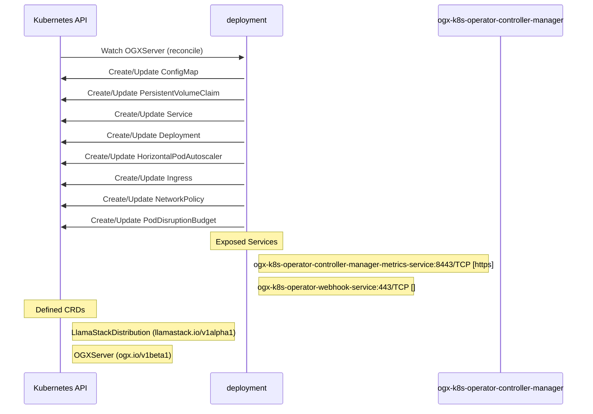

# ogx-k8s-operator: Dataflow

## Controller Watches

Kubernetes resources this controller monitors for changes. Each watch triggers reconciliation when the watched resource is created, updated, or deleted.

| Type | GVK | Source |
|------|-----|--------|
| For | api/v1beta1/OGXServer | [`controllers/ogxserver_controller.go:620`](https://github.com/opendatahub-io/ogx-k8s-operator/blob/e2e94610d6d884caae50b8615b3b67d3df9f6518/controllers/ogxserver_controller.go#L620) |
| Owns | /v1/ConfigMap | [`controllers/ogxserver_controller.go:627`](https://github.com/opendatahub-io/ogx-k8s-operator/blob/e2e94610d6d884caae50b8615b3b67d3df9f6518/controllers/ogxserver_controller.go#L627) |
| Owns | /v1/PersistentVolumeClaim | [`controllers/ogxserver_controller.go:635`](https://github.com/opendatahub-io/ogx-k8s-operator/blob/e2e94610d6d884caae50b8615b3b67d3df9f6518/controllers/ogxserver_controller.go#L635) |
| Owns | /v1/Service | [`controllers/ogxserver_controller.go:626`](https://github.com/opendatahub-io/ogx-k8s-operator/blob/e2e94610d6d884caae50b8615b3b67d3df9f6518/controllers/ogxserver_controller.go#L626) |
| Owns | apps/v1/Deployment | [`controllers/ogxserver_controller.go:623`](https://github.com/opendatahub-io/ogx-k8s-operator/blob/e2e94610d6d884caae50b8615b3b67d3df9f6518/controllers/ogxserver_controller.go#L623) |
| Owns | autoscaling/v2/HorizontalPodAutoscaler | [`controllers/ogxserver_controller.go:625`](https://github.com/opendatahub-io/ogx-k8s-operator/blob/e2e94610d6d884caae50b8615b3b67d3df9f6518/controllers/ogxserver_controller.go#L625) |
| Owns | networking.k8s.io/v1/Ingress | [`controllers/ogxserver_controller.go:634`](https://github.com/opendatahub-io/ogx-k8s-operator/blob/e2e94610d6d884caae50b8615b3b67d3df9f6518/controllers/ogxserver_controller.go#L634) |
| Owns | networking.k8s.io/v1/NetworkPolicy | [`controllers/ogxserver_controller.go:633`](https://github.com/opendatahub-io/ogx-k8s-operator/blob/e2e94610d6d884caae50b8615b3b67d3df9f6518/controllers/ogxserver_controller.go#L633) |
| Owns | policy/v1/PodDisruptionBudget | [`controllers/ogxserver_controller.go:624`](https://github.com/opendatahub-io/ogx-k8s-operator/blob/e2e94610d6d884caae50b8615b3b67d3df9f6518/controllers/ogxserver_controller.go#L624) |

### Programmatic Resource Operations

| Verb | Kind | Group | Condition |
|------|------|-------|----------|
| delete | ConfigMap |  |  |
| create | ConfigMap |  |  |
| patch | ConfigMap |  |  |

## Reconciliation Flow

How the controller interacts with the Kubernetes API during reconciliation.

### Webhooks

| Name | Type | Path | Failure Policy | Service | Overlays | Enable Condition | Sources |
|------|------|------|----------------|---------|----------|------------------|----------|
| vogxserver.kb.io | validating | /validate-ogx-io-v1beta1-ogxserver | Fail | ogx-k8s-operator-system/ogx-k8s-operator-webhook-service | config/overlays/cert-manager |  | [`config/webhook/manifests.yaml`](https://github.com/opendatahub-io/ogx-k8s-operator/blob/e2e94610d6d884caae50b8615b3b67d3df9f6518/config/webhook/manifests.yaml), [`kustomize:config/overlays/cert-manager (ogx-k8s-operator-validating-webhook-configuration)`](https://github.com/opendatahub-io/ogx-k8s-operator/blob/e2e94610d6d884caae50b8615b3b67d3df9f6518/kustomize:config/overlays/cert-manager %28ogx-k8s-operator-validating-webhook-configuration%29) |

## Configuration

ConfigMaps and Helm values that control this component's runtime behavior.

