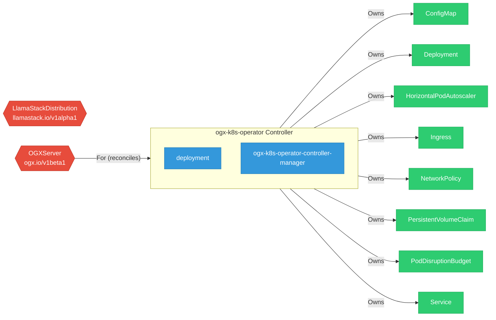

# ogx-k8s-operator

> **Architecture snapshot: 2026-10-24** (2026-10-24)

**Repository:** opendatahub-io/ogx-k8s-operator  
**Analyzer:** arch-analyzer dev  
**Extracted:** 2026-10-24T04:06:52Z

## Summary

| Metric | Count |
|--------|-------|
| CRDs | 2 |
| Deployments | 2 |
| Services | 2 |
| Secrets | 1 |
| Cluster Roles | 5 |
| Controller Watches | 10 |

## Component Architecture

CRDs, controllers, and owned Kubernetes resources.

### CRDs

| Group | Version | Kind | Scope | Fields | Validation Rules | Discovery | Source |
|-------|---------|------|-------|--------|------------------|-----------|--------|
| llamastack.io | v1alpha1 | LlamaStackDistribution | Namespaced | 371 | 1 | YAML | [`config/crd/bases/llamastack.io_llamastackdistributions.yaml`](https://github.com/opendatahub-io/ogx-k8s-operator/blob/e2e94610d6d884caae50b8615b3b67d3df9f6518/config/crd/bases/llamastack.io_llamastackdistributions.yaml) |
| ogx.io | v1beta1 | OGXServer | Namespaced | 892 | 118 | YAML | [`config/crd/bases/ogx.io_ogxservers.yaml`](https://github.com/opendatahub-io/ogx-k8s-operator/blob/e2e94610d6d884caae50b8615b3b67d3df9f6518/config/crd/bases/ogx.io_ogxservers.yaml) |

## Dependencies

### Key External Dependencies

| Module | Version |
|--------|---------|
| github.com/go-logr/logr | v1.4.3 |
| k8s.io/api | v0.34.3 |
| k8s.io/apiextensions-apiserver | v0.34.3 |
| k8s.io/apimachinery | v0.34.3 |
| k8s.io/client-go | v0.34.3 |
| sigs.k8s.io/controller-runtime | v0.22.4 |

