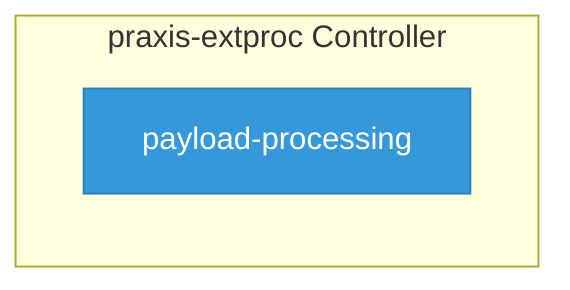

# praxis-extproc

> **Architecture snapshot: 2026-11-21** (2026-11-21)

**Repository:** opendatahub-io/praxis-extproc  
**Analyzer:** arch-analyzer f62b7632f89631498789b54d78e8c552c27100c7  
**Extracted:** 2026-11-21T06:38:32Z

See [Agent Context](agent-context.md) for repository structure and code relationships, and [Extracted Data](details.md) for dependency and configuration details.

## Summary

| Metric | Count |
|--------|-------|
| CRDs | 0 |
| Deployments | 1 |
| Services | 1 |
| Secrets | 1 |
| Cluster Roles | 0 |
| Controller Watches | 0 |

## Component Architecture

CRDs, controllers, and owned Kubernetes resources.

### CRDs

No CRDs found in analyzed sources.

## Dependencies

