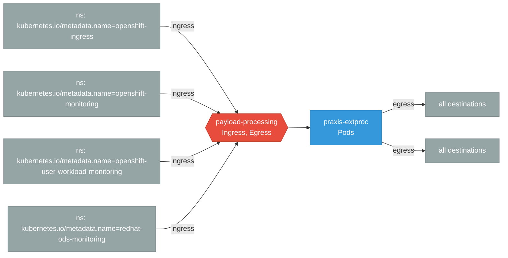

# praxis-extproc: Network

## Service Map

### Services

| Name | Type | Ports | Source |
|------|------|-------|--------|
| payload-processing | ClusterIP | 9004/TCP | [`deploy/base/instance/service.yaml`](https://github.com/opendatahub-io/praxis-extproc/blob/814a177260f1d3ce5f2e62f5cdfd8c7c532ea710/deploy/base/instance/service.yaml) |

### Network Policies

| Name | Policy Types | Source |
|------|-------------|--------|
| payload-processing | Ingress, Egress | [`deploy/overlays/odh/networking/networkpolicy.yaml`](https://github.com/opendatahub-io/praxis-extproc/blob/814a177260f1d3ce5f2e62f5cdfd8c7c532ea710/deploy/overlays/odh/networking/networkpolicy.yaml) |

## Network Policy Graph

Visual representation of NetworkPolicy rules. Ingress rules show what traffic is allowed into pods, egress rules show what traffic is allowed out.

