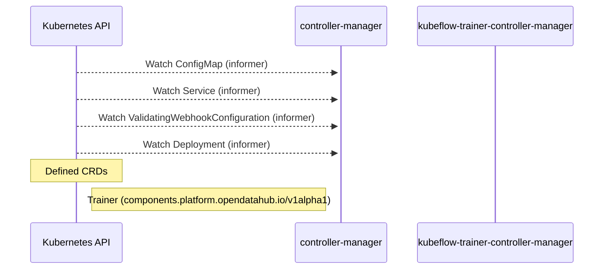

# trainer-operator: Dataflow

## Controller Watches

Kubernetes resources this controller monitors for changes. Each watch triggers reconciliation when the watched resource is created, updated, or deleted.

| Type | GVK | Source |
|------|-----|--------|
| Watches | /v1/ConfigMap | [`internal/controller/trainer_controller.go:207`](https://github.com/opendatahub-io/trainer-operator/blob/a9eba745f514719d14ec057679f45bdfda38cb57/internal/controller/trainer_controller.go#L207) |
| Watches | /v1/Service | [`internal/controller/trainer_controller.go:206`](https://github.com/opendatahub-io/trainer-operator/blob/a9eba745f514719d14ec057679f45bdfda38cb57/internal/controller/trainer_controller.go#L206) |
| Watches | admissionregistration.k8s.io/v1/ValidatingWebhookConfiguration | [`internal/controller/trainer_controller.go:208`](https://github.com/opendatahub-io/trainer-operator/blob/a9eba745f514719d14ec057679f45bdfda38cb57/internal/controller/trainer_controller.go#L208) |
| Watches | apps/v1/Deployment | [`internal/controller/trainer_controller.go:204`](https://github.com/opendatahub-io/trainer-operator/blob/a9eba745f514719d14ec057679f45bdfda38cb57/internal/controller/trainer_controller.go#L204) |

## Reconciliation Flow

How the controller interacts with the Kubernetes API during reconciliation.

## Configuration

ConfigMaps and Helm values that control this component's runtime behavior.

