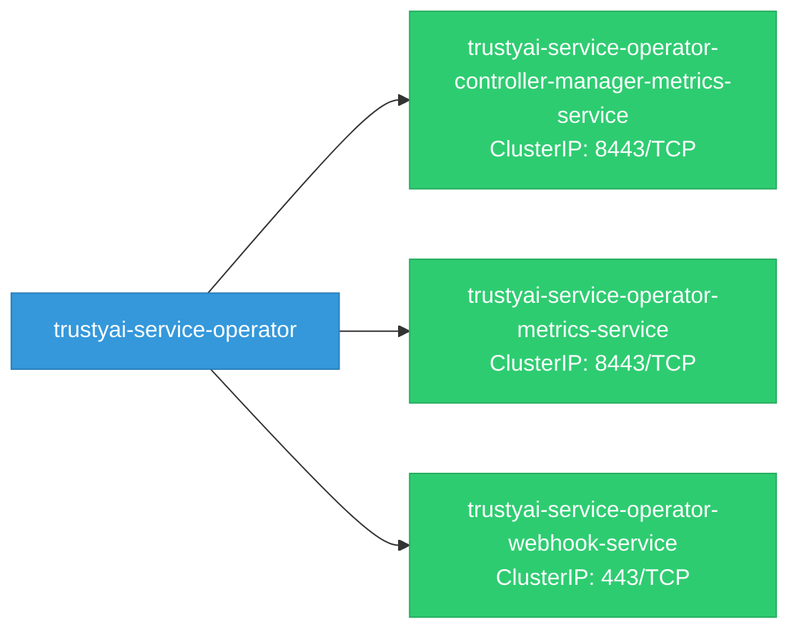
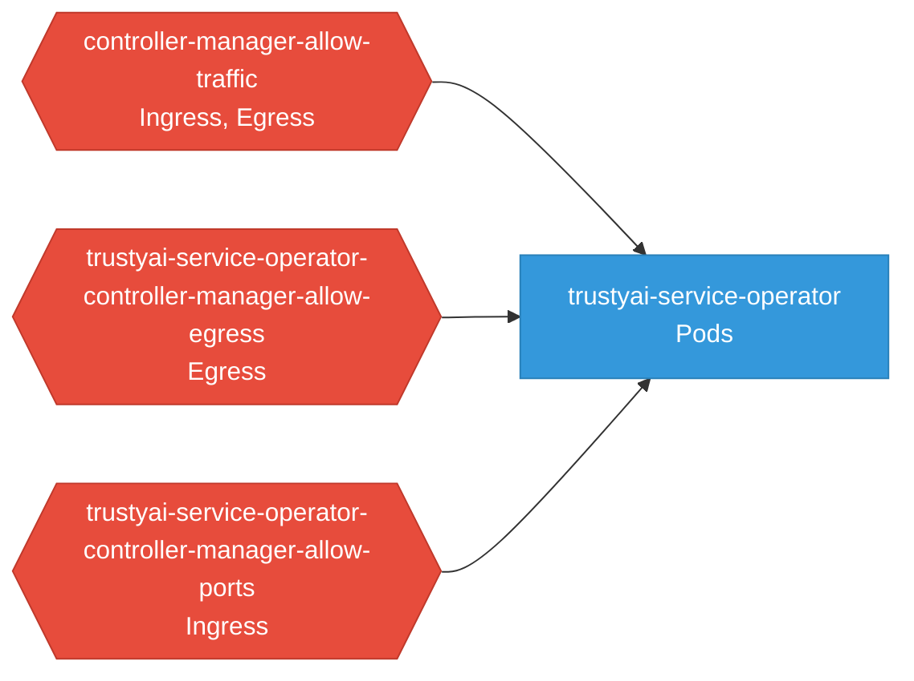

# trustyai-service-operator: Network

## Service Map

### Services

| Name | Type | Ports | Source |
|------|------|-------|--------|
| trustyai-service-operator-controller-manager-metrics-service | ClusterIP | 8443/TCP | [`kustomize:config/overlays/odh`](https://github.com/opendatahub-io/trustyai-service-operator/blob/81f45a36ebad1f0f800d230321b589adf7bd404e/kustomize:config/overlays/odh) |
| trustyai-service-operator-metrics-service | ClusterIP | 8443/TCP | [`kustomize:config/overlays/odh`](https://github.com/opendatahub-io/trustyai-service-operator/blob/81f45a36ebad1f0f800d230321b589adf7bd404e/kustomize:config/overlays/odh) |
| trustyai-service-operator-webhook-service | ClusterIP | 443/TCP | [`kustomize:config/overlays/odh`](https://github.com/opendatahub-io/trustyai-service-operator/blob/81f45a36ebad1f0f800d230321b589adf7bd404e/kustomize:config/overlays/odh) |

### Network Policies

| Name | Policy Types | Source |
|------|-------------|--------|
| controller-manager-allow-traffic | Ingress, Egress | [`trustyai-operator-module/config/manager/networkpolicy.yaml`](https://github.com/opendatahub-io/trustyai-service-operator/blob/81f45a36ebad1f0f800d230321b589adf7bd404e/trustyai-operator-module/config/manager/networkpolicy.yaml) |
| trustyai-service-operator-controller-manager-allow-egress | Egress | [`kustomize:config/overlays/odh`](https://github.com/opendatahub-io/trustyai-service-operator/blob/81f45a36ebad1f0f800d230321b589adf7bd404e/kustomize:config/overlays/odh) |
| trustyai-service-operator-controller-manager-allow-ports | Ingress | [`kustomize:config/overlays/odh`](https://github.com/opendatahub-io/trustyai-service-operator/blob/81f45a36ebad1f0f800d230321b589adf7bd404e/kustomize:config/overlays/odh) |

## Network Policy Graph

Visual representation of NetworkPolicy rules. Ingress rules show what traffic is allowed into pods, egress rules show what traffic is allowed out.

