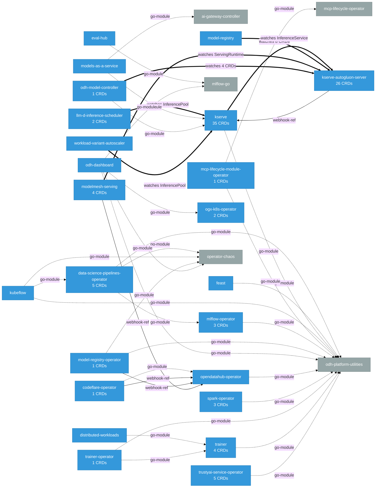

# Platform Platform Analysis

> **Architecture snapshot: 2026-11-28** (2026-11-28)

*Generated by architecture-analyzer. All data produced by deterministic static analysis.*

## Platform Summary

| Metric | Count |
|--------|-------|
| Components | 44 |
| CRDs | 99 |
| Services | 78 |
| Secrets | 62 |
| Cluster Roles | 122 |
| Cross-Component Dependencies | 53 |
| Webhooks | 112 |

## Component Dependency Graph

## Components Analyzed

| Component | CRDs | Deployments | Services |
|-----------|------|-------------|----------|
| [agents-operator](components/agents_operator/index.md) | 0 | 3 | 2 |
| [ai4rag](components/ai4rag/index.md) | 0 | 0 | 0 |
| [argo-workflows](components/argo_workflows/index.md) | 0 | 0 | 0 |
| [batch-gateway](components/batch_gateway/index.md) | 0 | 0 | 0 |
| [codeflare-operator](components/codeflare_operator/index.md) | 1 | 2 | 1 |
| [data-science-pipelines](components/data_science_pipelines/index.md) | 3 | 10 | 1 |
| [data-science-pipelines-operator](components/data_science_pipelines_operator/index.md) | 5 | 8 | 8 |
| [distributed-workloads](components/distributed_workloads/index.md) | 0 | 0 | 0 |
| [eval-hub](components/eval_hub/index.md) | 0 | 0 | 0 |
| [feast](components/feast/index.md) | 0 | 3 | 1 |
| [fms-guardrails-orchestrator](components/fms_guardrails_orchestrator/index.md) | 0 | 0 | 0 |
| [guardrails-detectors](components/guardrails_detectors/index.md) | 0 | 0 | 0 |
| [kale](components/kale/index.md) | 0 | 0 | 0 |
| [kserve](components/kserve/index.md) | 35 | 4 | 6 |
| [kserve-autogluon-server](components/kserve_autogluon_server/index.md) | 26 | 3 | 6 |
| [kube-auth-proxy](components/kube_auth_proxy/index.md) | 0 | 0 | 0 |
| [kube-rbac-proxy](components/kube_rbac_proxy/index.md) | 0 | 0 | 0 |
| [kubeflow](components/kubeflow/index.md) | 0 | 9 | 3 |
| [kuberay](components/kuberay/index.md) | 0 | 1 | 1 |
| [kueue](components/kueue/index.md) | 2 | 11 | 2 |
| [llama-stack](components/llama_stack/index.md) | 0 | 0 | 1 |
| [llama-stack-provider-trustyai-garak](components/llama_stack_provider_trustyai_garak/index.md) | 0 | 0 | 0 |
| [llm-d](components/llm_d/index.md) | 0 | 6 | 8 |
| [llm-d-inference-scheduler](components/llm_d_inference_scheduler/index.md) | 2 | 0 | 0 |
| [llm-d-kv-cache](components/llm_d_kv_cache/index.md) | 0 | 2 | 0 |
| [lm-evaluation-harness](components/lm_evaluation_harness/index.md) | 0 | 0 | 0 |
| [mcp-lifecycle-module-operator](components/mcp_lifecycle_module_operator/index.md) | 1 | 5 | 1 |
| [mlflow](components/mlflow/index.md) | 0 | 0 | 1 |
| [mlflow-operator](components/mlflow_operator/index.md) | 3 | 1 | 1 |
| [model-registry](components/model_registry/index.md) | 0 | 4 | 1 |
| [model-registry-operator](components/model_registry_operator/index.md) | 1 | 4 | 5 |
| [modelmesh-serving](components/modelmesh_serving/index.md) | 4 | 4 | 3 |
| [models-as-a-service](components/models_as_a_service/index.md) | 0 | 5 | 5 |
| [notebooks](components/notebooks/index.md) | 0 | 7 | 7 |
| [odh-dashboard](components/odh_dashboard/index.md) | 0 | 16 | 15 |
| [odh-model-controller](components/odh_model_controller/index.md) | 1 | 2 | 3 |
| [ogx-k8s-operator](components/ogx_k8s_operator/index.md) | 2 | 2 | 2 |
| [opendatahub-operator](components/opendatahub_operator/index.md) | 0 | 22 | 3 |
| [praxis-extproc](components/praxis_extproc/index.md) | 0 | 1 | 1 |
| [spark-operator](components/spark_operator/index.md) | 3 | 4 | 3 |
| [trainer](components/trainer/index.md) | 4 | 4 | 0 |
| [trainer-operator](components/trainer_operator/index.md) | 1 | 4 | 0 |
| [trustyai-service-operator](components/trustyai_service_operator/index.md) | 5 | 1 | 3 |
| [workload-variant-autoscaler](components/workload_variant_autoscaler/index.md) | 0 | 2 | 1 |

