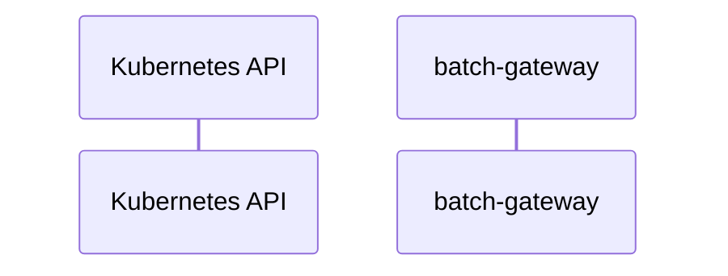

# batch-gateway: Dataflow

[Overview](index.md) · [Agent Context](agent-context.md) · [Extracted Data](details.md) · [Network](network.md) · [RBAC](rbac.md) · [Security](security.md) · [Dataflow](dataflow.md)

## Controller Watches

Kubernetes resources this controller monitors for changes. Each watch triggers reconciliation when the watched resource is created, updated, or deleted.

No controller watches found in analyzed sources.

## Reconciliation Flow

How the controller interacts with the Kubernetes API during reconciliation.

### HTTP Endpoints

| Method | Path | Source |
|--------|------|--------|
| * | / | [`internal/apiserver/common/rest.go:74`](https://github.com/red-hat-data-services/batch-gateway/blob/d9f8a5de91bed52e9fde0776ad697359d731688b/internal/apiserver/common/rest.go#L74) |
| * | /health | [`cmd/batch-gc/main.go:178`](https://github.com/red-hat-data-services/batch-gateway/blob/d9f8a5de91bed52e9fde0776ad697359d731688b/cmd/batch-gc/main.go#L178) |
| * | /metrics | [`cmd/batch-gc/main.go:177`](https://github.com/red-hat-data-services/batch-gateway/blob/d9f8a5de91bed52e9fde0776ad697359d731688b/cmd/batch-gc/main.go#L177) |

## Configuration

ConfigMaps and Helm values that control this component's runtime behavior.

### Helm

**Chart:** batch-gateway v0.1.0

