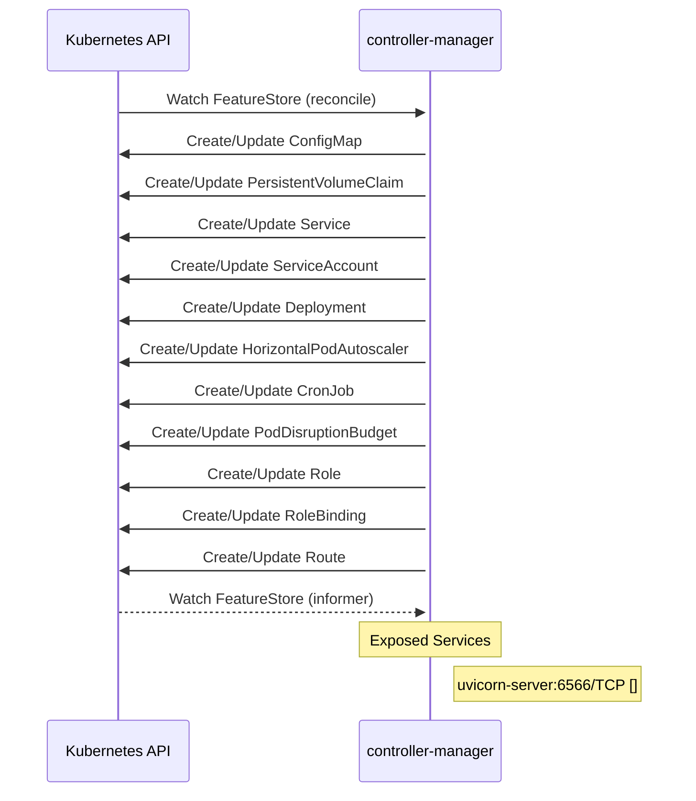

# feast: Dataflow

## Controller Watches

Kubernetes resources this controller monitors for changes. Each watch triggers reconciliation when the watched resource is created, updated, or deleted.

| Type | GVK | Source |
|------|-----|--------|
| For | api/v1/FeatureStore | [`infra/feast-operator/internal/controller/featurestore_controller.go:580`](https://github.com/red-hat-data-services/feast/blob/a04a097bbd861405744915b39f51276fed479137/infra/feast-operator/internal/controller/featurestore_controller.go#L580) |
| Owns | /v1/ConfigMap | [`infra/feast-operator/internal/controller/featurestore_controller.go:581`](https://github.com/red-hat-data-services/feast/blob/a04a097bbd861405744915b39f51276fed479137/infra/feast-operator/internal/controller/featurestore_controller.go#L581) |
| Owns | /v1/PersistentVolumeClaim | [`infra/feast-operator/internal/controller/featurestore_controller.go:584`](https://github.com/red-hat-data-services/feast/blob/a04a097bbd861405744915b39f51276fed479137/infra/feast-operator/internal/controller/featurestore_controller.go#L584) |
| Owns | /v1/Service | [`infra/feast-operator/internal/controller/featurestore_controller.go:583`](https://github.com/red-hat-data-services/feast/blob/a04a097bbd861405744915b39f51276fed479137/infra/feast-operator/internal/controller/featurestore_controller.go#L583) |
| Owns | /v1/ServiceAccount | [`infra/feast-operator/internal/controller/featurestore_controller.go:585`](https://github.com/red-hat-data-services/feast/blob/a04a097bbd861405744915b39f51276fed479137/infra/feast-operator/internal/controller/featurestore_controller.go#L585) |
| Owns | apps/v1/Deployment | [`infra/feast-operator/internal/controller/featurestore_controller.go:582`](https://github.com/red-hat-data-services/feast/blob/a04a097bbd861405744915b39f51276fed479137/infra/feast-operator/internal/controller/featurestore_controller.go#L582) |
| Owns | autoscaling/v2/HorizontalPodAutoscaler | [`infra/feast-operator/internal/controller/featurestore_controller.go:589`](https://github.com/red-hat-data-services/feast/blob/a04a097bbd861405744915b39f51276fed479137/infra/feast-operator/internal/controller/featurestore_controller.go#L589) |
| Owns | batch/v1/CronJob | [`infra/feast-operator/internal/controller/featurestore_controller.go:588`](https://github.com/red-hat-data-services/feast/blob/a04a097bbd861405744915b39f51276fed479137/infra/feast-operator/internal/controller/featurestore_controller.go#L588) |
| Owns | policy/v1/PodDisruptionBudget | [`infra/feast-operator/internal/controller/featurestore_controller.go:590`](https://github.com/red-hat-data-services/feast/blob/a04a097bbd861405744915b39f51276fed479137/infra/feast-operator/internal/controller/featurestore_controller.go#L590) |
| Owns | rbac.authorization.k8s.io/v1/Role | [`infra/feast-operator/internal/controller/featurestore_controller.go:587`](https://github.com/red-hat-data-services/feast/blob/a04a097bbd861405744915b39f51276fed479137/infra/feast-operator/internal/controller/featurestore_controller.go#L587) |
| Owns | rbac.authorization.k8s.io/v1/RoleBinding | [`infra/feast-operator/internal/controller/featurestore_controller.go:586`](https://github.com/red-hat-data-services/feast/blob/a04a097bbd861405744915b39f51276fed479137/infra/feast-operator/internal/controller/featurestore_controller.go#L586) |
| Owns | route/v1/Route | [`infra/feast-operator/internal/controller/featurestore_controller.go:594`](https://github.com/red-hat-data-services/feast/blob/a04a097bbd861405744915b39f51276fed479137/infra/feast-operator/internal/controller/featurestore_controller.go#L594) |
| Watches | api/v1/FeatureStore | [`infra/feast-operator/internal/controller/featurestore_controller.go:591`](https://github.com/red-hat-data-services/feast/blob/a04a097bbd861405744915b39f51276fed479137/infra/feast-operator/internal/controller/featurestore_controller.go#L591) |

## Reconciliation Flow

How the controller interacts with the Kubernetes API during reconciliation.

### HTTP Endpoints

| Method | Path | Source |
|--------|------|--------|
| * | /get-online-features | [`go/internal/feast/server/http_server.go:387`](https://github.com/red-hat-data-services/feast/blob/a04a097bbd861405744915b39f51276fed479137/go/internal/feast/server/http_server.go#L387) |
| * | /get-online-features | [`go/internal/feast/server/http_server.go:401`](https://github.com/red-hat-data-services/feast/blob/a04a097bbd861405744915b39f51276fed479137/go/internal/feast/server/http_server.go#L401) |
| * | /health | [`go/internal/feast/server/http_server.go:388`](https://github.com/red-hat-data-services/feast/blob/a04a097bbd861405744915b39f51276fed479137/go/internal/feast/server/http_server.go#L388) |
| * | /health | [`go/internal/feast/server/http_server.go:402`](https://github.com/red-hat-data-services/feast/blob/a04a097bbd861405744915b39f51276fed479137/go/internal/feast/server/http_server.go#L402) |
| * | /metrics | [`go/main.go:204`](https://github.com/red-hat-data-services/feast/blob/a04a097bbd861405744915b39f51276fed479137/go/main.go#L204) |
| * | /metrics | [`go/main.go:264`](https://github.com/red-hat-data-services/feast/blob/a04a097bbd861405744915b39f51276fed479137/go/main.go#L264) |

## Configuration

ConfigMaps and Helm values that control this component's runtime behavior.

### Helm

**Chart:** feast v0.67.0

