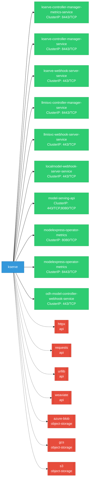
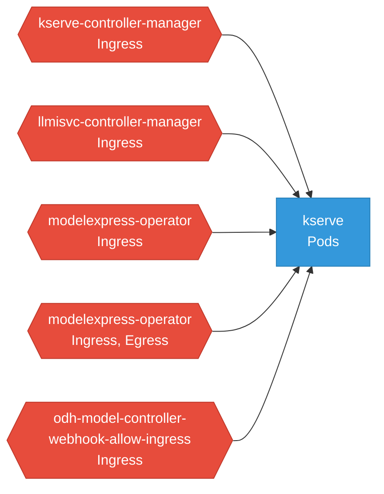

# kserve: Network

## Service Map

### Services

| Name | Type | Ports | Source |
|------|------|-------|--------|
| kserve-controller-manager-metrics-service | ClusterIP | 8443/TCP | [`kustomize:config/overlays/odh`](https://github.com/red-hat-data-services/kserve/blob/4db69f8e7e04d9babc0ac88d3b691bdadacdb860/kustomize:config/overlays/odh) |
| kserve-controller-manager-service | ClusterIP | 8443/TCP | [`kustomize:config/overlays/odh`](https://github.com/red-hat-data-services/kserve/blob/4db69f8e7e04d9babc0ac88d3b691bdadacdb860/kustomize:config/overlays/odh) |
| kserve-webhook-server-service | ClusterIP | 443/TCP | [`kustomize:config/overlays/odh`](https://github.com/red-hat-data-services/kserve/blob/4db69f8e7e04d9babc0ac88d3b691bdadacdb860/kustomize:config/overlays/odh) |
| llmisvc-controller-manager-service | ClusterIP | 8443/TCP | [`kustomize:config/overlays/odh`](https://github.com/red-hat-data-services/kserve/blob/4db69f8e7e04d9babc0ac88d3b691bdadacdb860/kustomize:config/overlays/odh) |
| llmisvc-webhook-server-service | ClusterIP | 443/TCP | [`kustomize:config/overlays/odh`](https://github.com/red-hat-data-services/kserve/blob/4db69f8e7e04d9babc0ac88d3b691bdadacdb860/kustomize:config/overlays/odh) |
| localmodel-webhook-server-service | ClusterIP | 443/TCP | [`config/webhook/localmodel/service.yaml`](https://github.com/red-hat-data-services/kserve/blob/4db69f8e7e04d9babc0ac88d3b691bdadacdb860/config/webhook/localmodel/service.yaml) |
| model-serving-api | ClusterIP | 443/TCP, 8080/TCP | [`kserve-module/prefetched-manifests-rhoai/modelcontroller/server/service.yaml`](https://github.com/red-hat-data-services/kserve/blob/4db69f8e7e04d9babc0ac88d3b691bdadacdb860/kserve-module/prefetched-manifests-rhoai/modelcontroller/server/service.yaml) |
| modelexpress-operator-metrics | ClusterIP | 8080/TCP | [`kserve-module/prefetched-manifests-rhoai/modelexpress/manager/service.yaml`](https://github.com/red-hat-data-services/kserve/blob/4db69f8e7e04d9babc0ac88d3b691bdadacdb860/kserve-module/prefetched-manifests-rhoai/modelexpress/manager/service.yaml) |
| modelexpress-operator-metrics | ClusterIP | 8443/TCP | [`kserve-module/prefetched-manifests-rhoai/modelexpress/components/openshift/service-patch.yaml`](https://github.com/red-hat-data-services/kserve/blob/4db69f8e7e04d9babc0ac88d3b691bdadacdb860/kserve-module/prefetched-manifests-rhoai/modelexpress/components/openshift/service-patch.yaml) |
| odh-model-controller-webhook-service | ClusterIP | 443/TCP | [`kserve-module/prefetched-manifests-rhoai/modelcontroller/webhook/service.yaml`](https://github.com/red-hat-data-services/kserve/blob/4db69f8e7e04d9babc0ac88d3b691bdadacdb860/kserve-module/prefetched-manifests-rhoai/modelcontroller/webhook/service.yaml) |

### Ingress / Routing

| Kind | Name | Hosts | Paths | TLS | Source |
|------|------|-------|-------|-----|--------|
| HTTPRoute | rbac-inferred |  |  | no | [`rbac/kserve-manager-role`](https://github.com/red-hat-data-services/kserve/blob/4db69f8e7e04d9babc0ac88d3b691bdadacdb860/rbac/kserve-manager-role) |
| Ingress | rbac-inferred |  |  | no | [`rbac/kserve-manager-role`](https://github.com/red-hat-data-services/kserve/blob/4db69f8e7e04d9babc0ac88d3b691bdadacdb860/rbac/kserve-manager-role) |
| VirtualService | rbac-inferred |  |  | no | [`rbac/kserve-manager-role`](https://github.com/red-hat-data-services/kserve/blob/4db69f8e7e04d9babc0ac88d3b691bdadacdb860/rbac/kserve-manager-role) |

### Network Policies

| Name | Policy Types | Source |
|------|-------------|--------|
| kserve-controller-manager |  | [`kustomize:config/overlays/odh`](https://github.com/red-hat-data-services/kserve/blob/4db69f8e7e04d9babc0ac88d3b691bdadacdb860/kustomize:config/overlays/odh) |
| llmisvc-controller-manager |  | [`kustomize:config/overlays/odh`](https://github.com/red-hat-data-services/kserve/blob/4db69f8e7e04d9babc0ac88d3b691bdadacdb860/kustomize:config/overlays/odh) |
| modelexpress-operator |  | [`kserve-module/prefetched-manifests-rhoai/modelexpress/components/openshift/networkpolicy-patch.yaml`](https://github.com/red-hat-data-services/kserve/blob/4db69f8e7e04d9babc0ac88d3b691bdadacdb860/kserve-module/prefetched-manifests-rhoai/modelexpress/components/openshift/networkpolicy-patch.yaml) |
| modelexpress-operator | Ingress, Egress | [`kserve-module/prefetched-manifests-rhoai/modelexpress/manager/networkpolicy.yaml`](https://github.com/red-hat-data-services/kserve/blob/4db69f8e7e04d9babc0ac88d3b691bdadacdb860/kserve-module/prefetched-manifests-rhoai/modelexpress/manager/networkpolicy.yaml) |
| odh-model-controller-webhook-allow-ingress |  | [`kserve-module/prefetched-manifests-rhoai/modelcontroller/webhook/networkpolicy.yaml`](https://github.com/red-hat-data-services/kserve/blob/4db69f8e7e04d9babc0ac88d3b691bdadacdb860/kserve-module/prefetched-manifests-rhoai/modelcontroller/webhook/networkpolicy.yaml) |

## Network Policy Graph

Visual representation of NetworkPolicy rules. Ingress rules show what traffic is allowed into pods, egress rules show what traffic is allowed out.

