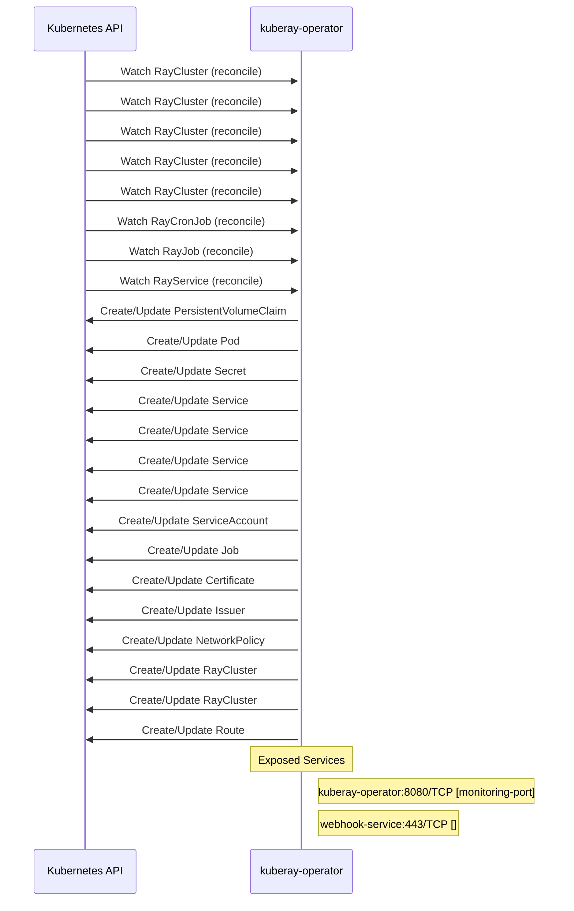

# kuberay: Dataflow

## Controller Watches

Kubernetes resources this controller monitors for changes. Each watch triggers reconciliation when the watched resource is created, updated, or deleted.

| Type | GVK | Source |
|------|-----|--------|
| For | ray/v1/RayCluster | [`ray-operator/controllers/ray/networkpolicy_controller.go:562`](https://github.com/ray-project/kuberay/blob/34fe8dad30c8b3ab265c7054971c3dd24fadc9d3/ray-operator/controllers/ray/networkpolicy_controller.go#L562) |
| For | ray/v1/RayCluster | [`ray-operator/controllers/ray/authentication_controller.go:1051`](https://github.com/ray-project/kuberay/blob/34fe8dad30c8b3ab265c7054971c3dd24fadc9d3/ray-operator/controllers/ray/authentication_controller.go#L1051) |
| For | ray/v1/RayCluster | [`ray-operator/controllers/ray/raycluster_mtls_controller.go:497`](https://github.com/ray-project/kuberay/blob/34fe8dad30c8b3ab265c7054971c3dd24fadc9d3/ray-operator/controllers/ray/raycluster_mtls_controller.go#L497) |
| For | ray/v1/RayCluster | [`ray-operator/controllers/ray/raycluster_controller.go:2018`](https://github.com/ray-project/kuberay/blob/34fe8dad30c8b3ab265c7054971c3dd24fadc9d3/ray-operator/controllers/ray/raycluster_controller.go#L2018) |
| For | ray/v1/RayCluster | [`ray-operator/controllers/ray/legacy_security_controller.go:64`](https://github.com/ray-project/kuberay/blob/34fe8dad30c8b3ab265c7054971c3dd24fadc9d3/ray-operator/controllers/ray/legacy_security_controller.go#L64) |
| For | ray/v1/RayCronJob | [`ray-operator/controllers/ray/raycronjob_controller.go:196`](https://github.com/ray-project/kuberay/blob/34fe8dad30c8b3ab265c7054971c3dd24fadc9d3/ray-operator/controllers/ray/raycronjob_controller.go#L196) |
| For | ray/v1/RayJob | [`ray-operator/controllers/ray/rayjob_controller.go:915`](https://github.com/ray-project/kuberay/blob/34fe8dad30c8b3ab265c7054971c3dd24fadc9d3/ray-operator/controllers/ray/rayjob_controller.go#L915) |
| For | ray/v1/RayService | [`ray-operator/controllers/ray/rayservice_controller.go:834`](https://github.com/ray-project/kuberay/blob/34fe8dad30c8b3ab265c7054971c3dd24fadc9d3/ray-operator/controllers/ray/rayservice_controller.go#L834) |
| Owns | /v1/PersistentVolumeClaim | [`ray-operator/controllers/ray/raycluster_controller.go:2026`](https://github.com/ray-project/kuberay/blob/34fe8dad30c8b3ab265c7054971c3dd24fadc9d3/ray-operator/controllers/ray/raycluster_controller.go#L2026) |
| Owns | /v1/Pod | [`ray-operator/controllers/ray/raycluster_controller.go:2023`](https://github.com/ray-project/kuberay/blob/34fe8dad30c8b3ab265c7054971c3dd24fadc9d3/ray-operator/controllers/ray/raycluster_controller.go#L2023) |
| Owns | /v1/Secret | [`ray-operator/controllers/ray/raycluster_controller.go:2025`](https://github.com/ray-project/kuberay/blob/34fe8dad30c8b3ab265c7054971c3dd24fadc9d3/ray-operator/controllers/ray/raycluster_controller.go#L2025) |
| Owns | /v1/Service | [`ray-operator/controllers/ray/rayjob_controller.go:917`](https://github.com/ray-project/kuberay/blob/34fe8dad30c8b3ab265c7054971c3dd24fadc9d3/ray-operator/controllers/ray/rayjob_controller.go#L917) |
| Owns | /v1/Service | [`ray-operator/controllers/ray/authentication_controller.go:1054`](https://github.com/ray-project/kuberay/blob/34fe8dad30c8b3ab265c7054971c3dd24fadc9d3/ray-operator/controllers/ray/authentication_controller.go#L1054) |
| Owns | /v1/Service | [`ray-operator/controllers/ray/raycluster_controller.go:2024`](https://github.com/ray-project/kuberay/blob/34fe8dad30c8b3ab265c7054971c3dd24fadc9d3/ray-operator/controllers/ray/raycluster_controller.go#L2024) |
| Owns | /v1/Service | [`ray-operator/controllers/ray/rayservice_controller.go:840`](https://github.com/ray-project/kuberay/blob/34fe8dad30c8b3ab265c7054971c3dd24fadc9d3/ray-operator/controllers/ray/rayservice_controller.go#L840) |
| Owns | /v1/ServiceAccount | [`ray-operator/controllers/ray/authentication_controller.go:1053`](https://github.com/ray-project/kuberay/blob/34fe8dad30c8b3ab265c7054971c3dd24fadc9d3/ray-operator/controllers/ray/authentication_controller.go#L1053) |
| Owns | batch/v1/Job | [`ray-operator/controllers/ray/rayjob_controller.go:918`](https://github.com/ray-project/kuberay/blob/34fe8dad30c8b3ab265c7054971c3dd24fadc9d3/ray-operator/controllers/ray/rayjob_controller.go#L918) |
| Owns | certmanager/v1/Certificate | [`ray-operator/controllers/ray/raycluster_mtls_controller.go:499`](https://github.com/ray-project/kuberay/blob/34fe8dad30c8b3ab265c7054971c3dd24fadc9d3/ray-operator/controllers/ray/raycluster_mtls_controller.go#L499) |
| Owns | certmanager/v1/Issuer | [`ray-operator/controllers/ray/raycluster_mtls_controller.go:498`](https://github.com/ray-project/kuberay/blob/34fe8dad30c8b3ab265c7054971c3dd24fadc9d3/ray-operator/controllers/ray/raycluster_mtls_controller.go#L498) |
| Owns | networking.k8s.io/v1/NetworkPolicy | [`ray-operator/controllers/ray/networkpolicy_controller.go:563`](https://github.com/ray-project/kuberay/blob/34fe8dad30c8b3ab265c7054971c3dd24fadc9d3/ray-operator/controllers/ray/networkpolicy_controller.go#L563) |
| Owns | ray/v1/RayCluster | [`ray-operator/controllers/ray/rayjob_controller.go:916`](https://github.com/ray-project/kuberay/blob/34fe8dad30c8b3ab265c7054971c3dd24fadc9d3/ray-operator/controllers/ray/rayjob_controller.go#L916) |
| Owns | ray/v1/RayCluster | [`ray-operator/controllers/ray/rayservice_controller.go:839`](https://github.com/ray-project/kuberay/blob/34fe8dad30c8b3ab265c7054971c3dd24fadc9d3/ray-operator/controllers/ray/rayservice_controller.go#L839) |
| Owns | route/v1/Route | [`ray-operator/controllers/ray/authentication_controller.go:1056`](https://github.com/ray-project/kuberay/blob/34fe8dad30c8b3ab265c7054971c3dd24fadc9d3/ray-operator/controllers/ray/authentication_controller.go#L1056) |

## Reconciliation Flow

How the controller interacts with the Kubernetes API during reconciliation.

### Webhooks

| Name | Type | Path | Failure Policy | Service | Overlays | Enable Condition | Sources |
|------|------|------|----------------|---------|----------|------------------|----------|
| mraycluster.kb.io | mutating | /mutate-ray-io-v1-raycluster | Fail | $(namespace)/kuberay-webhook-service |  |  | [`ray-operator/config/openshift/webhook.yaml`](https://github.com/ray-project/kuberay/blob/34fe8dad30c8b3ab265c7054971c3dd24fadc9d3/ray-operator/config/openshift/webhook.yaml) |
| mraycluster.kb.io | mutating | /mutate-ray-io-v1-raycluster | fail |  |  |  | [`ray-operator/pkg/webhooks/v1/raycluster_mutating_webhook.go`](https://github.com/ray-project/kuberay/blob/34fe8dad30c8b3ab265c7054971c3dd24fadc9d3/ray-operator/pkg/webhooks/v1/raycluster_mutating_webhook.go), [`ray-operator/pkg/webhooks/v1/raycluster_mutating_webhook.go`](https://github.com/ray-project/kuberay/blob/34fe8dad30c8b3ab265c7054971c3dd24fadc9d3/ray-operator/pkg/webhooks/v1/raycluster_mutating_webhook.go) |
| vraycluster.kb.io | validating | /validate-ray-io-v1-raycluster | fail |  |  |  | [`ray-operator/pkg/webhooks/v1/raycluster_validating_webhook.go`](https://github.com/ray-project/kuberay/blob/34fe8dad30c8b3ab265c7054971c3dd24fadc9d3/ray-operator/pkg/webhooks/v1/raycluster_validating_webhook.go), [`ray-operator/pkg/webhooks/v1/raycluster_validating_webhook.go`](https://github.com/ray-project/kuberay/blob/34fe8dad30c8b3ab265c7054971c3dd24fadc9d3/ray-operator/pkg/webhooks/v1/raycluster_validating_webhook.go) |
| vrayjob.kb.io | validating | /validate-ray-io-v1-rayjob | fail |  |  |  | [`ray-operator/pkg/webhooks/v1/rayjob_webhook.go`](https://github.com/ray-project/kuberay/blob/34fe8dad30c8b3ab265c7054971c3dd24fadc9d3/ray-operator/pkg/webhooks/v1/rayjob_webhook.go), [`ray-operator/pkg/webhooks/v1/rayjob_webhook.go`](https://github.com/ray-project/kuberay/blob/34fe8dad30c8b3ab265c7054971c3dd24fadc9d3/ray-operator/pkg/webhooks/v1/rayjob_webhook.go) |
| vrayservice.kb.io | validating | /validate-ray-io-v1-rayservice | fail |  |  |  | [`ray-operator/pkg/webhooks/v1/rayservice_webhook.go`](https://github.com/ray-project/kuberay/blob/34fe8dad30c8b3ab265c7054971c3dd24fadc9d3/ray-operator/pkg/webhooks/v1/rayservice_webhook.go), [`ray-operator/pkg/webhooks/v1/rayservice_webhook.go`](https://github.com/ray-project/kuberay/blob/34fe8dad30c8b3ab265c7054971c3dd24fadc9d3/ray-operator/pkg/webhooks/v1/rayservice_webhook.go) |

### HTTP Endpoints

| Method | Path | Source |
|--------|------|--------|
| GET | / | [`historyserver/pkg/historyserver/router.go:112`](https://github.com/ray-project/kuberay/blob/34fe8dad30c8b3ab265c7054971c3dd24fadc9d3/historyserver/pkg/historyserver/router.go#L112) |
| GET | / | [`historyserver/pkg/historyserver/router.go:74`](https://github.com/ray-project/kuberay/blob/34fe8dad30c8b3ab265c7054971c3dd24fadc9d3/historyserver/pkg/historyserver/router.go#L74) |
| GET | / | [`historyserver/pkg/historyserver/router.go:65`](https://github.com/ray-project/kuberay/blob/34fe8dad30c8b3ab265c7054971c3dd24fadc9d3/historyserver/pkg/historyserver/router.go#L65) |
| GET | /actors | [`historyserver/pkg/historyserver/router.go:298`](https://github.com/ray-project/kuberay/blob/34fe8dad30c8b3ab265c7054971c3dd24fadc9d3/historyserver/pkg/historyserver/router.go#L298) |
| GET | /actors/{single_actor:*} | [`historyserver/pkg/historyserver/router.go:306`](https://github.com/ray-project/kuberay/blob/34fe8dad30c8b3ab265c7054971c3dd24fadc9d3/historyserver/pkg/historyserver/router.go#L306) |
| * | /api/v1/namespaces/{namespace}/services/{service}/proxy | [`apiserversdk/proxy.go:64`](https://github.com/ray-project/kuberay/blob/34fe8dad30c8b3ab265c7054971c3dd24fadc9d3/apiserversdk/proxy.go#L64) |
| * | /api/v1/namespaces/{namespace}/services/{service}/proxy/ | [`apiserversdk/proxy.go:65`](https://github.com/ray-project/kuberay/blob/34fe8dad30c8b3ab265c7054971c3dd24fadc9d3/apiserversdk/proxy.go#L65) |
| * | /apis/ray.io/v1/ | [`apiserversdk/proxy.go:46`](https://github.com/ray-project/kuberay/blob/34fe8dad30c8b3ab265c7054971c3dd24fadc9d3/apiserversdk/proxy.go#L46) |
| GET | /cluster_status | [`historyserver/pkg/historyserver/router.go:121`](https://github.com/ray-project/kuberay/blob/34fe8dad30c8b3ab265c7054971c3dd24fadc9d3/historyserver/pkg/historyserver/router.go#L121) |
| POST | /events | [`historyserver/pkg/collector/eventcollector/eventcollector.go:241`](https://github.com/ray-project/kuberay/blob/34fe8dad30c8b3ab265c7054971c3dd24fadc9d3/historyserver/pkg/collector/eventcollector/eventcollector.go#L241) |
| GET | /grafana_health | [`historyserver/pkg/historyserver/router.go:124`](https://github.com/ray-project/kuberay/blob/34fe8dad30c8b3ab265c7054971c3dd24fadc9d3/historyserver/pkg/historyserver/router.go#L124) |
| GET | /jobs/ | [`historyserver/pkg/historyserver/router.go:131`](https://github.com/ray-project/kuberay/blob/34fe8dad30c8b3ab265c7054971c3dd24fadc9d3/historyserver/pkg/historyserver/router.go#L131) |
| GET | /jobs/{job_id} | [`historyserver/pkg/historyserver/router.go:135`](https://github.com/ray-project/kuberay/blob/34fe8dad30c8b3ab265c7054971c3dd24fadc9d3/historyserver/pkg/historyserver/router.go#L135) |
| * | /livez | [`historyserver/pkg/historyserver/router.go:271`](https://github.com/ray-project/kuberay/blob/34fe8dad30c8b3ab265c7054971c3dd24fadc9d3/historyserver/pkg/historyserver/router.go#L271) |
| GET | /prometheus_health | [`historyserver/pkg/historyserver/router.go:127`](https://github.com/ray-project/kuberay/blob/34fe8dad30c8b3ab265c7054971c3dd24fadc9d3/historyserver/pkg/historyserver/router.go#L127) |
| * | /readz | [`historyserver/pkg/historyserver/router.go:265`](https://github.com/ray-project/kuberay/blob/34fe8dad30c8b3ab265c7054971c3dd24fadc9d3/historyserver/pkg/historyserver/router.go#L265) |
| * | /select_cluster | [`historyserver/pkg/historyserver/router.go:289`](https://github.com/ray-project/kuberay/blob/34fe8dad30c8b3ab265c7054971c3dd24fadc9d3/historyserver/pkg/historyserver/router.go#L289) |
| GET | /v0/cluster_metadata | [`historyserver/pkg/historyserver/router.go:140`](https://github.com/ray-project/kuberay/blob/34fe8dad30c8b3ab265c7054971c3dd24fadc9d3/historyserver/pkg/historyserver/router.go#L140) |
| GET | /v0/logs | [`historyserver/pkg/historyserver/router.go:144`](https://github.com/ray-project/kuberay/blob/34fe8dad30c8b3ab265c7054971c3dd24fadc9d3/historyserver/pkg/historyserver/router.go#L144) |
| GET | /v0/logs/{media_type} | [`historyserver/pkg/historyserver/router.go:150`](https://github.com/ray-project/kuberay/blob/34fe8dad30c8b3ab265c7054971c3dd24fadc9d3/historyserver/pkg/historyserver/router.go#L150) |
| GET | /v0/tasks | [`historyserver/pkg/historyserver/router.go:173`](https://github.com/ray-project/kuberay/blob/34fe8dad30c8b3ab265c7054971c3dd24fadc9d3/historyserver/pkg/historyserver/router.go#L173) |
| GET | /v0/tasks/summarize | [`historyserver/pkg/historyserver/router.go:184`](https://github.com/ray-project/kuberay/blob/34fe8dad30c8b3ab265c7054971c3dd24fadc9d3/historyserver/pkg/historyserver/router.go#L184) |
| GET | /v0/tasks/timeline | [`historyserver/pkg/historyserver/router.go:192`](https://github.com/ray-project/kuberay/blob/34fe8dad30c8b3ab265c7054971c3dd24fadc9d3/historyserver/pkg/historyserver/router.go#L192) |
| GET | /{namespace}/{kind}/{name} | [`historyserver/pkg/historyserver/router.go:379`](https://github.com/ray-project/kuberay/blob/34fe8dad30c8b3ab265c7054971c3dd24fadc9d3/historyserver/pkg/historyserver/router.go#L379) |
| GET | /{namespace}/{kind}/{name}/{session} | [`historyserver/pkg/historyserver/router.go:391`](https://github.com/ray-project/kuberay/blob/34fe8dad30c8b3ab265c7054971c3dd24fadc9d3/historyserver/pkg/historyserver/router.go#L391) |
| GET | /{node_id} | [`historyserver/pkg/historyserver/router.go:101`](https://github.com/ray-project/kuberay/blob/34fe8dad30c8b3ab265c7054971c3dd24fadc9d3/historyserver/pkg/historyserver/router.go#L101) |
| GET | /{subpath:*} | [`historyserver/pkg/historyserver/router.go:201`](https://github.com/ray-project/kuberay/blob/34fe8dad30c8b3ab265c7054971c3dd24fadc9d3/historyserver/pkg/historyserver/router.go#L201) |
| * | GET /apis/events.k8s.io/v1/namespaces/{namespace}/events | [`apiserversdk/proxy.go:47`](https://github.com/ray-project/kuberay/blob/34fe8dad30c8b3ab265c7054971c3dd24fadc9d3/apiserversdk/proxy.go#L47) |
| * | POST /apis/ray.io/v1/namespaces/{namespace}/rayclusters | [`apiserversdk/proxy.go:53`](https://github.com/ray-project/kuberay/blob/34fe8dad30c8b3ab265c7054971c3dd24fadc9d3/apiserversdk/proxy.go#L53) |
| * | POST /apis/ray.io/v1/namespaces/{namespace}/rayjobs | [`apiserversdk/proxy.go:55`](https://github.com/ray-project/kuberay/blob/34fe8dad30c8b3ab265c7054971c3dd24fadc9d3/apiserversdk/proxy.go#L55) |
| * | POST /apis/ray.io/v1/namespaces/{namespace}/rayservices | [`apiserversdk/proxy.go:57`](https://github.com/ray-project/kuberay/blob/34fe8dad30c8b3ab265c7054971c3dd24fadc9d3/apiserversdk/proxy.go#L57) |
| * | PUT /apis/ray.io/v1/namespaces/{namespace}/rayclusters/{name} | [`apiserversdk/proxy.go:54`](https://github.com/ray-project/kuberay/blob/34fe8dad30c8b3ab265c7054971c3dd24fadc9d3/apiserversdk/proxy.go#L54) |
| * | PUT /apis/ray.io/v1/namespaces/{namespace}/rayjobs/{name} | [`apiserversdk/proxy.go:56`](https://github.com/ray-project/kuberay/blob/34fe8dad30c8b3ab265c7054971c3dd24fadc9d3/apiserversdk/proxy.go#L56) |
| * | PUT /apis/ray.io/v1/namespaces/{namespace}/rayservices/{name} | [`apiserversdk/proxy.go:58`](https://github.com/ray-project/kuberay/blob/34fe8dad30c8b3ab265c7054971c3dd24fadc9d3/apiserversdk/proxy.go#L58) |
| * | gateway.networking.k8s.io | [`ray-operator/controllers/ray/authentication_controller.go:454`](https://github.com/ray-project/kuberay/blob/34fe8dad30c8b3ab265c7054971c3dd24fadc9d3/ray-operator/controllers/ray/authentication_controller.go#L454) |

## Configuration

ConfigMaps and Helm values that control this component's runtime behavior.

### Helm

**Chart:** kuberay-apiserver v1.7.1

