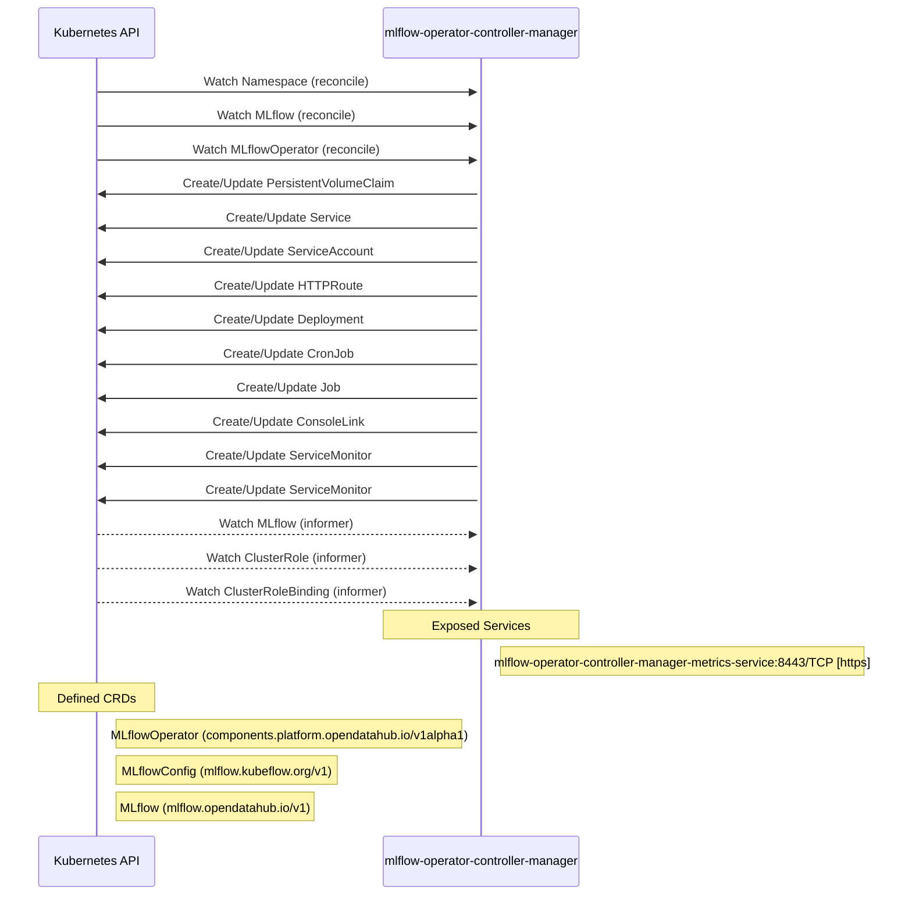

# mlflow-operator: Dataflow

## Controller Watches

Kubernetes resources this controller monitors for changes. Each watch triggers reconciliation when the watched resource is created, updated, or deleted.

| Type | GVK | Source |
|------|-----|--------|
| For | /v1/Namespace | [`internal/controller/namespace_rbac_controller.go:92`](https://github.com/red-hat-data-services/mlflow-operator/blob/6642e1bf7fba36f644b31dfe44efaf4dc654ec6e/internal/controller/namespace_rbac_controller.go#L92) |
| For | api/v1/MLflow | [`internal/controller/mlflow_controller.go:650`](https://github.com/red-hat-data-services/mlflow-operator/blob/6642e1bf7fba36f644b31dfe44efaf4dc654ec6e/internal/controller/mlflow_controller.go#L650) |
| For | mlflowoperator/v1alpha1/MLflowOperator | [`internal/controller/mlflowoperator_controller.go:148`](https://github.com/red-hat-data-services/mlflow-operator/blob/6642e1bf7fba36f644b31dfe44efaf4dc654ec6e/internal/controller/mlflowoperator_controller.go#L148) |
| Owns | /v1/PersistentVolumeClaim | [`internal/controller/mlflow_controller.go:656`](https://github.com/red-hat-data-services/mlflow-operator/blob/6642e1bf7fba36f644b31dfe44efaf4dc654ec6e/internal/controller/mlflow_controller.go#L656) |
| Owns | /v1/Service | [`internal/controller/mlflow_controller.go:654`](https://github.com/red-hat-data-services/mlflow-operator/blob/6642e1bf7fba36f644b31dfe44efaf4dc654ec6e/internal/controller/mlflow_controller.go#L654) |
| Owns | /v1/ServiceAccount | [`internal/controller/mlflow_controller.go:655`](https://github.com/red-hat-data-services/mlflow-operator/blob/6642e1bf7fba36f644b31dfe44efaf4dc654ec6e/internal/controller/mlflow_controller.go#L655) |
| Owns | apis/v1/HTTPRoute | [`internal/controller/mlflow_controller.go:723`](https://github.com/red-hat-data-services/mlflow-operator/blob/6642e1bf7fba36f644b31dfe44efaf4dc654ec6e/internal/controller/mlflow_controller.go#L723) |
| Owns | apps/v1/Deployment | [`internal/controller/mlflow_controller.go:651`](https://github.com/red-hat-data-services/mlflow-operator/blob/6642e1bf7fba36f644b31dfe44efaf4dc654ec6e/internal/controller/mlflow_controller.go#L651) |
| Owns | batch/v1/CronJob | [`internal/controller/mlflow_controller.go:653`](https://github.com/red-hat-data-services/mlflow-operator/blob/6642e1bf7fba36f644b31dfe44efaf4dc654ec6e/internal/controller/mlflow_controller.go#L653) |
| Owns | batch/v1/Job | [`internal/controller/mlflow_controller.go:652`](https://github.com/red-hat-data-services/mlflow-operator/blob/6642e1bf7fba36f644b31dfe44efaf4dc654ec6e/internal/controller/mlflow_controller.go#L652) |
| Owns | console/v1/ConsoleLink | [`internal/controller/mlflow_controller.go:715`](https://github.com/red-hat-data-services/mlflow-operator/blob/6642e1bf7fba36f644b31dfe44efaf4dc654ec6e/internal/controller/mlflow_controller.go#L715) |
| Owns | monitoring/v1/ServiceMonitor | [`internal/controller/mlflow_controller.go:731`](https://github.com/red-hat-data-services/mlflow-operator/blob/6642e1bf7fba36f644b31dfe44efaf4dc654ec6e/internal/controller/mlflow_controller.go#L731) |
| Owns | monitoring/v1/ServiceMonitor | [`internal/controller/mlflowoperator_controller.go:165`](https://github.com/red-hat-data-services/mlflow-operator/blob/6642e1bf7fba36f644b31dfe44efaf4dc654ec6e/internal/controller/mlflowoperator_controller.go#L165) |
| Watches | api/v1/MLflow | [`internal/controller/namespace_rbac_controller.go:101`](https://github.com/red-hat-data-services/mlflow-operator/blob/6642e1bf7fba36f644b31dfe44efaf4dc654ec6e/internal/controller/namespace_rbac_controller.go#L101) |
| Watches | rbac.authorization.k8s.io/v1/ClusterRole | [`internal/controller/mlflow_controller.go:661`](https://github.com/red-hat-data-services/mlflow-operator/blob/6642e1bf7fba36f644b31dfe44efaf4dc654ec6e/internal/controller/mlflow_controller.go#L661) |
| Watches | rbac.authorization.k8s.io/v1/ClusterRoleBinding | [`internal/controller/mlflow_controller.go:662`](https://github.com/red-hat-data-services/mlflow-operator/blob/6642e1bf7fba36f644b31dfe44efaf4dc654ec6e/internal/controller/mlflow_controller.go#L662) |

### Programmatic Resource Operations

| Verb | Kind | Group | Condition |
|------|------|-------|----------|
| update | MLflow | api |  |
| update | MLflowOperator | mlflowoperator |  |

## Reconciliation Flow

How the controller interacts with the Kubernetes API during reconciliation.

## Configuration

ConfigMaps and Helm values that control this component's runtime behavior.

### Helm

**Chart:** mlflow v0.1.0

