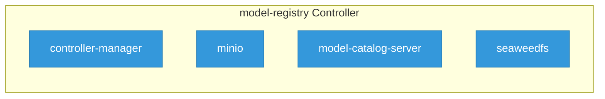

# model-registry

> **Architecture snapshot: 2026-11-28** (2026-11-28)

[Overview](index.md) · [Agent Context](agent-context.md) · [Extracted Data](details.md) · [Network](network.md) · [RBAC](rbac.md) · [Security](security.md) · [Cache](cache.md) · [Dataflow](dataflow.md)

**Repository:** red-hat-data-services/model-registry  
**Analyzer:** arch-analyzer 38b24267ad379636973f678b4ca92689c2c6fdf3  
**Extracted:** 2026-11-28T07:13:03Z

## Summary

| Metric | Count |
|--------|-------|
| CRDs | 0 |
| Deployments | 4 |
| Services | 1 |
| Secrets | 5 |
| Cluster Roles | 6 |
| Controller Watches | 2 |

## Component Architecture

CRDs, controllers, and owned Kubernetes resources.

### CRDs

No CRDs found in analyzed sources.

## Dependencies

### Key External Dependencies

| Module | Version |
|--------|---------|
| github.com/go-logr/logr | v1.4.4 |
| github.com/go-logr/logr | v1.4.4 |
| k8s.io/api | v0.37.2 |
| k8s.io/api | v0.34.5 |
| k8s.io/apimachinery | v0.37.2 |
| k8s.io/apimachinery | v0.35.2 |
| k8s.io/apimachinery | v0.37.2 |
| k8s.io/apimachinery | v0.35.2 |
| k8s.io/client-go | v0.34.5 |
| k8s.io/client-go | v0.37.2 |
| k8s.io/client-go | v0.34.5 |
| sigs.k8s.io/controller-runtime | v0.22.5 |
| sigs.k8s.io/controller-runtime | v0.25.2 |
| sigs.k8s.io/controller-runtime | v0.22.5 |

