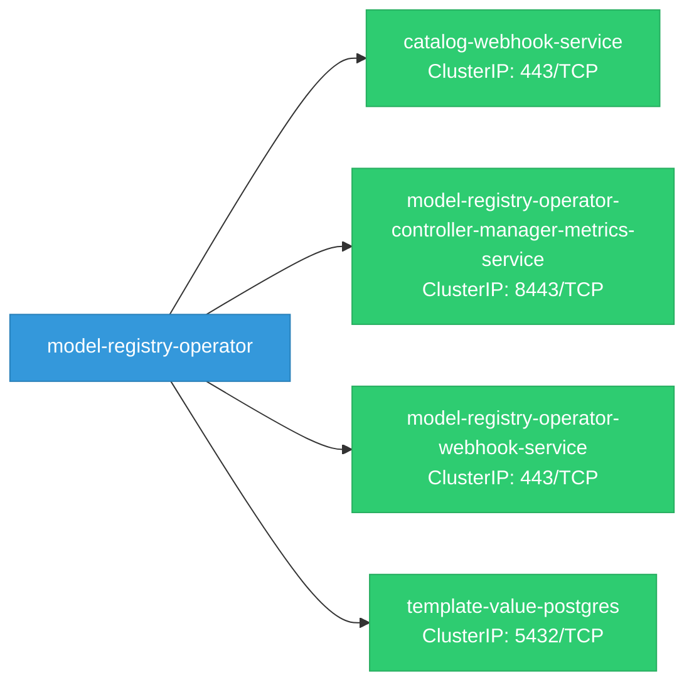
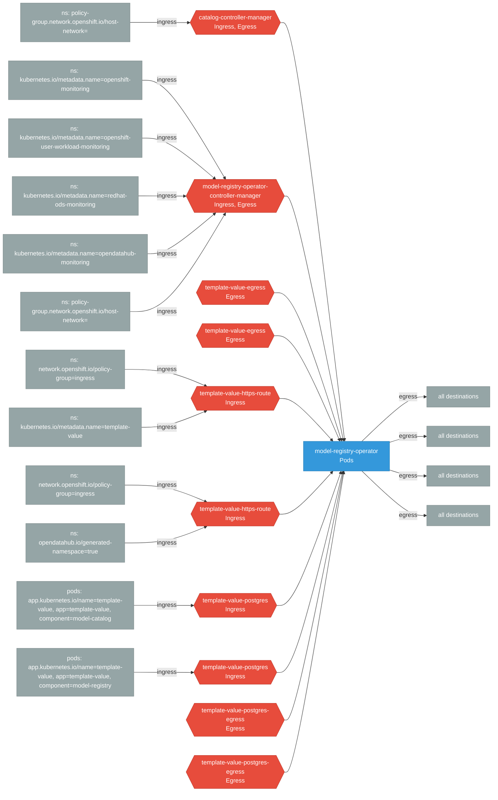

# model-registry-operator: Network

## Service Map

*4 unique services (5 total, duplicates from test fixtures collapsed).*

### Services

| Name | Type | Ports | Source |
|------|------|-------|--------|
| catalog-webhook-service | ClusterIP | 443/TCP | [`kustomize:config/overlays/odh`](https://github.com/red-hat-data-services/model-registry-operator/blob/3c3a420bd1b39f7d97013b600af7ca77d2ab55dc/kustomize:config/overlays/odh) |
| model-registry-operator-controller-manager-metrics-service | ClusterIP | 8443/TCP | [`kustomize:config/overlays/odh`](https://github.com/red-hat-data-services/model-registry-operator/blob/3c3a420bd1b39f7d97013b600af7ca77d2ab55dc/kustomize:config/overlays/odh) |
| model-registry-operator-webhook-service | ClusterIP | 443/TCP | [`kustomize:config/overlays/odh`](https://github.com/red-hat-data-services/model-registry-operator/blob/3c3a420bd1b39f7d97013b600af7ca77d2ab55dc/kustomize:config/overlays/odh) |
| template-value-postgres | ClusterIP | 5432/TCP | [`internal/controller/config/templates/catalog/catalog-postgres-service.yaml.tmpl`](https://github.com/red-hat-data-services/model-registry-operator/blob/3c3a420bd1b39f7d97013b600af7ca77d2ab55dc/internal/controller/config/templates/catalog/catalog-postgres-service.yaml.tmpl) |
| template-value-postgres | ClusterIP | 5432/TCP | [`internal/controller/config/templates/postgres-service.yaml.tmpl`](https://github.com/red-hat-data-services/model-registry-operator/blob/3c3a420bd1b39f7d97013b600af7ca77d2ab55dc/internal/controller/config/templates/postgres-service.yaml.tmpl) |

### Ingress / Routing

| Kind | Name | Hosts | Paths | TLS | Source |
|------|------|-------|-------|-----|--------|
| HTTPRoute | model-catalog |  | /catalog/ | no | [`internal/controller/config/templates/catalog/catalog-gateway-httproute.yaml.tmpl`](https://github.com/red-hat-data-services/model-registry-operator/blob/3c3a420bd1b39f7d97013b600af7ca77d2ab55dc/internal/controller/config/templates/catalog/catalog-gateway-httproute.yaml.tmpl) |
| HTTPRoute | model-registry-template-value |  | /model-registry/template-value/ | no | [`internal/controller/config/templates/gateway/gateway-httproute.yaml.tmpl`](https://github.com/red-hat-data-services/model-registry-operator/blob/3c3a420bd1b39f7d97013b600af7ca77d2ab55dc/internal/controller/config/templates/gateway/gateway-httproute.yaml.tmpl) |
| Route | template-value-http |  |  | no | [`internal/controller/config/templates/http-route.yaml.tmpl`](https://github.com/red-hat-data-services/model-registry-operator/blob/3c3a420bd1b39f7d97013b600af7ca77d2ab55dc/internal/controller/config/templates/http-route.yaml.tmpl) |
| Route | template-value-https | template-value.template-value |  | yes | [`internal/controller/config/templates/catalog/catalog-kube-rbac-proxy-https-route.yaml.tmpl`](https://github.com/red-hat-data-services/model-registry-operator/blob/3c3a420bd1b39f7d97013b600af7ca77d2ab55dc/internal/controller/config/templates/catalog/catalog-kube-rbac-proxy-https-route.yaml.tmpl) |
| Route | template-value-https | template-value-rest.template-value |  | yes | [`internal/controller/config/templates/kube-rbac-proxy/kube-rbac-proxy-https-route.yaml.tmpl`](https://github.com/red-hat-data-services/model-registry-operator/blob/3c3a420bd1b39f7d97013b600af7ca77d2ab55dc/internal/controller/config/templates/kube-rbac-proxy/kube-rbac-proxy-https-route.yaml.tmpl) |

### Network Policies

| Name | Policy Types | Source |
|------|-------------|--------|
| catalog-controller-manager | Ingress, Egress | [`kustomize:config/overlays/odh`](https://github.com/red-hat-data-services/model-registry-operator/blob/3c3a420bd1b39f7d97013b600af7ca77d2ab55dc/kustomize:config/overlays/odh) |
| model-registry-operator-controller-manager | Ingress, Egress | [`kustomize:config/overlays/odh`](https://github.com/red-hat-data-services/model-registry-operator/blob/3c3a420bd1b39f7d97013b600af7ca77d2ab55dc/kustomize:config/overlays/odh) |
| template-value-egress | Egress | [`internal/controller/config/templates/catalog/catalog-egress-network-policy.yaml.tmpl`](https://github.com/red-hat-data-services/model-registry-operator/blob/3c3a420bd1b39f7d97013b600af7ca77d2ab55dc/internal/controller/config/templates/catalog/catalog-egress-network-policy.yaml.tmpl) |
| template-value-egress | Egress | [`internal/controller/config/templates/egress-network-policy.yaml.tmpl`](https://github.com/red-hat-data-services/model-registry-operator/blob/3c3a420bd1b39f7d97013b600af7ca77d2ab55dc/internal/controller/config/templates/egress-network-policy.yaml.tmpl) |
| template-value-https-route | Ingress | [`internal/controller/config/templates/catalog/catalog-kube-rbac-proxy-network-policy.yaml.tmpl`](https://github.com/red-hat-data-services/model-registry-operator/blob/3c3a420bd1b39f7d97013b600af7ca77d2ab55dc/internal/controller/config/templates/catalog/catalog-kube-rbac-proxy-network-policy.yaml.tmpl) |
| template-value-https-route | Ingress | [`internal/controller/config/templates/ingress-network-policy.yaml.tmpl`](https://github.com/red-hat-data-services/model-registry-operator/blob/3c3a420bd1b39f7d97013b600af7ca77d2ab55dc/internal/controller/config/templates/ingress-network-policy.yaml.tmpl) |
| template-value-postgres | Ingress | [`internal/controller/config/templates/catalog/catalog-postgres-network-policy.yaml.tmpl`](https://github.com/red-hat-data-services/model-registry-operator/blob/3c3a420bd1b39f7d97013b600af7ca77d2ab55dc/internal/controller/config/templates/catalog/catalog-postgres-network-policy.yaml.tmpl) |
| template-value-postgres | Ingress | [`internal/controller/config/templates/postgres-network-policy.yaml.tmpl`](https://github.com/red-hat-data-services/model-registry-operator/blob/3c3a420bd1b39f7d97013b600af7ca77d2ab55dc/internal/controller/config/templates/postgres-network-policy.yaml.tmpl) |
| template-value-postgres-egress | Egress | [`internal/controller/config/templates/catalog/catalog-postgres-egress-network-policy.yaml.tmpl`](https://github.com/red-hat-data-services/model-registry-operator/blob/3c3a420bd1b39f7d97013b600af7ca77d2ab55dc/internal/controller/config/templates/catalog/catalog-postgres-egress-network-policy.yaml.tmpl) |
| template-value-postgres-egress | Egress | [`internal/controller/config/templates/postgres-egress-network-policy.yaml.tmpl`](https://github.com/red-hat-data-services/model-registry-operator/blob/3c3a420bd1b39f7d97013b600af7ca77d2ab55dc/internal/controller/config/templates/postgres-egress-network-policy.yaml.tmpl) |

## Network Policy Graph

Visual representation of NetworkPolicy rules. Ingress rules show what traffic is allowed into pods, egress rules show what traffic is allowed out.

