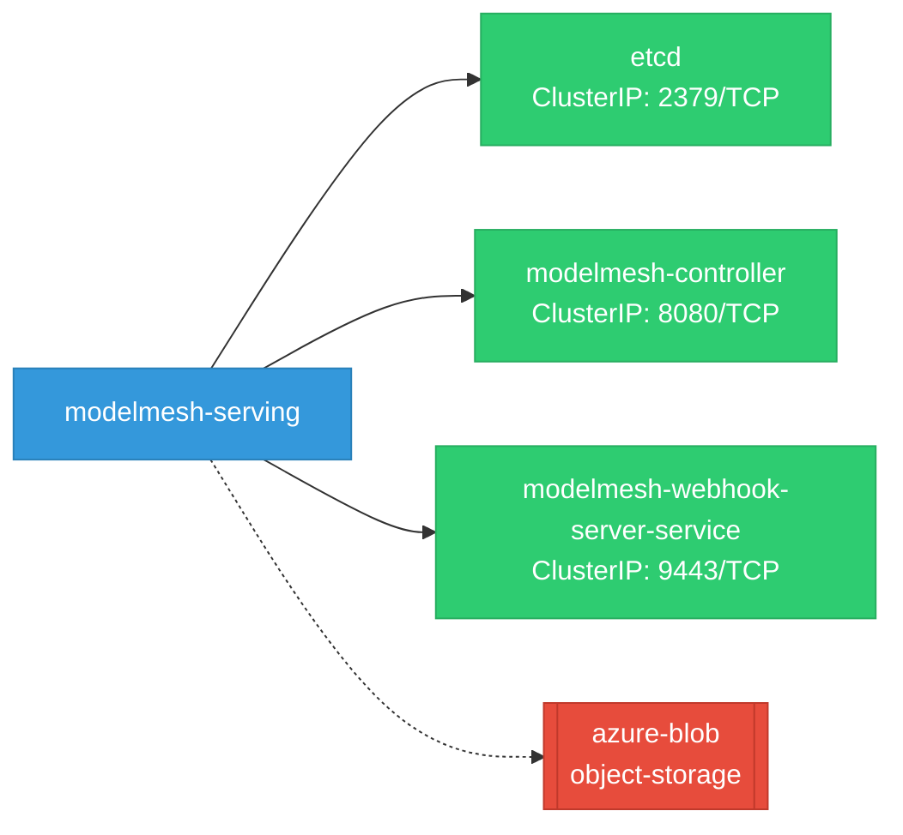
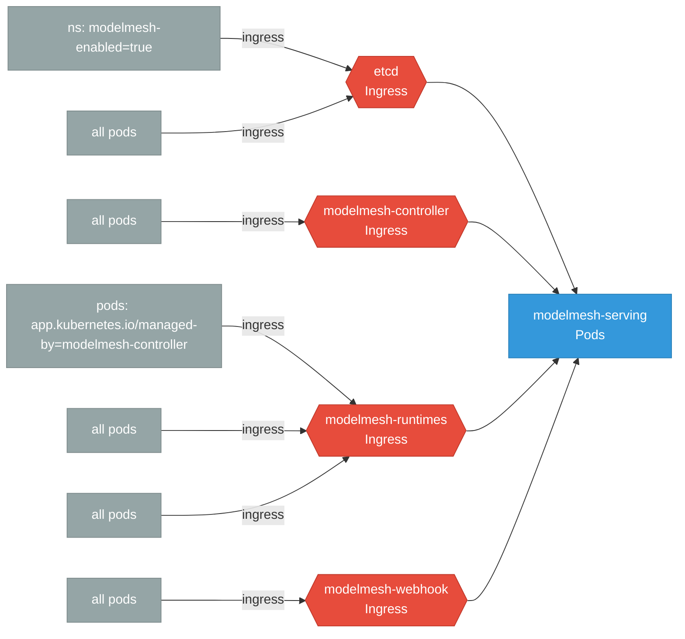

# modelmesh-serving: Network

[Overview](index.md) · [Agent Context](agent-context.md) · [Extracted Data](details.md) · [Network](network.md) · [RBAC](rbac.md) · [Security](security.md) · [Cache](cache.md) · [Dataflow](dataflow.md)

## Service Map

### Services

| Name | Type | Ports | Source |
|------|------|-------|--------|
| etcd | ClusterIP | 2379/TCP | [`kustomize:config/overlays/odh`](https://github.com/red-hat-data-services/modelmesh-serving/blob/2751b227f532385b73e407e5a6f09ee61920406a/kustomize:config/overlays/odh) |
| modelmesh-controller | ClusterIP | 8080/TCP | [`kustomize:config/overlays/odh`](https://github.com/red-hat-data-services/modelmesh-serving/blob/2751b227f532385b73e407e5a6f09ee61920406a/kustomize:config/overlays/odh) |
| modelmesh-webhook-server-service | ClusterIP | 9443/TCP | [`kustomize:config/overlays/odh`](https://github.com/red-hat-data-services/modelmesh-serving/blob/2751b227f532385b73e407e5a6f09ee61920406a/kustomize:config/overlays/odh) |

### Network Policies

| Name | Policy Types | Source |
|------|-------------|--------|
| etcd | Ingress | [`kustomize:config/overlays/odh`](https://github.com/red-hat-data-services/modelmesh-serving/blob/2751b227f532385b73e407e5a6f09ee61920406a/kustomize:config/overlays/odh) |
| modelmesh-controller | Ingress | [`kustomize:config/overlays/odh`](https://github.com/red-hat-data-services/modelmesh-serving/blob/2751b227f532385b73e407e5a6f09ee61920406a/kustomize:config/overlays/odh) |
| modelmesh-runtimes | Ingress | [`config/rbac/common/networkpolicy-runtimes.yaml`](https://github.com/red-hat-data-services/modelmesh-serving/blob/2751b227f532385b73e407e5a6f09ee61920406a/config/rbac/common/networkpolicy-runtimes.yaml) |
| modelmesh-webhook | Ingress | [`kustomize:config/overlays/odh`](https://github.com/red-hat-data-services/modelmesh-serving/blob/2751b227f532385b73e407e5a6f09ee61920406a/kustomize:config/overlays/odh) |

## Network Policy Graph

Visual representation of NetworkPolicy rules. Ingress rules show what traffic is allowed into pods, egress rules show what traffic is allowed out.

