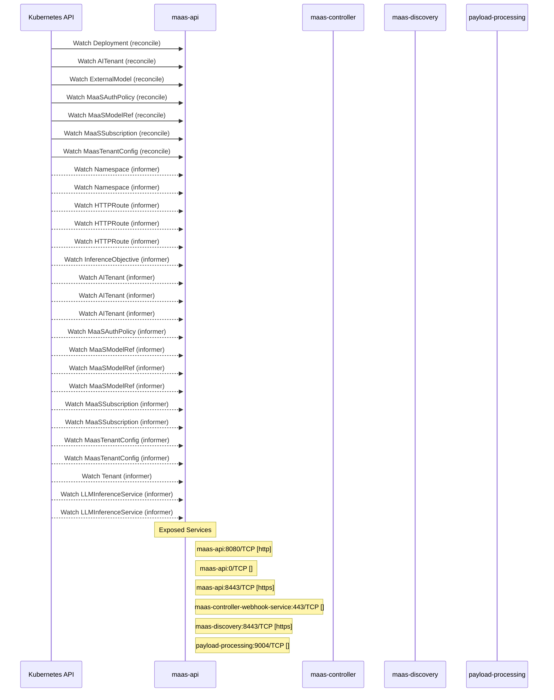

# models-as-a-service: Dataflow

## Controller Watches

Kubernetes resources this controller monitors for changes. Each watch triggers reconciliation when the watched resource is created, updated, or deleted.

| Type | GVK | Source |
|------|-----|--------|
| For | apps/v1/Deployment | [`maas-controller/pkg/controller/maas/self_deployment_controller.go:1089`](https://github.com/red-hat-data-services/models-as-a-service/blob/6666e0478c1fbd786c28be3fc9de36d6fa807c26/maas-controller/pkg/controller/maas/self_deployment_controller.go#L1089) |
| For | maas/v1alpha1/AITenant | [`maas-controller/pkg/controller/maas/aitenant_controller.go:291`](https://github.com/red-hat-data-services/models-as-a-service/blob/6666e0478c1fbd786c28be3fc9de36d6fa807c26/maas-controller/pkg/controller/maas/aitenant_controller.go#L291) |
| For | maas/v1alpha1/ExternalModel | [`maas-controller/pkg/reconciler/externalmodel/reconciler.go:439`](https://github.com/red-hat-data-services/models-as-a-service/blob/6666e0478c1fbd786c28be3fc9de36d6fa807c26/maas-controller/pkg/reconciler/externalmodel/reconciler.go#L439) |
| For | maas/v1alpha1/MaaSAuthPolicy | [`maas-controller/pkg/controller/maas/maasauthpolicy_controller.go:2245`](https://github.com/red-hat-data-services/models-as-a-service/blob/6666e0478c1fbd786c28be3fc9de36d6fa807c26/maas-controller/pkg/controller/maas/maasauthpolicy_controller.go#L2245) |
| For | maas/v1alpha1/MaaSModelRef | [`maas-controller/pkg/controller/maas/maasmodelref_controller.go:717`](https://github.com/red-hat-data-services/models-as-a-service/blob/6666e0478c1fbd786c28be3fc9de36d6fa807c26/maas-controller/pkg/controller/maas/maasmodelref_controller.go#L717) |
| For | maas/v1alpha1/MaaSSubscription | [`maas-controller/pkg/controller/maas/maassubscription_controller.go:1455`](https://github.com/red-hat-data-services/models-as-a-service/blob/6666e0478c1fbd786c28be3fc9de36d6fa807c26/maas-controller/pkg/controller/maas/maassubscription_controller.go#L1455) |
| For | maas/v1alpha1/MaasTenantConfig | [`maas-controller/pkg/controller/maas/tenant_controller.go:320`](https://github.com/red-hat-data-services/models-as-a-service/blob/6666e0478c1fbd786c28be3fc9de36d6fa807c26/maas-controller/pkg/controller/maas/tenant_controller.go#L320) |
| Watches | /v1/Namespace | [`maas-controller/pkg/controller/maas/maasauthpolicy_controller.go:2318`](https://github.com/red-hat-data-services/models-as-a-service/blob/6666e0478c1fbd786c28be3fc9de36d6fa807c26/maas-controller/pkg/controller/maas/maasauthpolicy_controller.go#L2318) |
| Watches | /v1/Namespace | [`maas-controller/pkg/controller/maas/maassubscription_controller.go:1534`](https://github.com/red-hat-data-services/models-as-a-service/blob/6666e0478c1fbd786c28be3fc9de36d6fa807c26/maas-controller/pkg/controller/maas/maassubscription_controller.go#L1534) |
| Watches | apis/v1/HTTPRoute | [`maas-controller/pkg/controller/maas/maasauthpolicy_controller.go:2251`](https://github.com/red-hat-data-services/models-as-a-service/blob/6666e0478c1fbd786c28be3fc9de36d6fa807c26/maas-controller/pkg/controller/maas/maasauthpolicy_controller.go#L2251) |
| Watches | apis/v1/HTTPRoute | [`maas-controller/pkg/controller/maas/maasmodelref_controller.go:723`](https://github.com/red-hat-data-services/models-as-a-service/blob/6666e0478c1fbd786c28be3fc9de36d6fa807c26/maas-controller/pkg/controller/maas/maasmodelref_controller.go#L723) |
| Watches | apis/v1/HTTPRoute | [`maas-controller/pkg/controller/maas/maassubscription_controller.go:1468`](https://github.com/red-hat-data-services/models-as-a-service/blob/6666e0478c1fbd786c28be3fc9de36d6fa807c26/maas-controller/pkg/controller/maas/maassubscription_controller.go#L1468) |
| Watches | apix/v1alpha2/InferenceObjective | [`maas-controller/pkg/controller/maas/maassubscription_controller.go:1506`](https://github.com/red-hat-data-services/models-as-a-service/blob/6666e0478c1fbd786c28be3fc9de36d6fa807c26/maas-controller/pkg/controller/maas/maassubscription_controller.go#L1506) |
| Watches | maas/v1alpha1/AITenant | [`maas-controller/pkg/controller/maas/maasauthpolicy_controller.go:2265`](https://github.com/red-hat-data-services/models-as-a-service/blob/6666e0478c1fbd786c28be3fc9de36d6fa807c26/maas-controller/pkg/controller/maas/maasauthpolicy_controller.go#L2265) |
| Watches | maas/v1alpha1/AITenant | [`maas-controller/pkg/controller/maas/maasmodelref_controller.go:790`](https://github.com/red-hat-data-services/models-as-a-service/blob/6666e0478c1fbd786c28be3fc9de36d6fa807c26/maas-controller/pkg/controller/maas/maasmodelref_controller.go#L790) |
| Watches | maas/v1alpha1/AITenant | [`maas-controller/pkg/controller/maas/maassubscription_controller.go:1477`](https://github.com/red-hat-data-services/models-as-a-service/blob/6666e0478c1fbd786c28be3fc9de36d6fa807c26/maas-controller/pkg/controller/maas/maassubscription_controller.go#L1477) |
| Watches | maas/v1alpha1/MaaSAuthPolicy | [`maas-controller/pkg/controller/maas/maasmodelref_controller.go:784`](https://github.com/red-hat-data-services/models-as-a-service/blob/6666e0478c1fbd786c28be3fc9de36d6fa807c26/maas-controller/pkg/controller/maas/maasmodelref_controller.go#L784) |
| Watches | maas/v1alpha1/MaaSModelRef | [`maas-controller/pkg/controller/maas/maasmodelref_controller.go:733`](https://github.com/red-hat-data-services/models-as-a-service/blob/6666e0478c1fbd786c28be3fc9de36d6fa807c26/maas-controller/pkg/controller/maas/maasmodelref_controller.go#L733) |
| Watches | maas/v1alpha1/MaaSModelRef | [`maas-controller/pkg/controller/maas/maassubscription_controller.go:1472`](https://github.com/red-hat-data-services/models-as-a-service/blob/6666e0478c1fbd786c28be3fc9de36d6fa807c26/maas-controller/pkg/controller/maas/maassubscription_controller.go#L1472) |
| Watches | maas/v1alpha1/MaaSModelRef | [`maas-controller/pkg/controller/maas/maasauthpolicy_controller.go:2255`](https://github.com/red-hat-data-services/models-as-a-service/blob/6666e0478c1fbd786c28be3fc9de36d6fa807c26/maas-controller/pkg/controller/maas/maasauthpolicy_controller.go#L2255) |
| Watches | maas/v1alpha1/MaaSSubscription | [`maas-controller/pkg/controller/maas/maasauthpolicy_controller.go:2278`](https://github.com/red-hat-data-services/models-as-a-service/blob/6666e0478c1fbd786c28be3fc9de36d6fa807c26/maas-controller/pkg/controller/maas/maasauthpolicy_controller.go#L2278) |
| Watches | maas/v1alpha1/MaaSSubscription | [`maas-controller/pkg/controller/maas/maasmodelref_controller.go:780`](https://github.com/red-hat-data-services/models-as-a-service/blob/6666e0478c1fbd786c28be3fc9de36d6fa807c26/maas-controller/pkg/controller/maas/maasmodelref_controller.go#L780) |
| Watches | maas/v1alpha1/MaasTenantConfig | [`maas-controller/pkg/controller/maas/maassubscription_controller.go:1482`](https://github.com/red-hat-data-services/models-as-a-service/blob/6666e0478c1fbd786c28be3fc9de36d6fa807c26/maas-controller/pkg/controller/maas/maassubscription_controller.go#L1482) |
| Watches | maas/v1alpha1/MaasTenantConfig | [`maas-controller/pkg/controller/maas/maasauthpolicy_controller.go:2271`](https://github.com/red-hat-data-services/models-as-a-service/blob/6666e0478c1fbd786c28be3fc9de36d6fa807c26/maas-controller/pkg/controller/maas/maasauthpolicy_controller.go#L2271) |
| Watches | maas/v1alpha1/Tenant | [`maas-controller/pkg/controller/maas/maassubscription_controller.go:1485`](https://github.com/red-hat-data-services/models-as-a-service/blob/6666e0478c1fbd786c28be3fc9de36d6fa807c26/maas-controller/pkg/controller/maas/maassubscription_controller.go#L1485) |
| Watches | serving/v1alpha2/LLMInferenceService | [`maas-controller/pkg/controller/maas/maassubscription_controller.go:1494`](https://github.com/red-hat-data-services/models-as-a-service/blob/6666e0478c1fbd786c28be3fc9de36d6fa807c26/maas-controller/pkg/controller/maas/maassubscription_controller.go#L1494) |
| Watches | serving/v1alpha2/LLMInferenceService | [`maas-controller/pkg/controller/maas/maasmodelref_controller.go:759`](https://github.com/red-hat-data-services/models-as-a-service/blob/6666e0478c1fbd786c28be3fc9de36d6fa807c26/maas-controller/pkg/controller/maas/maasmodelref_controller.go#L759) |

## Reconciliation Flow

How the controller interacts with the Kubernetes API during reconciliation.

### Webhooks

| Name | Type | Path | Failure Policy | Service | Overlays | Enable Condition | Sources |
|------|------|------|----------------|---------|----------|------------------|----------|
| vaitenant.kb.io | validating | /validate-maas-opendatahub-io-v1alpha1-aitenant | Fail | system/maas-controller-webhook-service |  |  | [`deployment/base/maas-controller/webhook/validating_webhook_configuration.yaml`](https://github.com/red-hat-data-services/models-as-a-service/blob/6666e0478c1fbd786c28be3fc9de36d6fa807c26/deployment/base/maas-controller/webhook/validating_webhook_configuration.yaml) |
| vexternalmodel.kb.io | validating | /validate-maas-opendatahub-io-v1alpha1-externalmodel | Fail | system/maas-controller-webhook-service |  |  | [`deployment/base/maas-controller/webhook/validating_webhook_configuration.yaml`](https://github.com/red-hat-data-services/models-as-a-service/blob/6666e0478c1fbd786c28be3fc9de36d6fa807c26/deployment/base/maas-controller/webhook/validating_webhook_configuration.yaml) |
| vmaasauthpolicy.kb.io | validating | /validate-maas-opendatahub-io-v1alpha1-maasauthpolicy | Fail | system/maas-controller-webhook-service |  |  | [`deployment/base/maas-controller/webhook/validating_webhook_configuration.yaml`](https://github.com/red-hat-data-services/models-as-a-service/blob/6666e0478c1fbd786c28be3fc9de36d6fa807c26/deployment/base/maas-controller/webhook/validating_webhook_configuration.yaml) |
| vmaasmodelref.kb.io | validating | /validate-maas-opendatahub-io-v1alpha1-maasmodelref | Fail | system/maas-controller-webhook-service |  |  | [`deployment/base/maas-controller/webhook/validating_webhook_configuration.yaml`](https://github.com/red-hat-data-services/models-as-a-service/blob/6666e0478c1fbd786c28be3fc9de36d6fa807c26/deployment/base/maas-controller/webhook/validating_webhook_configuration.yaml) |
| vmaassubscription.kb.io | validating | /validate-maas-opendatahub-io-v1alpha1-maassubscription | Fail | system/maas-controller-webhook-service |  |  | [`deployment/base/maas-controller/webhook/validating_webhook_configuration.yaml`](https://github.com/red-hat-data-services/models-as-a-service/blob/6666e0478c1fbd786c28be3fc9de36d6fa807c26/deployment/base/maas-controller/webhook/validating_webhook_configuration.yaml) |

### HTTP Endpoints

| Method | Path | Source |
|--------|------|--------|
| OPTIONS | /*path | [`maas-api/cmd/main.go:171`](https://github.com/red-hat-data-services/models-as-a-service/blob/6666e0478c1fbd786c28be3fc9de36d6fa807c26/maas-api/cmd/main.go#L171) |
| DELETE | /:id | [`maas-api/cmd/main.go:366`](https://github.com/red-hat-data-services/models-as-a-service/blob/6666e0478c1fbd786c28be3fc9de36d6fa807c26/maas-api/cmd/main.go#L366) |
| GET | /:id | [`maas-api/cmd/main.go:365`](https://github.com/red-hat-data-services/models-as-a-service/blob/6666e0478c1fbd786c28be3fc9de36d6fa807c26/maas-api/cmd/main.go#L365) |
| * | /api-keys | [`maas-api/cmd/main.go:361`](https://github.com/red-hat-data-services/models-as-a-service/blob/6666e0478c1fbd786c28be3fc9de36d6fa807c26/maas-api/cmd/main.go#L361) |
| POST | /api-keys/cleanup | [`maas-api/cmd/main.go:384`](https://github.com/red-hat-data-services/models-as-a-service/blob/6666e0478c1fbd786c28be3fc9de36d6fa807c26/maas-api/cmd/main.go#L384) |
| POST | /api-keys/search | [`maas-api/cmd/main.go:369`](https://github.com/red-hat-data-services/models-as-a-service/blob/6666e0478c1fbd786c28be3fc9de36d6fa807c26/maas-api/cmd/main.go#L369) |
| POST | /api-keys/validate | [`maas-api/cmd/main.go:382`](https://github.com/red-hat-data-services/models-as-a-service/blob/6666e0478c1fbd786c28be3fc9de36d6fa807c26/maas-api/cmd/main.go#L382) |
| POST | /bulk-revoke | [`maas-api/cmd/main.go:364`](https://github.com/red-hat-data-services/models-as-a-service/blob/6666e0478c1fbd786c28be3fc9de36d6fa807c26/maas-api/cmd/main.go#L364) |
| GET | /config | [`maas-api/cmd/main.go:362`](https://github.com/red-hat-data-services/models-as-a-service/blob/6666e0478c1fbd786c28be3fc9de36d6fa807c26/maas-api/cmd/main.go#L362) |
| GET | /health | [`maas-api/cmd/main.go:266`](https://github.com/red-hat-data-services/models-as-a-service/blob/6666e0478c1fbd786c28be3fc9de36d6fa807c26/maas-api/cmd/main.go#L266) |
| GET | /healthz | [`maas-discovery/internal/handler/handler.go:84`](https://github.com/red-hat-data-services/models-as-a-service/blob/6666e0478c1fbd786c28be3fc9de36d6fa807c26/maas-discovery/internal/handler/handler.go#L84) |
| * | /internal/v1 | [`maas-api/cmd/main.go:381`](https://github.com/red-hat-data-services/models-as-a-service/blob/6666e0478c1fbd786c28be3fc9de36d6fa807c26/maas-api/cmd/main.go#L381) |
| GET | /me | [`maas-api/cmd/main.go:345`](https://github.com/red-hat-data-services/models-as-a-service/blob/6666e0478c1fbd786c28be3fc9de36d6fa807c26/maas-api/cmd/main.go#L345) |
| * | /metrics | [`maas-api/internal/metrics/server.go:86`](https://github.com/red-hat-data-services/models-as-a-service/blob/6666e0478c1fbd786c28be3fc9de36d6fa807c26/maas-api/internal/metrics/server.go#L86) |
| GET | /model/:model-id/subscriptions | [`maas-api/cmd/main.go:350`](https://github.com/red-hat-data-services/models-as-a-service/blob/6666e0478c1fbd786c28be3fc9de36d6fa807c26/maas-api/cmd/main.go#L350) |
| GET | /models | [`maas-api/cmd/main.go:331`](https://github.com/red-hat-data-services/models-as-a-service/blob/6666e0478c1fbd786c28be3fc9de36d6fa807c26/maas-api/cmd/main.go#L331) |
| GET | /readyz | [`maas-discovery/internal/handler/handler.go:85`](https://github.com/red-hat-data-services/models-as-a-service/blob/6666e0478c1fbd786c28be3fc9de36d6fa807c26/maas-discovery/internal/handler/handler.go#L85) |
| GET | /subscriptions | [`maas-api/cmd/main.go:349`](https://github.com/red-hat-data-services/models-as-a-service/blob/6666e0478c1fbd786c28be3fc9de36d6fa807c26/maas-api/cmd/main.go#L349) |
| POST | /subscriptions/select | [`maas-api/cmd/main.go:387`](https://github.com/red-hat-data-services/models-as-a-service/blob/6666e0478c1fbd786c28be3fc9de36d6fa807c26/maas-api/cmd/main.go#L387) |
| GET | /tenants | [`maas-api/cmd/main.go:373`](https://github.com/red-hat-data-services/models-as-a-service/blob/6666e0478c1fbd786c28be3fc9de36d6fa807c26/maas-api/cmd/main.go#L373) |
| DELETE | /tenants/:tenant/api-keys | [`maas-api/cmd/main.go:385`](https://github.com/red-hat-data-services/models-as-a-service/blob/6666e0478c1fbd786c28be3fc9de36d6fa807c26/maas-api/cmd/main.go#L385) |
| DELETE | /tenants/:tenant/subscriptions/:subscription/api-keys | [`maas-api/cmd/main.go:386`](https://github.com/red-hat-data-services/models-as-a-service/blob/6666e0478c1fbd786c28be3fc9de36d6fa807c26/maas-api/cmd/main.go#L386) |
| * | /v1 | [`maas-api/cmd/main.go:274`](https://github.com/red-hat-data-services/models-as-a-service/blob/6666e0478c1fbd786c28be3fc9de36d6fa807c26/maas-api/cmd/main.go#L274) |
| GET | /v1/tenants | [`maas-discovery/internal/handler/handler.go:83`](https://github.com/red-hat-data-services/models-as-a-service/blob/6666e0478c1fbd786c28be3fc9de36d6fa807c26/maas-discovery/internal/handler/handler.go#L83) |

## Configuration

ConfigMaps and Helm values that control this component's runtime behavior.

