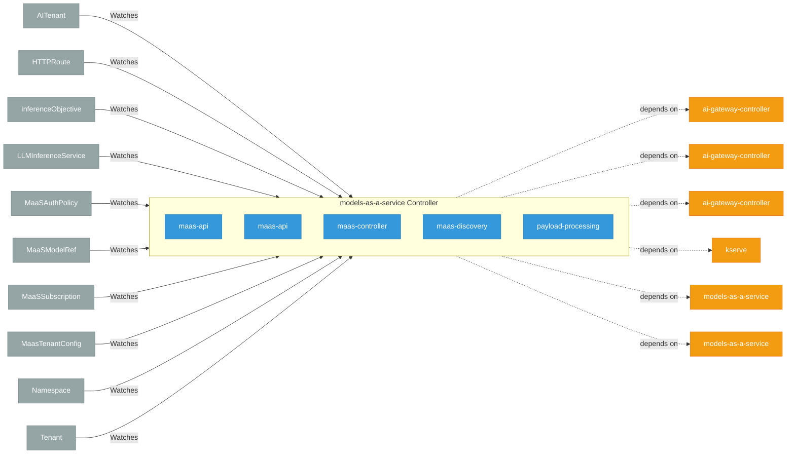

# models-as-a-service

> **Architecture snapshot: 2026-10-31** (2026-10-31)

**Repository:** red-hat-data-services/models-as-a-service  
**Analyzer:** arch-analyzer dev  
**Extracted:** 2026-10-31T04:56:33Z

## Summary

| Metric | Count |
|--------|-------|
| CRDs | 0 |
| Deployments | 5 |
| Services | 5 |
| Secrets | 5 |
| Cluster Roles | 0 |
| Controller Watches | 27 |

## Component Architecture

CRDs, controllers, and owned Kubernetes resources.

### CRDs

No CRDs found in analyzed sources.

## Dependencies

### Internal Platform Dependencies

| Component | Interaction |
|-----------|-------------|
| ai-gateway-controller | Go module dependency: github.com/opendatahub-io/ai-gateway-controller |
| ai-gateway-controller | Go module dependency: github.com/opendatahub-io/ai-gateway-controller |
| ai-gateway-controller | Go module dependency: github.com/opendatahub-io/ai-gateway-controller |
| kserve | Go module dependency: github.com/opendatahub-io/kserve |
| models-as-a-service | Go module dependency: github.com/opendatahub-io/models-as-a-service/maas-common |
| models-as-a-service | Go module dependency: github.com/opendatahub-io/models-as-a-service/maas-common |

### Key External Dependencies

| Module | Version |
|--------|---------|
| github.com/go-logr/logr | v1.4.4 |
| github.com/go-logr/logr | v1.4.4 |
| github.com/go-logr/zapr | v1.3.0 |
| github.com/prometheus/client_golang | v1.24.1 |
| github.com/prometheus/client_model | v0.6.3 |
| google.golang.org/grpc | v1.84.0 |
| k8s.io/api | v0.37.1 |
| k8s.io/api | v0.35.3 |
| k8s.io/api | v0.36.4 |
| k8s.io/apiextensions-apiserver | v0.36.4 |
| k8s.io/apimachinery | v0.36.4 |
| k8s.io/apimachinery | v0.35.3 |
| k8s.io/apimachinery | v0.35.3 |
| k8s.io/apimachinery | v0.37.1 |
| k8s.io/apiserver | v0.36.4 |
| k8s.io/client-go | v0.37.1 |
| k8s.io/client-go | v0.36.4 |
| k8s.io/client-go | v0.35.3 |
| sigs.k8s.io/controller-runtime | v0.24.1 |
| sigs.k8s.io/controller-runtime | v0.25.2 |

