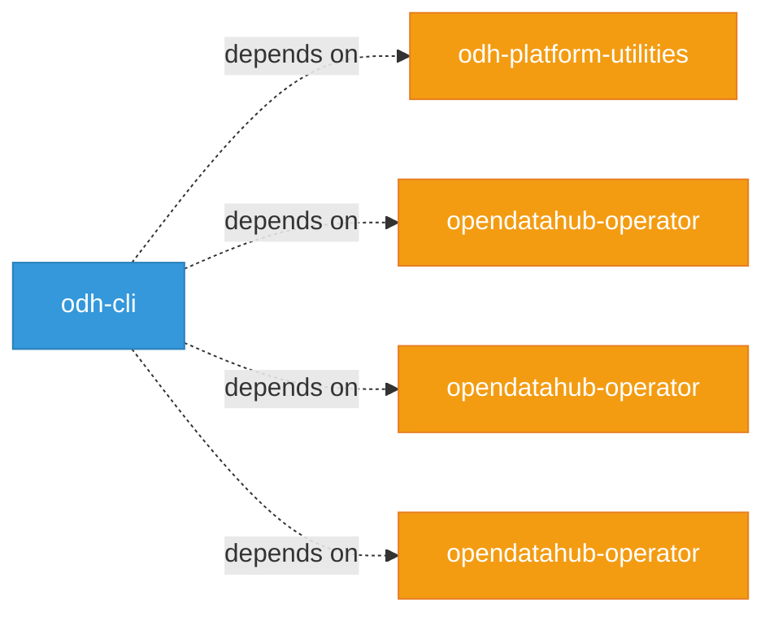

# odh-cli

> **Architecture snapshot: 2026-11-21** (2026-11-21)

**Repository:** red-hat-data-services/odh-cli  
**Analyzer:** arch-analyzer f62b7632f89631498789b54d78e8c552c27100c7  
**Extracted:** 2026-11-21T06:39:20Z

See [Agent Context](agent-context.md) for repository structure and code relationships, and [Extracted Data](details.md) for dependency and configuration details.

## Summary

| Metric | Count |
|--------|-------|
| CRDs | 0 |
| Deployments | 0 |
| Services | 0 |
| Secrets | 0 |
| Cluster Roles | 0 |
| Controller Watches | 0 |

## Component Architecture

CRDs, controllers, and owned Kubernetes resources.

### CRDs

No CRDs found in analyzed sources.

## Dependencies

### Internal Platform Dependencies

| Component | Interaction |
|-----------|-------------|
| odh-platform-utilities | Go module dependency: github.com/opendatahub-io/odh-platform-utilities |
| opendatahub-operator | Go module dependency: github.com/opendatahub-io/opendatahub-operator/pkg/clusterhealth |
| opendatahub-operator | Go module dependency: github.com/opendatahub-io/opendatahub-operator/pkg/failureclassifier |
| opendatahub-operator | Go module dependency: github.com/opendatahub-io/opendatahub-operator/pkg/mcptools |

### Key External Dependencies

| Module | Version |
|--------|---------|
| github.com/operator-framework/api | v0.39.0 |
| github.com/operator-framework/operator-lifecycle-manager | v0.40.0 |
| k8s.io/api | v0.35.3 |
| k8s.io/apiextensions-apiserver | v0.35.3 |
| k8s.io/apimachinery | v0.35.4 |
| k8s.io/client-go | v0.35.3 |
| sigs.k8s.io/controller-runtime | v0.23.3 |

