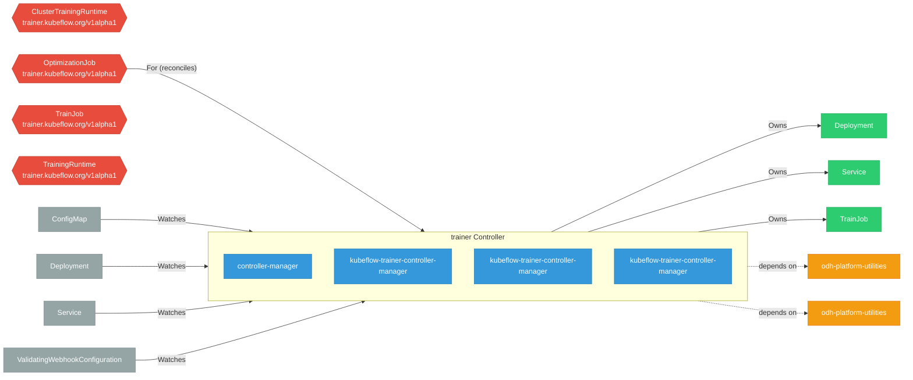

# trainer

> **Architecture snapshot: 2026-11-14** (2026-11-14)

**Repository:** red-hat-data-services/trainer  
**Analyzer:** arch-analyzer dev  
**Extracted:** 2026-11-14T05:50:52Z

## Summary

| Metric | Count |
|--------|-------|
| CRDs | 4 |
| Deployments | 4 |
| Services | 0 |
| Secrets | 1 |
| Cluster Roles | 11 |
| Controller Watches | 9 |

## Component Architecture

CRDs, controllers, and owned Kubernetes resources.

### CRDs

| Group | Version | Kind | Scope | Fields | Validation Rules | Discovery | Source |
|-------|---------|------|-------|--------|------------------|-----------|--------|
| trainer.kubeflow.org | v1alpha1 | ClusterTrainingRuntime | Cluster | 1307 | 19 | YAML | [`manifests/base/crds/trainer.kubeflow.org_clustertrainingruntimes.yaml`](https://github.com/red-hat-data-services/trainer/blob/cc8278f05532a988e858a8d7292adc50bab98800/manifests/base/crds/trainer.kubeflow.org_clustertrainingruntimes.yaml) |
| trainer.kubeflow.org | v1alpha1 | OptimizationJob | Namespaced | 729 | 21 | YAML + Go AST | [`manifests/base/crds/trainer.kubeflow.org_optimizationjobs.yaml`](https://github.com/red-hat-data-services/trainer/blob/cc8278f05532a988e858a8d7292adc50bab98800/manifests/base/crds/trainer.kubeflow.org_optimizationjobs.yaml) |
| trainer.kubeflow.org | v1alpha1 | TrainJob | Namespaced | 708 | 14 | YAML | [`manifests/base/crds/trainer.kubeflow.org_trainjobs.yaml`](https://github.com/red-hat-data-services/trainer/blob/cc8278f05532a988e858a8d7292adc50bab98800/manifests/base/crds/trainer.kubeflow.org_trainjobs.yaml) |
| trainer.kubeflow.org | v1alpha1 | TrainingRuntime | Namespaced | 1307 | 19 | YAML | [`manifests/base/crds/trainer.kubeflow.org_trainingruntimes.yaml`](https://github.com/red-hat-data-services/trainer/blob/cc8278f05532a988e858a8d7292adc50bab98800/manifests/base/crds/trainer.kubeflow.org_trainingruntimes.yaml) |

## Dependencies

### Internal Platform Dependencies

| Component | Interaction |
|-----------|-------------|
| odh-platform-utilities | Go module dependency: github.com/opendatahub-io/odh-platform-utilities |
| odh-platform-utilities | Go module dependency: github.com/opendatahub-io/odh-platform-utilities/framework |

### Key External Dependencies

| Module | Version |
|--------|---------|
| github.com/go-logr/logr | v1.4.4 |
| github.com/go-logr/logr | v1.4.4 |
| github.com/operator-framework/api | v0.42.0 |
| github.com/prometheus/client_golang | v1.25.0 |
| google.golang.org/grpc | v1.84.0 |
| k8s.io/api | v0.37.1 |
| k8s.io/api | v0.37.1 |
| k8s.io/apiextensions-apiserver | v0.37.1 |
| k8s.io/apimachinery | v0.37.1 |
| k8s.io/apimachinery | v0.37.1 |
| k8s.io/apiserver | v0.37.1 |
| k8s.io/client-go | v0.37.1 |
| k8s.io/client-go | v0.37.1 |
| sigs.k8s.io/controller-runtime | v0.25.2 |
| sigs.k8s.io/controller-runtime | v0.25.2 |

