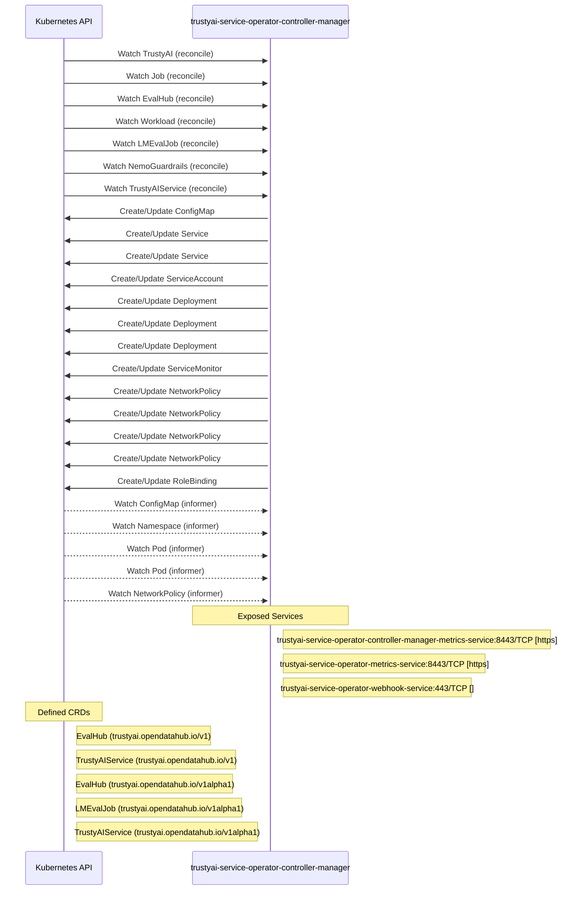

# trustyai-service-operator: Dataflow

[Overview](index.md) · [Agent Context](agent-context.md) · [Extracted Data](details.md) · [Network](network.md) · [RBAC](rbac.md) · [Security](security.md) · [Cache](cache.md) · [Dataflow](dataflow.md)

## Controller Watches

Kubernetes resources this controller monitors for changes. Each watch triggers reconciliation when the watched resource is created, updated, or deleted.

| Type | GVK | Source |
|------|-----|--------|
| For | apis/v1alpha1/TrustyAI | [`trustyai-operator-module/pkg/trustyaimodule/reconciler.go:516`](https://github.com/red-hat-data-services/trustyai-service-operator/blob/136ae01feaa1c5edd794af980240064097432e93/trustyai-operator-module/pkg/trustyaimodule/reconciler.go#L516) |
| For | batch/v1/Job | [`controllers/evalhub/evaluation_job_failure_reconciler.go:219`](https://github.com/red-hat-data-services/trustyai-service-operator/blob/136ae01feaa1c5edd794af980240064097432e93/controllers/evalhub/evaluation_job_failure_reconciler.go#L219) |
| For | evalhub/v1/EvalHub | [`controllers/evalhub/evalhub_controller.go:409`](https://github.com/red-hat-data-services/trustyai-service-operator/blob/136ae01feaa1c5edd794af980240064097432e93/controllers/evalhub/evalhub_controller.go#L409) |
| For | kueue/v1beta1/Workload | [`controllers/evalhub/evaluation_failed_kueue_workloads_reconciler.go:90`](https://github.com/red-hat-data-services/trustyai-service-operator/blob/136ae01feaa1c5edd794af980240064097432e93/controllers/evalhub/evaluation_failed_kueue_workloads_reconciler.go#L90) |
| For | lmes/v1alpha1/LMEvalJob | [`controllers/lmes/lmevaljob_controller.go:351`](https://github.com/red-hat-data-services/trustyai-service-operator/blob/136ae01feaa1c5edd794af980240064097432e93/controllers/lmes/lmevaljob_controller.go#L351) |
| For | nemo_guardrails/v1alpha1/NemoGuardrails | [`controllers/nemo_guardrails/nemoguardrail_controller.go:378`](https://github.com/red-hat-data-services/trustyai-service-operator/blob/136ae01feaa1c5edd794af980240064097432e93/controllers/nemo_guardrails/nemoguardrail_controller.go#L378) |
| For | tas/v1/TrustyAIService | [`controllers/tas/trustyaiservice_controller.go:401`](https://github.com/red-hat-data-services/trustyai-service-operator/blob/136ae01feaa1c5edd794af980240064097432e93/controllers/tas/trustyaiservice_controller.go#L401) |
| Owns | /v1/ConfigMap | [`controllers/evalhub/evalhub_controller.go:413`](https://github.com/red-hat-data-services/trustyai-service-operator/blob/136ae01feaa1c5edd794af980240064097432e93/controllers/evalhub/evalhub_controller.go#L413) |
| Owns | /v1/Service | [`controllers/evalhub/evalhub_controller.go:412`](https://github.com/red-hat-data-services/trustyai-service-operator/blob/136ae01feaa1c5edd794af980240064097432e93/controllers/evalhub/evalhub_controller.go#L412) |
| Owns | /v1/Service | [`trustyai-operator-module/pkg/trustyaimodule/reconciler.go:518`](https://github.com/red-hat-data-services/trustyai-service-operator/blob/136ae01feaa1c5edd794af980240064097432e93/trustyai-operator-module/pkg/trustyaimodule/reconciler.go#L518) |
| Owns | /v1/ServiceAccount | [`trustyai-operator-module/pkg/trustyaimodule/reconciler.go:517`](https://github.com/red-hat-data-services/trustyai-service-operator/blob/136ae01feaa1c5edd794af980240064097432e93/trustyai-operator-module/pkg/trustyaimodule/reconciler.go#L517) |
| Owns | apps/v1/Deployment | [`trustyai-operator-module/pkg/trustyaimodule/reconciler.go:519`](https://github.com/red-hat-data-services/trustyai-service-operator/blob/136ae01feaa1c5edd794af980240064097432e93/trustyai-operator-module/pkg/trustyaimodule/reconciler.go#L519) |
| Owns | apps/v1/Deployment | [`controllers/evalhub/evalhub_controller.go:410`](https://github.com/red-hat-data-services/trustyai-service-operator/blob/136ae01feaa1c5edd794af980240064097432e93/controllers/evalhub/evalhub_controller.go#L410) |
| Owns | apps/v1/Deployment | [`controllers/tas/trustyaiservice_controller.go:402`](https://github.com/red-hat-data-services/trustyai-service-operator/blob/136ae01feaa1c5edd794af980240064097432e93/controllers/tas/trustyaiservice_controller.go#L402) |
| Owns | monitoring/v1/ServiceMonitor | [`controllers/evalhub/evalhub_controller.go:428`](https://github.com/red-hat-data-services/trustyai-service-operator/blob/136ae01feaa1c5edd794af980240064097432e93/controllers/evalhub/evalhub_controller.go#L428) |
| Owns | networking.k8s.io/v1/NetworkPolicy | [`controllers/lmes/lmevaljob_controller.go:357`](https://github.com/red-hat-data-services/trustyai-service-operator/blob/136ae01feaa1c5edd794af980240064097432e93/controllers/lmes/lmevaljob_controller.go#L357) |
| Owns | networking.k8s.io/v1/NetworkPolicy | [`controllers/tas/trustyaiservice_controller.go:403`](https://github.com/red-hat-data-services/trustyai-service-operator/blob/136ae01feaa1c5edd794af980240064097432e93/controllers/tas/trustyaiservice_controller.go#L403) |
| Owns | networking.k8s.io/v1/NetworkPolicy | [`trustyai-operator-module/pkg/trustyaimodule/reconciler.go:525`](https://github.com/red-hat-data-services/trustyai-service-operator/blob/136ae01feaa1c5edd794af980240064097432e93/trustyai-operator-module/pkg/trustyaimodule/reconciler.go#L525) |
| Owns | networking.k8s.io/v1/NetworkPolicy | [`controllers/evalhub/evalhub_controller.go:411`](https://github.com/red-hat-data-services/trustyai-service-operator/blob/136ae01feaa1c5edd794af980240064097432e93/controllers/evalhub/evalhub_controller.go#L411) |
| Owns | rbac.authorization.k8s.io/v1/RoleBinding | [`trustyai-operator-module/pkg/trustyaimodule/reconciler.go:520`](https://github.com/red-hat-data-services/trustyai-service-operator/blob/136ae01feaa1c5edd794af980240064097432e93/trustyai-operator-module/pkg/trustyaimodule/reconciler.go#L520) |
| Watches | /v1/ConfigMap | [`controllers/evalhub/evalhub_controller.go:425`](https://github.com/red-hat-data-services/trustyai-service-operator/blob/136ae01feaa1c5edd794af980240064097432e93/controllers/evalhub/evalhub_controller.go#L425) |
| Watches | /v1/Namespace | [`controllers/evalhub/evalhub_controller.go:424`](https://github.com/red-hat-data-services/trustyai-service-operator/blob/136ae01feaa1c5edd794af980240064097432e93/controllers/evalhub/evalhub_controller.go#L424) |
| Watches | /v1/Pod | [`controllers/tas/trustyaiservice_controller.go:408`](https://github.com/red-hat-data-services/trustyai-service-operator/blob/136ae01feaa1c5edd794af980240064097432e93/controllers/tas/trustyaiservice_controller.go#L408) |
| Watches | /v1/Pod | [`controllers/evalhub/evalhub_controller.go:418`](https://github.com/red-hat-data-services/trustyai-service-operator/blob/136ae01feaa1c5edd794af980240064097432e93/controllers/evalhub/evalhub_controller.go#L418) |
| Watches | networking.k8s.io/v1/NetworkPolicy | [`controllers/nemo_guardrails/nemoguardrail_controller.go:384`](https://github.com/red-hat-data-services/trustyai-service-operator/blob/136ae01feaa1c5edd794af980240064097432e93/controllers/nemo_guardrails/nemoguardrail_controller.go#L384) |

### Programmatic Resource Operations

| Verb | Kind | Group | Condition |
|------|------|-------|----------|
| create | ConfigMap |  |  |
| update | ConfigMap |  |  |
| create | Deployment | apps |  |
| update | Deployment | apps |  |
| update | EvalHub | evalhub |  |
| patch | Job | batch |  |
| create | Route | route |  |
| update | Route | route |  |
| create | Service |  |  |
| update | Service |  |  |
| create | ServiceMonitor | monitoring |  |
| update | LMEvalJob | lmes |  |
| patch | Pod |  |  |
| patch | NemoGuardrails | nemo_guardrails |  |
| update | TrustyAIService | tas |  |

## Reconciliation Flow

How the controller interacts with the Kubernetes API during reconciliation.

## Configuration

ConfigMaps and Helm values that control this component's runtime behavior.

