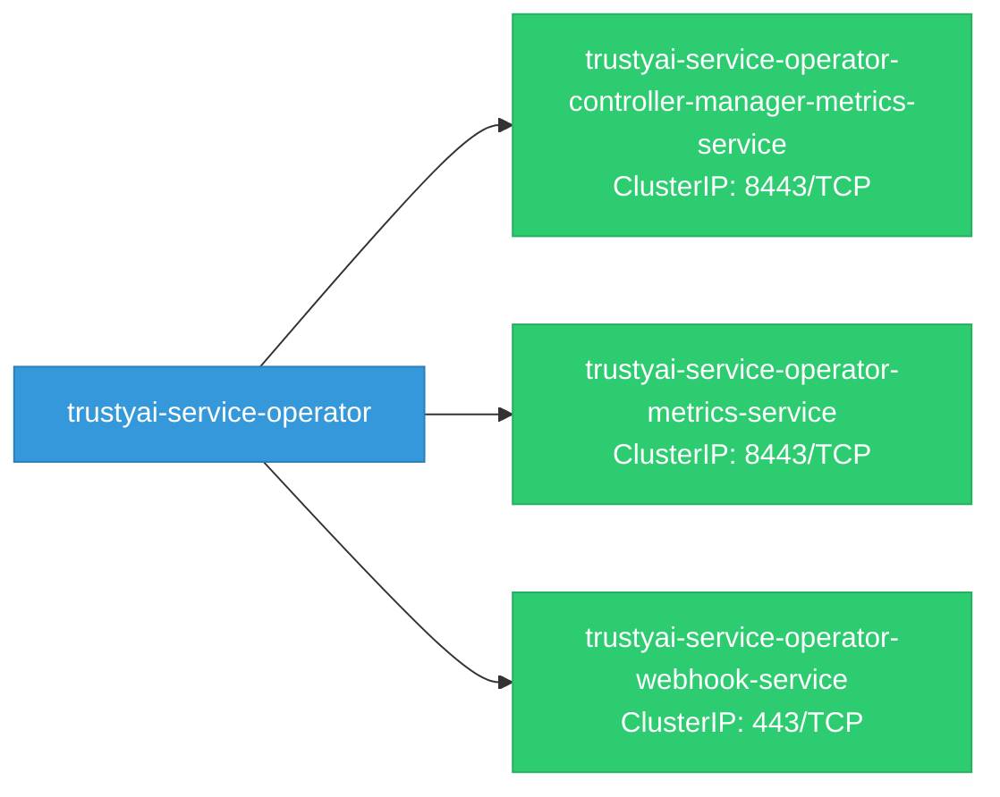
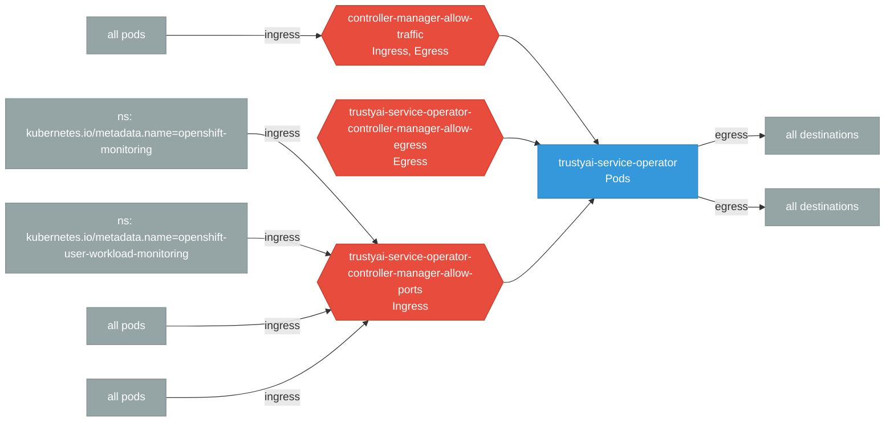

# trustyai-service-operator: Network

[Overview](index.md) · [Agent Context](agent-context.md) · [Extracted Data](details.md) · [Network](network.md) · [RBAC](rbac.md) · [Security](security.md) · [Cache](cache.md) · [Dataflow](dataflow.md)

## Service Map

### Services

| Name | Type | Ports | Source |
|------|------|-------|--------|
| trustyai-service-operator-controller-manager-metrics-service | ClusterIP | 8443/TCP | [`kustomize:config/overlays/odh`](https://github.com/red-hat-data-services/trustyai-service-operator/blob/136ae01feaa1c5edd794af980240064097432e93/kustomize:config/overlays/odh) |
| trustyai-service-operator-metrics-service | ClusterIP | 8443/TCP | [`kustomize:config/overlays/odh`](https://github.com/red-hat-data-services/trustyai-service-operator/blob/136ae01feaa1c5edd794af980240064097432e93/kustomize:config/overlays/odh) |
| trustyai-service-operator-webhook-service | ClusterIP | 443/TCP | [`kustomize:config/overlays/odh`](https://github.com/red-hat-data-services/trustyai-service-operator/blob/136ae01feaa1c5edd794af980240064097432e93/kustomize:config/overlays/odh) |

### Network Policies

| Name | Policy Types | Source |
|------|-------------|--------|
| controller-manager-allow-traffic | Ingress, Egress | [`trustyai-operator-module/config/manager/networkpolicy.yaml`](https://github.com/red-hat-data-services/trustyai-service-operator/blob/136ae01feaa1c5edd794af980240064097432e93/trustyai-operator-module/config/manager/networkpolicy.yaml) |
| trustyai-service-operator-controller-manager-allow-egress | Egress | [`kustomize:config/overlays/odh`](https://github.com/red-hat-data-services/trustyai-service-operator/blob/136ae01feaa1c5edd794af980240064097432e93/kustomize:config/overlays/odh) |
| trustyai-service-operator-controller-manager-allow-ports | Ingress | [`kustomize:config/overlays/odh`](https://github.com/red-hat-data-services/trustyai-service-operator/blob/136ae01feaa1c5edd794af980240064097432e93/kustomize:config/overlays/odh) |

## Network Policy Graph

Visual representation of NetworkPolicy rules. Ingress rules show what traffic is allowed into pods, egress rules show what traffic is allowed out.

