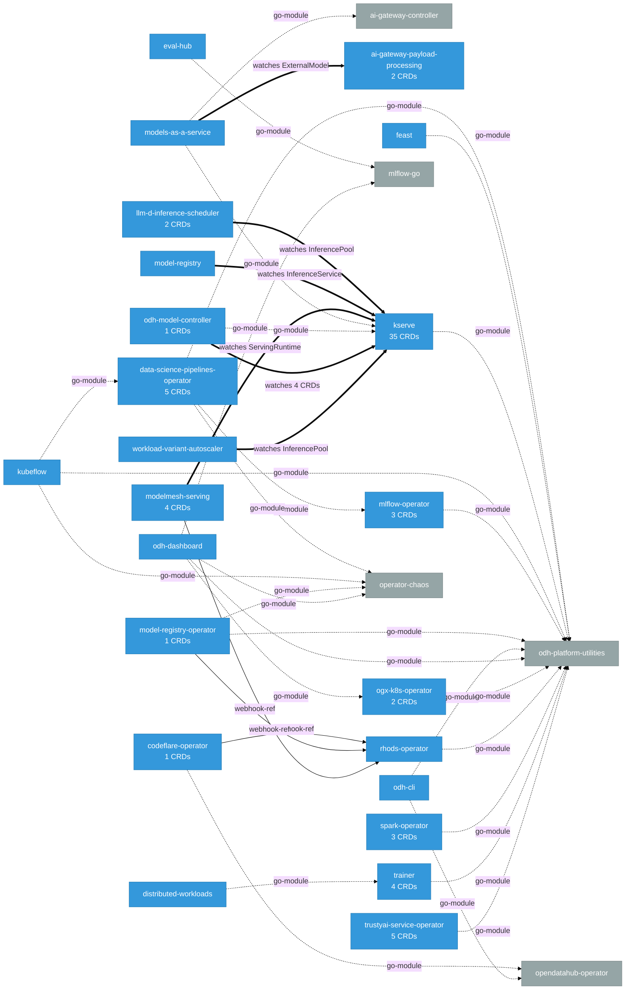

# Platform Platform Analysis

> **Architecture snapshot: 2026-11-28** (2026-11-28)

*Generated by architecture-analyzer. All data produced by deterministic static analysis.*

## Platform Summary

| Metric | Count |
|--------|-------|
| Components | 64 |
| CRDs | 79 |
| Services | 88 |
| Secrets | 71 |
| Cluster Roles | 110 |
| Cross-Component Dependencies | 44 |
| Webhooks | 101 |

## Component Dependency Graph

## Components Analyzed

| Component | CRDs | Deployments | Services |
|-----------|------|-------------|----------|
| [MLServer](components/MLServer/index.md) | 0 | 0 | 0 |
| [NeMo-Guardrails](components/NeMo_Guardrails/index.md) | 0 | 0 | 0 |
| [agents-operator](components/agents_operator/index.md) | 0 | 3 | 2 |
| [ai-gateway-payload-processing](components/ai_gateway_payload_processing/index.md) | 2 | 0 | 0 |
| [ai4rag](components/ai4rag/index.md) | 0 | 0 | 0 |
| [argo-workflows](components/argo_workflows/index.md) | 0 | 0 | 0 |
| [batch-gateway](components/batch_gateway/index.md) | 0 | 0 | 0 |
| [caikit-nlp](components/caikit_nlp/index.md) | 0 | 0 | 0 |
| [caikit-tgis-serving](components/caikit_tgis_serving/index.md) | 0 | 0 | 0 |
| [codeflare-operator](components/codeflare_operator/index.md) | 1 | 2 | 1 |
| [codeflare-sdk](components/codeflare_sdk/index.md) | 0 | 0 | 0 |
| [data-science-pipelines](components/data_science_pipelines/index.md) | 3 | 10 | 1 |
| [data-science-pipelines-operator](components/data_science_pipelines_operator/index.md) | 5 | 8 | 8 |
| [distributed-workloads](components/distributed_workloads/index.md) | 0 | 0 | 0 |
| [eval-hub](components/eval_hub/index.md) | 0 | 0 | 0 |
| [feast](components/feast/index.md) | 0 | 3 | 1 |
| [fms-guardrails-orchestrator](components/fms_guardrails_orchestrator/index.md) | 0 | 0 | 0 |
| [fms-hf-tuning](components/fms_hf_tuning/index.md) | 0 | 0 | 0 |
| [guardrails-regex-detector](components/guardrails_regex_detector/index.md) | 0 | 0 | 0 |
| [kserve](components/kserve/index.md) | 35 | 10 | 10 |
| [kube-auth-proxy](components/kube_auth_proxy/index.md) | 0 | 0 | 0 |
| [kube-rbac-proxy](components/kube_rbac_proxy/index.md) | 0 | 0 | 0 |
| [kubeflow](components/kubeflow/index.md) | 0 | 9 | 3 |
| [kuberay](components/kuberay/index.md) | 0 | 4 | 2 |
| [kueue](components/kueue/index.md) | 2 | 11 | 2 |
| [llama-stack](components/llama_stack/index.md) | 0 | 0 | 0 |
| [llm-d](components/llm_d/index.md) | 0 | 6 | 8 |
| [llm-d-inference-scheduler](components/llm_d_inference_scheduler/index.md) | 2 | 6 | 7 |
| [llm-d-kv-cache](components/llm_d_kv_cache/index.md) | 0 | 2 | 0 |
| [llm-d-routing-sidecar](components/llm_d_routing_sidecar/index.md) | 0 | 1 | 1 |
| [lm-evaluation-harness](components/lm_evaluation_harness/index.md) | 0 | 0 | 0 |
| [ml-metadata](components/ml_metadata/index.md) | 0 | 0 | 0 |
| [mlflow-operator](components/mlflow_operator/index.md) | 3 | 1 | 1 |
| [model-metadata-collection](components/model_metadata_collection/index.md) | 0 | 0 | 0 |
| [model-registry](components/model_registry/index.md) | 0 | 4 | 1 |
| [model-registry-operator](components/model_registry_operator/index.md) | 1 | 4 | 5 |
| [modelmesh-runtime-adapter](components/modelmesh_runtime_adapter/index.md) | 0 | 0 | 0 |
| [modelmesh-serving](components/modelmesh_serving/index.md) | 4 | 4 | 3 |
| [models-as-a-service](components/models_as_a_service/index.md) | 0 | 5 | 5 |
| [notebooks](components/notebooks/index.md) | 0 | 7 | 7 |
| [notebooks-downstream](components/notebooks_downstream/index.md) | 0 | 13 | 13 |
| [odh-cli](components/odh_cli/index.md) | 0 | 0 | 0 |
| [odh-dashboard](components/odh_dashboard/index.md) | 0 | 25 | 19 |
| [odh-deployer](components/odh_deployer/index.md) | 0 | 0 | 0 |
| [odh-model-controller](components/odh_model_controller/index.md) | 1 | 2 | 3 |
| [ogx-k8s-operator](components/ogx_k8s_operator/index.md) | 2 | 3 | 2 |
| [openvino_model_server](components/openvino_model_server/index.md) | 0 | 0 | 0 |
| [pipelines-components](components/pipelines_components/index.md) | 0 | 0 | 0 |
| [rest-proxy](components/rest_proxy/index.md) | 0 | 0 | 0 |
| [rhds-llama-stack-distribution](components/rhds_llama_stack_distribution/index.md) | 0 | 0 | 0 |
| [rhods-operator](components/rhods_operator/index.md) | 0 | 22 | 3 |
| [spark-operator](components/spark_operator/index.md) | 3 | 4 | 3 |
| [text-generation-inference](components/text_generation_inference/index.md) | 0 | 1 | 1 |
| [trainer](components/trainer/index.md) | 4 | 4 | 0 |
| [training-operator](components/training_operator/index.md) | 6 | 3 | 1 |
| [trustyai-explainability](components/trustyai_explainability/index.md) | 0 | 0 | 0 |
| [trustyai-service-operator](components/trustyai_service_operator/index.md) | 5 | 1 | 3 |
| [vllm](components/vllm/index.md) | 0 | 0 | 0 |
| [vllm-cpu](components/vllm_cpu/index.md) | 0 | 0 | 1 |
| [vllm-gaudi](components/vllm_gaudi/index.md) | 0 | 0 | 0 |
| [vllm-orchestrator-gateway](components/vllm_orchestrator_gateway/index.md) | 0 | 0 | 0 |
| [vllm-rocm](components/vllm_rocm/index.md) | 0 | 0 | 0 |
| [vllm-spyre](components/vllm_spyre/index.md) | 0 | 0 | 0 |
| [workload-variant-autoscaler](components/workload_variant_autoscaler/index.md) | 0 | 2 | 1 |

